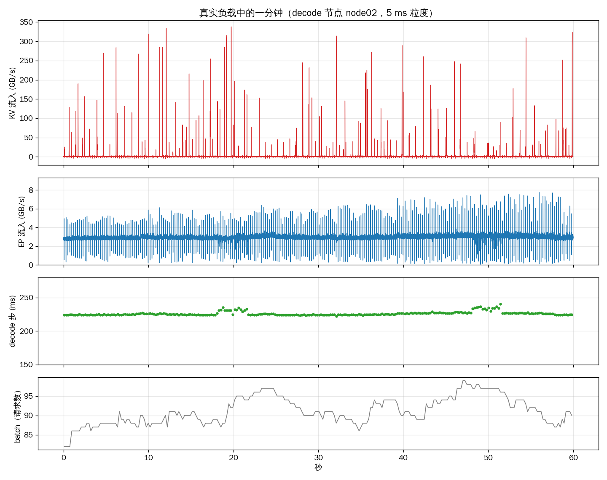
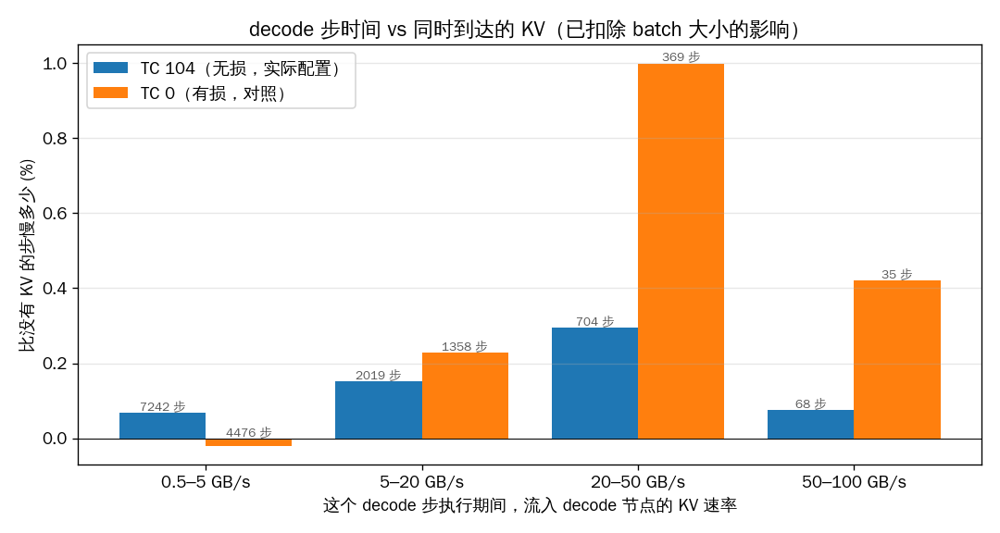
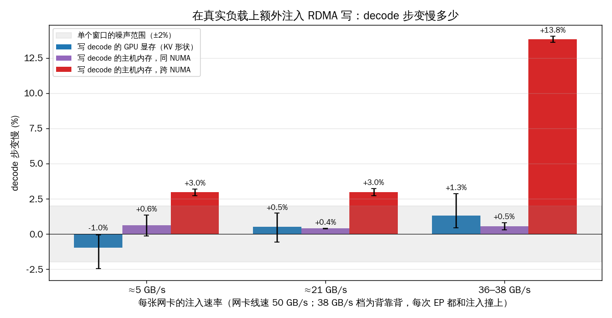
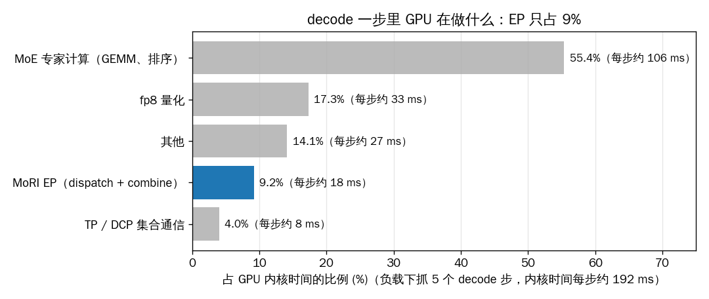

# K3.1-Pro AgentX PD：KV 传输 / UMBP 会不会拖慢 MoRI EP —— 我们在 MI355X 上的测试

这份文档说明我们怎么测、测了什么、看到了什么。每张图下面都写了"怎么看"和"说明了什么"；明细表格折叠在各节末尾。

## 结论

- **真实负载下，KV 传输不拖慢 EP。** decode 每一步（里面包含跨机 EP 的 all-to-all）的耗时，不随同一时刻到达的 KV 变化；KV 突发前后，EP 的流量也没有变化。
- **主动加压也一样。** 往 decode 的 GPU 显存额外打 KV 形状的流量，一直加到接近网卡线速、每一次 EP 都和它撞上，decode 每一步只慢约 1%，和噪声相当。
- **会拖慢的是写 decode 主机内存、而且跨 NUMA 的流量**：最高让 decode 每一步慢 14%；同 NUMA 时没有影响。
- **原因之一是 EP 在这里是小流量、只占 decode 时间的一小部分**：EP 流量只占网卡能力的 0.6%，EP 内核只占 decode GPU 内核时间的 9%。
- 对照：把所有 RDMA 流量都放进有损的 TC 0，KV 突发会丢包，EP 也会跟着重传；无损的 TC 104 下没有这个问题。

## 1. 测的是什么

| 项 | 内容 |
|---|---|
| 硬件 | 4 台 AMD MI355X（每台 8 GPU），每 GPU 一张 400 Gb/s AMD AINIC；rail-only 组网（GPU i ↔ 网卡 i ↔ rail i，rail 之间不互通）；云上虚拟机，GPU 和网卡直通 |
| 模型 | Kimi-K3.1-Pro（fp4），DFLASH 投机解码（每步 5 个草稿 token，接受长度按 InferenceY recipe 模拟为 3.25） |
| 框架 | sglang 0.5.24 + K3.1 的 MoRI PD / UMBP 补丁（本分支），MoRI = ROCm/mori PR #996（EPv2 跨机） |
| 部署 | 2 台 prefill（各 TP8 + DCP8，各带本机 UMBP DRAM 缓存）+ 1 个跨 2 台机器的 decode（每台一个 attention DP 组，TP8 + DCP8；MoE 是跨两台的 EP16，MoRI EPv2） |
| KV 传输 | MoRI IO 用 RDMA 写，从 prefill 的 GPU 显存直接写进 decode 的 GPU 显存；prefill 的 GPU i 走 rail i 写 decode 的 GPU i |
| 流量类别 | EP、KV、跨机 RCCL 都在 TC 104（DSCP 26，无损，带 PFC） |
| 负载 | InferenceY 的 K3.1 AgentX（AIPerf，Claude Code 轨迹回放），参数与 InferenceY CI 相同，并发 256；先 warmup（只填缓存），再测 3600 s |

完整的启动参数和环境变量见文末附录。

## 2. 怎么测

- **decode 每一步的耗时**：在每个 DP 组的主 rank 上，用 GPU 事件记录每一步（draft + verify）的 GPU 时间和这一步的 batch 大小。EP 的 dispatch / combine 都在这一步里，所以 EP 如果变慢，这一步就会变慢。两个 DP 组每一层 MoE 都要通过 EP 互相交换 token，所以两组的步长是同步的。
- **网卡流量**：4 台机器每张网卡每 5 ms 记一次收发字节数，另外记 PFC 暂停时间和重传次数。
- **把 KV 和 EP 分开**：两台 decode 之间只有 EP；prefill 的网卡只发 KV。所以某台 decode 收到的字节，减去另一台 decode 发给它的（就是 EP），剩下的就是流入它的 KV。
- **对比时去掉 batch 的影响**：batch 越大，一步越慢。比较时，每一步都和"同样 batch 大小的步"的中位数比，看它慢了多少。
- **客户端**：AIPerf 的每个请求记录（TTFT、ITL、每条流式消息的到达时间）。

## 3. 真实负载下：KV 会不会拖慢 EP

### 3.1 KV 和 EP 的流量长什么样



**怎么看**：选的是 1 小时里 KV 超过 40 GB/s 次数最多的一分钟。同一分钟、同一台 decode 节点，从上到下依次是：流入的 KV、流入的 EP、decode 每一步的耗时（每个点是一步）、这一步的 batch 大小。

**说明了什么**：
- KV 是一根根尖刺：每根几十毫秒，峰值能到 300 GB/s 以上，其余时间几乎为 0。
- EP 是一条平稳的细流，这一分钟平均约 2.9 GB/s；规律的竖线是每一步里的 dispatch / combine。
- decode 每一步在 224–234 ms 之间。KV 尖刺最高、最密的几秒（第 10–14 秒、第 58–60 秒）步长没有变化。
- 两处小凸起（第 18–22 秒、第 48–52 秒，每步多 6–9 ms）：第二处前后几乎没有 KV（平均不到 1 GB/s），所以不是 KV 引起的；batch 大小、正在 decode 的请求的上下文总长度也解释不了，具体原因没有查到。

### 3.2 一步执行期间到达的 KV 越多，这一步会不会越慢



**怎么看**：把 1 小时里约 3 万个 decode 步，按"这一步执行期间流入 decode 节点的 KV 有多快"分成几档；纵轴是每档比"没有 KV 的步"慢多少（已经扣掉 batch 大小的影响），柱子上的数字是这一档有多少步，步数越少越不准（比如 TC 0 的 50–100 档只有 35 步）。蓝色是实际配置（TC 104），橙色是 TC 0 对照（第 7 节）。

**说明了什么**：在 TC 104 下，就算一步执行期间流入 20–100 GB/s 的 KV，这一步也只慢 0.1%–0.3%（217 ms 里不到 1 ms）。

### 3.3 KV 突发前后，EP 流量有没有变化


**怎么看**：找出 855 次 KV 突发，把每次突发开始的时刻对齐到 0，前后的流量取平均。上图是 KV，下图是同一时间流入同一节点的 EP（虚线是突发前的平均值）。

**说明了什么**：KV 在几毫秒内冲到约 60 GB/s 并持续几十毫秒，同一时间 EP 流量保持在 2.4 GB/s 左右，没有下降（变化不到 0.5%）。如果 KV 挤占了 EP（交换机排队或网卡暂停），这里会看到 EP 下凹。

<details>
<summary>真实负载的数据表</summary>

| 指标 | 值 |
|---|---|
| 请求 / 错误 | 8,553 / 2 |
| QPS、输出吞吐 | 2.35、1,894 tok/s |
| TTFT 均值 / p50 / p90 | 53.9 / 28.3 / 124 s |
| ITL 均值 / p90 / p99（AIPerf） | 65.6 / 69.4 / 78.2 ms |
| decode 每步 p50 / p90 / p99 | 217.3 / 225.1 / 231.3 ms（每个 DP 组约 70 个请求） |
| 平均输入 / 输出 | 8.7 万 / 806 token；客户端前缀命中 81% |

| 网络（54 分钟） | node02 | node04 |
|---|---|---|
| KV 流入均值 | 2.25 GB/s | 1.89 GB/s |
| KV 流入（100 ms）p90 / p99 / 最大 | 2.6 / 56 / 243 GB/s | 4.6 / 38 / 157 GB/s |
| 时间占比：KV > 1 / 10 / 40 / 100 GB/s | 6.1% / 2.7% / 1.27% / 0.75% | 6.2% / 2.5% / 1.28% / 0.58% |
| EP 流入均值，100 ms p99 / 最大 | 2.37，3.18 / 3.58 GB/s | 2.38，3.18 / 3.63 GB/s |
| 网卡发出的 PFC 暂停累计 | 141 ms | 61 ms |
| 重传包 | 0 | 43 |

| 一步期间的 KV（GB/s） | DP0 步数 | 比无 KV 的步慢 | DP1 步数 | 比无 KV 的步慢 |
|---|---|---|---|---|
| < 0.5（基准） | 9,814 | – | 10,113 | – |
| 0.5–5 | 3,810 | +0.01% | 3,432 | +0.13% |
| 5–20 | 848 | +0.22% | 1,171 | +0.09% |
| 20–50 | 439 | +0.28% | 265 | +0.31% |
| 50–100 | 68 | +0.07% | – | – |

线性回归（一步耗时 = a + b·batch + c·另一 DP 组的 batch + d·KV 速率）：d = 0.014 / 0.008 ms per GB/s，按 p99 的 KV 速率算影响 0.24% / 0.10%。

</details>

## 4. 加压：主动往 decode 节点打流量

真实 KV 大部分时间是空的，EP 很少和它撞上。为了看"撞上时 EP 受多大影响"，我们在真实负载跑着的时候，额外往 decode 节点打 RDMA 写。

- **怎么打**：用 MoRI IO 从 prefill 的 GPU 显存写到 decode 上的一块 1 GB 缓冲；GPU i 走 rail i，8 条 rail 全覆盖，和 EP 的跨机流量走同一个交换机出口、进同一张网卡。
- **写到哪**：三种目标——decode 的 GPU 显存（就是 KV 的写法）；decode 的主机内存，和网卡在同一个 NUMA 节点；decode 的主机内存，在另一个 NUMA 节点。
- **多快**：每次发 16 MB，以接近线速发完（约 0.4 ms），靠调两次发送之间的空闲时间控制平均速率。38 GB/s 档是连续不停地发，此时每一次 EP 都和注入撞上；低速档只有一部分 EP 撞上（20 GB/s 约 65%，5 GB/s 约 17%）。
- **怎么比**：每个窗口打 60 s，和窗口结束后的 52 s 比；每个窗口里 decode 跑了 230–270 步。


**怎么看**：上图是流入两台 decode 的总流量（KV + 注入），色块是注入窗口，颜色代表写到哪、上方数字是每张网卡的速率；下图是 decode 每一步的耗时（10 秒平均）。

**说明了什么**：
- 曲线整体的起伏是 batch 在变：前 10 分钟两个 DP 组合计从约 80 个请求涨到约 180 个，步长从约 195 ms 升到约 225 ms；后半段 batch 约 115–145 个，步长约 212–220 ms。所以每个注入窗口只和紧挨着它的、窗口结束后的 52 s 比，并且扣掉 batch 的影响。
- 大部分窗口里 decode 曲线没有跟着色块变化；唯一明显的抬升在第 35–36 分钟——"主机内存、跨 NUMA、36 GB/s"那个窗口（红色）。



**怎么看**：横轴是每张网卡的注入速率，三种颜色是三种写入目标；柱子是 decode 每一步比不注入时慢多少（同档的多个窗口、两个 DP 组取平均，误差线是最大 / 最小窗口）；灰色带是单个窗口的噪声范围（±2%）。

**说明了什么**：
- 写 GPU 显存（蓝色，就是 KV 的写法）：一直加到 38 GB/s（每台 decode 约 300 GB/s，每次 EP 都撞上），也只慢 1.3%，在噪声范围内。两台 prefill 同时打一台 decode（接收网卡接近线速）也不超过 1%（图中没画）。
- 写主机内存、同 NUMA（紫色）：不到 1%。
- 写主机内存、跨 NUMA（红色）：5–21 GB/s 慢 3%，36 GB/s 慢 14%。

客户端看到的 ITL 也一样：写 GPU 显存的各档，ITL p90 和不注入时相比在 −3 到 +4 ms 之间，有升有降；跨 NUMA 36 GB/s 时 ITL p90 从 72 ms 升到 84 ms（明细见下面折叠的表）。

<details>
<summary>每个注入窗口的明细</summary>

| 注入 | 每网卡 GB/s | 发送占空比 | decode 每步变慢（DP0 / DP1） | 逐 token ITL p90 前 → 中（ms） | ITL p99 前 → 中（ms） | decode 每步 p90 前 → 中（ms） | p99 前 → 中（ms） |
|---|---|---|---|---|---|---|---|
| GPU 显存 1:1 | 2.1 | 6% | +1.0% / −0.9% | 68.9 → 70.6 | 259 → 254 | 212.1 → 211.5 | 218.7 → 217.1 |
| GPU 显存 1:1 | 5.2 | 14% | −0.4% / −0.1% | 67.2 → 71.3 | 428 → 433 | 211.3 → 212.1 | 216.2 → 216.1 |
| GPU 显存 1:1（7 张网卡） | 10.5 | 28% | −1.3% / +4.0% | 71.3 → 71.1 | 340 → 328 | 218.3 → 213.4 | 230.6 → 220.0 |
| GPU 显存 1:1 | 20.9 | 56% | +0.8% / +1.5% | 73.9 → 76.4 | 378 → 373 | 226.0 → 230.6 | 232.1 → 235.3 |
| GPU 显存 1:1 | 37.7 | 100% | +0.4% / +2.9% | 76.2 → 73.3 | 364 → 449 | 228.0 → 230.2 | 316.0 → 236.3 |
| GPU 显存 1:1 | 37.7 | 100% | +1.3% / +0.7% | 70.7 → 73.3 | 407 → 409 | 216.4 → 218.7 | 222.2 → 226.4 |
| GPU 显存 1:1 | 20.9 | 56% | +0.4% / −0.6% | 72.4 → 72.1 | 350 → 384 | 217.4 → 216.8 | 222.6 → 220.3 |
| GPU 显存 1:1 | 10.5 | 28% | −0.7% / −0.4% | 70.1 → 70.4 | 407 → 375 | 218.2 → 218.4 | 223.7 → 222.5 |
| GPU 显存 1:1 | 5.2 | 14% | −2.5% / −0.9% | 70.8 → 70.1 | 381 → 398 | 219.3 → 215.3 | 225.8 → 220.2 |
| GPU 显存 2:1 汇聚到 node02 | 20.8 | 75% | +1.0% / −0.0% | 79.6 → 76.7 | 359 → 363 | 224.6 → 224.4 | 231.7 → 230.5 |
| GPU 显存 2:1 汇聚到 node02（接收约 47 GB/s） | 23.7 | 100% | +0.4% / −0.9% | 75.6 → 75.0 | 419 → 385 | 222.0 → 224.3 | 282.3 → 230.7 |
| 主机内存 同 NUMA | 5.2 | 14% | −0.1% / +1.3% | 72.8 → 72.8 | 377 → 386 | 221.9 → 226.2 | 229.3 → 230.2 |
| 主机内存 同 NUMA | 20.9 | 56% | +0.4% / +0.4% | 75.6 → 79.6 | 333 → 533 | 221.1 → 225.3 | 228.3 → 231.0 |
| 主机内存 同 NUMA | 37.7 | 100% | +0.3% / +0.8% | 71.9 → 73.9 | 361 → 445 | 220.3 → 224.4 | 223.9 → 231.6 |
| 主机内存 跨 NUMA | 5.2 | 15% | +2.7% / +3.2% | 74.1 → 76.7 | 378 → 402 | 221.6 → 229.5 | 228.3 → 233.5 |
| 主机内存 跨 NUMA | 20.9 | 56% | +2.7% / +3.2% | 71.1 → 75.9 | 390 → 402 | 221.4 → 228.5 | 224.0 → 231.7 |
| 主机内存 跨 NUMA | 35.7 | 100% | **+13.6% / +14.0%** | **71.7 → 84.0** | 350 → 447 | **221.7 → 255.3** | **227.9 → 261.4** |

- "前"是窗口结束后 5–57 s，"中"是窗口内；decode 每步的 p90 / p99 取 DP0。
- 逐 token ITL：按每条流式消息的到达时间分到窗口里，消息间隔 ÷ 该请求平均每条消息的 token 数。AIPerf 自己的 ITL 是一个请求一个平均值，而一个请求的 decode 有 50 多秒、跨好几个窗口，没法直接分窗口。
- ITL p99（250–530 ms）主要来自 decode 调度上的停顿（请求进出、等 KV），各窗口之间本来就差 ±20–30%，和注入没有一致关系；decode 每步 GPU 时间的 p99 只有约 231 ms。
- PFC：写 GPU 显存的 38 GB/s 窗口里 decode 网卡每 60 s 暂停 20–43 ms；写同 NUMA 主机内存 1–4 ms；跨 NUMA 17–55 ms。整个实验中 decode 之间的 EP 没有重传。
- 整个注入实验（含全部窗口）的 AIPerf ITL 均值 / p90 是 65.8 / 69.5 ms，不注入时 65.6 / 69.4 ms。

</details>

## 5. 为什么 EP 不敏感：流量小、时间占比低



**怎么看**：在负载下用 torch profiler 抓了 5 个 decode 步（DP0 的 TP0），按内核类型统计 GPU 内核时间；柱子是占比，括号里是折算到每一步的时间。

**说明了什么**：5 步的 GPU 内核时间共 957.5 ms，每步约 192 ms。大头是 MoE 专家计算（55%）和 fp8 量化（17%）；MoRI EP 的 dispatch + combine 只占 9%，每步约 18 ms（每步各 92 次，每次 dispatch 约 80 µs、combine 约 99 µs）。
- 即使 EP 慢一倍，decode 一步（约 217 ms）也只慢约 8%。
- 第 4 节"每次 EP 都撞上"时 decode 一步慢 1.3%，约 3 ms；全算到 EP（每步约 18 ms）头上，EP 自己最多慢约 16%。

| EP 流量（两台 decode 之间） | 值 |
|---|---|
| 每台每个方向的平均 | 2.37–2.38 GB/s（每台网卡能力 400 GB/s 的 0.6%） |
| 100 ms 粒度的 p50 / p90 / p99 / 最大 | 2.31 / 2.85 / 3.18 / 3.6 GB/s |
| 每一步 | 约 0.51 GB / 方向 / 台 |
| 每次 dispatch 或 combine | 约 2.8 MB / 方向 / 台（每条 rail 约 0.35 MB） |

## 6. UMBP

- 这套部署（和 InferenceY recipe 一样）里，UMBP 是每台 prefill 本机的 DRAM 缓存，读写只走本机 GPU 和主机内存之间的 PCIe，不经过网卡；EP 只在两台 decode 之间。所以 UMBP 和 EP 碰不到一起。
- 每台 prefill 上 UMBP 读入 GPU 约 2.7–3.0 GB/s、写出约 1.4 GB/s；同一时间 prefill 发 KV 的速度没有被它压低（两者都随负载一起升高，相关系数 0.6–0.9）。
- 如果把 UMBP 的远端缓存放到 decode 节点上，它的流量就是"写 decode 主机内存"：对应第 4 节的紫色（同 NUMA，不到 1%）和红色（跨 NUMA，3%–14%）。真实 UMBP 的流量摊到每张网卡约 0.2–0.7 GB/s，低于第 4 节测过的最低档（5 GB/s）。

## 7. 对照：全部改成有损的 TC 0

同样的配置和负载，只把 `MORI_RDMA_TC / MORI_IO_TC / NCCL_IB_TC` 改成 0，跑了约 40 分钟。端到端和 decode 每步耗时都和 TC 104 一样，但网络上开始丢包：

| | TC 104 | TC 0 |
|---|---|---|
| QPS / ITL 均值 / decode 每步 p50 | 2.35 / 65.6 ms / 217.3 ms | 2.40 / 65.3 ms / 217.7 ms |
| prefill（发 KV）重传的包 | 0 | 2.1–2.3%（每台 2000 多万个） |
| prefill ACK 超时 | 0 | 每台约 1,300 次 |
| decode 之间（EP）重传的包（node02 / node04） | 0 / 43 个 | 29,714 / 1,772 个 |
| decode 之间（EP）ACK 超时（node02 / node04） | 0 / 0 | 143 / 89 次 |
| KV 对 decode 每步的影响（图 2 的 20–50 GB/s 档） | +0.3% | +1.0% |

**说明了什么**：有损类别里，KV 突发在交换机里挤爆队列时会丢包，和它同一个队列的 EP 也被连带丢包重传；在这个负载下影响还小，但 KV 越重越明显。无损的 TC 104 靠 PFC 反压，全程几乎不丢包。

## 附录

<details>
<summary>完整启动参数</summary>

decode（两台各一个进程，node-rank 0 / 1）：

```
python3 -m sglang.launch_server --model-path Kimi-K3.1-Pro --served-model-name moonshotai/Kimi-K3.1-Pro \
  --disaggregation-mode decode --disaggregation-transfer-backend mori \
  --disaggregation-ib-device ionic_0,...,ionic_7 --disaggregation-decode-enable-radix-cache \
  --disaggregation-decode-extra-slots 16 --tp-size 16 --attn-dp-size 2 --enable-dp-lm-head \
  --ep-size 16 --moe-a2a-backend mori --shared-experts-tp-size 8 --nnodes 2 --node-rank {0,1} \
  --dcp-size 8 --dcp-comm-backend a2a --max-running-requests 272 --cuda-graph-max-bs-decode 136 \
  --mem-fraction-static 0.64 --kv-cache-dtype fp8_e4m3 --enable-dsa-fp4-indexer \
  --mamba-radix-cache-strategy extra_buffer --enable-linear-replayssm-spec \
  --speculative-algorithm DFLASH --speculative-draft-model-path Kimi-K3.1-Dflash2-Preview \
  --speculative-num-draft-tokens 5 --speculative-use-block-verification \
  --speculative-draft-attention-backend triton --speculative-draft-kv-cache-dtype fp8_e4m3 \
  --reasoning-parser kimi_k3 --tool-call-parser kimi_k3 --trust-remote-code --skip-server-warmup
```

prefill（每台一个）：

```
python3 -m sglang.launch_server ... --disaggregation-mode prefill --disaggregation-transfer-backend mori \
  --disaggregation-ib-device ionic_0,...,ionic_7 --disaggregation-bootstrap-port 7200 \
  --disaggregation-decode-allocation-policy early --tensor-parallel-size 8 --dcp-size 8 --dcp-comm-backend a2a \
  --chunked-prefill-size 16384 --max-prefill-tokens 16384 --cuda-graph-backend-prefill breakable \
  --cuda-graph-bs-prefill 256 512 768 1024 1536 2048 3072 4096 --mem-fraction-static 0.85 \
  --schedule-policy shortest-prefill-first --enable-unified-cache-external-linker \
  --unified-cache-external-linker-backend mori --mamba-full-memory-ratio 0.65 \
  --mamba-max-states-per-path 1 --mamba-track-interval 64 --enable-cache-report （模型 / 投机解码参数同 decode）
```

router：sglang-router PD 模式，prefill 选择 cache_aware；decode 内两个 DP 组之间轮流分配。

负载（与 InferenceY CI 相同，并发改为 256）：

```
agentx profile --url http://<router>:8000 --model moonshotai/Kimi-K3.1-Pro --tokenizer moonshotai/Kimi-K3.1-Pro \
  --concurrency 256 --benchmark-duration 3600 --tokenizer-trust-remote-code \
  --server-metrics <prefill1>/metrics <prefill2>/metrics <decode>/metrics \
  --output-artifact-dir <out> --public-dataset semianalysis_cc_traces_weka_062126
```

agentx-harness 1.0.13；环境变量 `AIPERF_HTTP_TCP_USER_TIMEOUT=900000 AIPERF_USE_DYNAMO_CONV_AWARE_ROUTING=1 AIPERF_DYNAMO_SESSION_TIMEOUT_SECONDS=3600` 等同 CI。

</details>

<details>
<summary>RDMA 相关的环境变量</summary>

| | decode | prefill |
|---|---|---|
| 流量类别 | `MORI_RDMA_TC=104 MORI_IO_TC=104 NCCL_IB_TC=104` | `MORI_RDMA_TC=104 MORI_IO_TC=104` |
| MoRI EP | `SGLANG_MORI_EP_V2=true MORI_EP_DISABLE_RDMA_ATOMICS=1 MORI_ENABLE_RAIL_ONLY=1 MORI_DEVICE_NIC=ionic MORI_RDMA_DEVICES=ionic_0..7 MORI_ENABLE_SDMA=0 MORI_EP_LAUNCH_CONFIG_MODE=AUTO` | – |
| MoRI IO | `MORI_IO_RAIL_AFFINITY=1 MORI_IO_QP_MAX_SEND_WR=32767` | 同左，加 `SGLANG_MORI_COALESCE_TRANSFERS=1` |
| 网卡 | `MORI_IB_GID_INDEX=1 MORI_DISABLE_IONIC_CCQE=1 MORI_IB_ENABLE_RELAXED_ORDERING=0` | 同左 |
| RCCL | `NCCL_IB_DISABLE=0 NCCL_NET=IB NCCL_IB_GID_INDEX=1 NCCL_CROSS_NIC=0` | `NCCL_IB_DISABLE=1`（单机 TP8） |
| 其他 | `SGLANG_ROCM_RUNTIME_RESERVE_GB=24`，其余同 recipe | 同 recipe |

</details>

<details>
<summary>代码</summary>

- 测量探针（本分支）：`python/sglang/srt/epio_probe.py`、`epio_clock.py`；挂在 `disaggregation/mori/conn.py`（KV 传输的入队 / 提交 / 完成时间和字节数）、`disaggregation/decode.py`（KV 到达）、`managers/scheduler.py`（每一步的 GPU 时间）。`EPIO_PROBE_DIR=<dir> EPIO_PROBE_RANKS=0,8` 打开。
- 注入工具：同目录的 `io_inject.py`（MoRI IO RDMA 写；接收端可选 GPU 显存 / 主机内存及 NUMA，可调每次大小和间隔，按指定时刻开始）。

</details>
