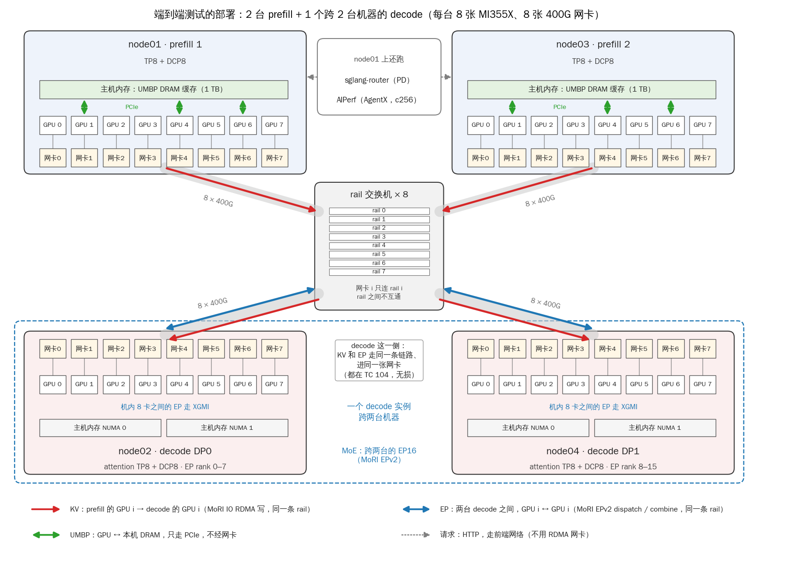
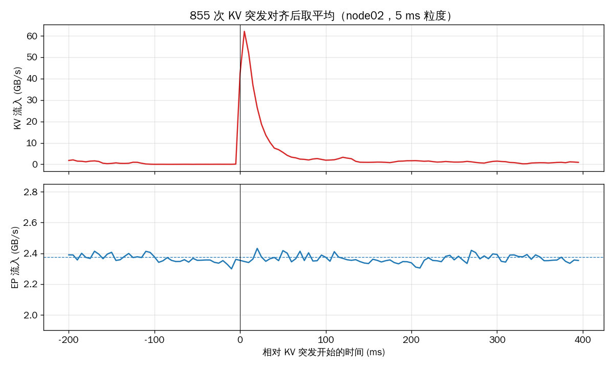
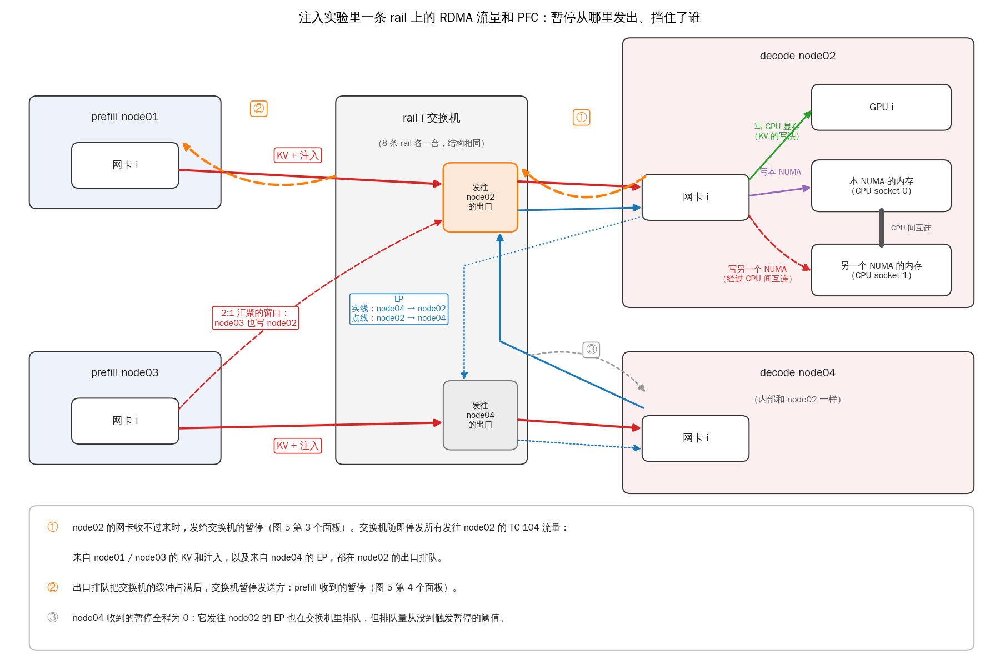
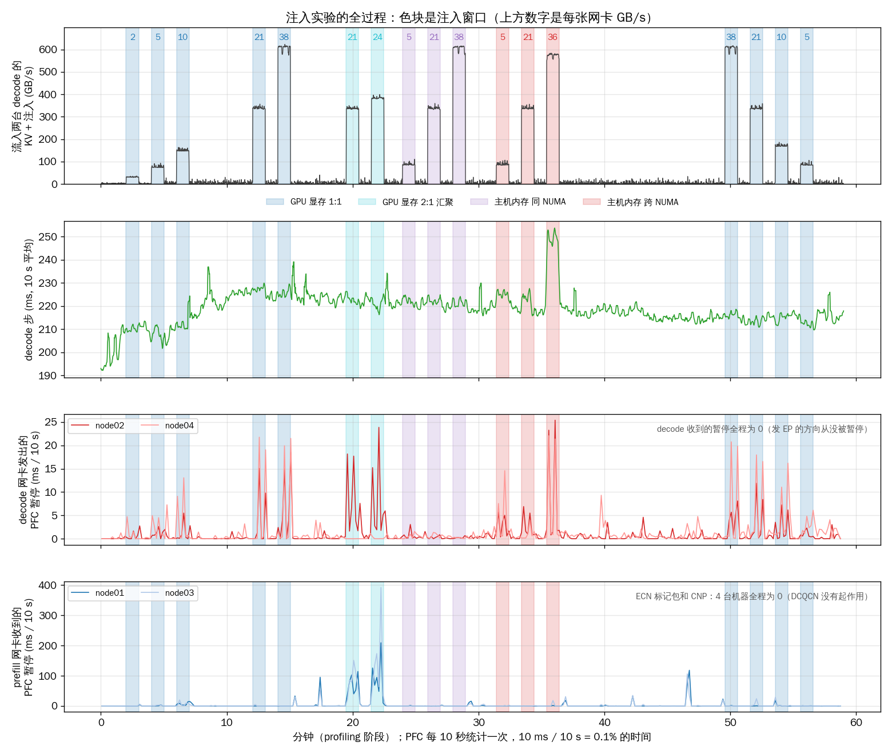
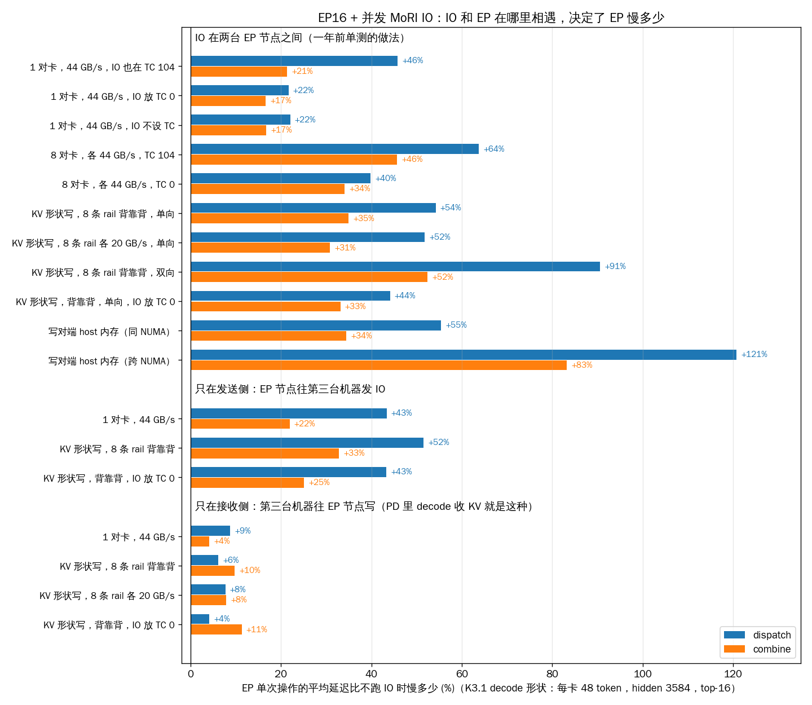
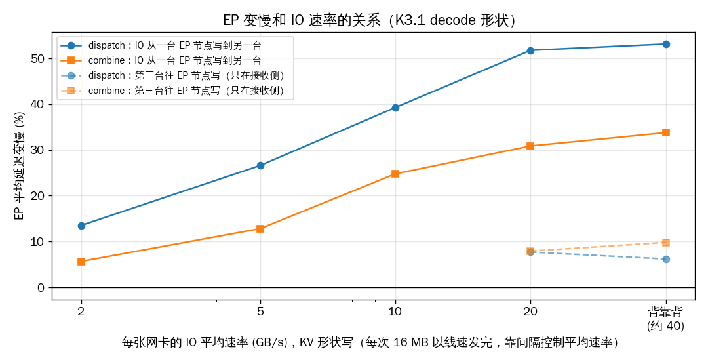
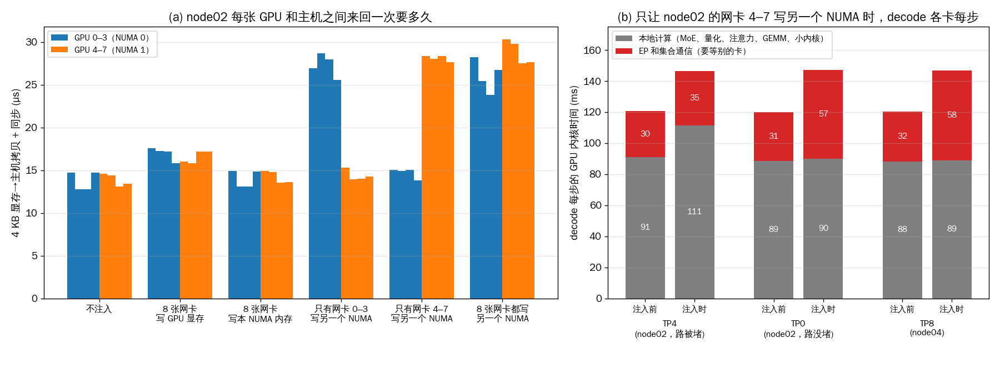

# K3.1-Pro AgentX PD：KV 传输 / UMBP 和 MoRI EP 的相互影响 —— 我们在 MI355X 上的测试

这份文档记录我们怎么测、测了什么、看到了什么，分两部分：

- **端到端**（第 2–4 节）：真实的 K3.1-Pro PD 部署（2 台 prefill + 跨 2 台机器、EP16 的 decode），跑 InferenceY 的 AgentX 负载，看 KV 传输有没有让 decode 变慢；再主动往 decode 节点打流量加压。
- **单测**（第 5 节）：mori 自带的 EP16 跨机用例 + 同时跑 MoRI IO，直接测单次 dispatch / combine 被拖慢多少，并拆开看 IO 和 EP 在哪里相遇时影响大、在哪里相遇时影响小。
- **配置修正和跨 NUMA 的原因**（第 9、10 节）：修正 decode 的一个 MoRI 配置后重测注入；再用专门的 GPU 测试和 decode 的 profile，查清"写另一个 NUMA 的主机内存"为什么让 decode 变慢。

每张图下面都写了"怎么看"和"说明了什么"；明细表格折叠在各节末尾。

> **第二轮**（RDMA READ 和 WRITE 对比、`SGLANG_MORI_MOE_MAX_INPUT_TOKENS`、跨 NUMA 触发条件的补充）见 [k31_ep_kv_read_write_zh.md](k31_ep_kv_read_write_zh.md)。本文第 10 节跨 NUMA 的机理已按第二轮的测试改写。

## 结论

1. **KV 这类 RDMA 流量会拖慢单次 EP 操作，拖慢多少主要看 IO 和 EP 在哪里相遇**（第 5 节，单测，用 K3.1 decode 的 EP 形状）。
   - **EP 节点一边跑 EP、一边往外发 IO**（同一张网卡既发 EP 又发 IO）：dispatch 平均慢 43%–52%，combine 慢 22%–33%。IO 平均只有每张网卡 2 GB/s 时，dispatch 平均仍慢 14%、p99 慢 55%。
   - **IO 只是写进 EP 节点**（只在接收侧相遇）：dispatch 平均慢 4%–9%，combine 慢 4%–11%，网卡打到接近线速也是这个量级。（第二轮在 node01 / 03 / 04 上用同样的脚本重测，接收侧 WRITE 慢 132%（1 对 rail）、24%（KV 形状）到 218%（8 对），因机器而异，原因还没查清；但端到端里同样的 KV 形状写入，decode 的 EP 单次耗时没有变化。见[第二轮文档](k31_ep_kv_read_write_zh.md) 2.5 节。）
   - 把 IO 放到低优先级的 TC 0 只能缓解一点（发送侧 dispatch +52% → +43%）。
   - 一年前单测的做法（IO 直接在两台 EP 节点之间跑，发送侧和接收侧都有）这次复现出来了：mori 默认形状下 dispatch 平均慢到 2.1 倍、combine 1.3 倍，和一年前测到的 2.0 倍、1.3 倍一致。
2. **我们的 PD 部署里没有"EP 节点往外发大流量"的情况**：KV 从 prefill 写进 decode，decode 节点只收 KV、不往外发；prefill 是单机 TP8 + DCP8，不跑跨机 EP。所以只剩接收侧的影响，加上 EP 只占 decode GPU 内核时间的 9%，在 decode 上几乎测不出来（第 3、4 节）：
   - 真实负载（1 小时）：一步执行期间流入的 KV 越多，这一步最多也只慢 0.3%。
   - 主动往两台 decode 的 GPU 显存写 KV 形状的流量，每张网卡 38 GB/s、每一次 EP 都和它撞上：decode 每一步平均慢 1.3%（单个窗口的噪声是 ±2%）。按单测里接收侧单次 EP 慢 4%–11% 折算，预期是 0.3%–0.9%，量级一致。
3. **写 host 内存、而且跨 NUMA 最重**：端到端注入时 decode 每一步慢 14%，修正配置后是 31%（同 NUMA 时都不到 1%）。原因在 PCIe 和两颗 CPU 之间的那条路上（第 10 节）：同一颗 CPU 下的 4 张网卡一起往另一颗 CPU 的内存写、总量很大时（约 145 GB/s，每张只能跑到 35–37 GB/s），写入在根端口排队，和这些网卡共用根端口的 GPU 访问主机内存要排在后面，被堵的 GPU 自己的计算内核变慢，其余的卡在 EP 和集合通信处等它们；只有 1–3 张网卡这样写时（每张约 41 GB/s）不出现。这和 PFC、DCQCN 无关：PFC 摊到每步只有约 0.03 ms，ECN / CNP 全程为 0。避免的办法：RDMA 写入主机内存的缓冲放在网卡所在的 NUMA 上。
4. **decode 配置有一处问题，已经修正**（第 9 节）：`SGLANG_MORI_NUM_MAX_DISPATCH_TOKENS_PER_RANK` 用的是默认 4096，MoE 每层按 65,536 行在算。按 MI355X 2P1D EP16 的配方设成 1024 后，decode 每步内核时间从 191 ms 降到 97 ms，ITL 减半，EP 的占比从 9% 升到约 17%。第 3、4 节是修正前的数据；修正后重测，KV 的写法仍然只让 decode 每步慢 1–2%，结论不变。
5. **全部放进有损的 TC 0** 时，KV 突发会丢包，EP 也跟着重传（第 8 节）；无损的 TC 104 下 EP 没有重传。
6. **UMBP** 在这个部署里是 prefill 本机的 DRAM 缓存，读写不经过网卡，和 EP 碰不到（第 7 节）。

## 1. 测试环境

### 1.1 端到端



**怎么看**：上面两台是 prefill，下面两台合起来是一个 decode 实例（蓝色虚线框）。每台 8 张 GPU、8 张网卡，GPU i 只通过网卡 i 连到 rail i 的交换机，rail 之间不互通；第 4 节有一张单条 rail 的细节图。红色是 KV，蓝色是 EP，绿色是 UMBP。

**说明了什么**：KV 和 EP 只在 decode 这一侧碰头。发往同一台 decode 的 KV（来自 prefill）和 EP（来自另一台 decode）走同一条链路、进同一张网卡；prefill 一侧只往外发 KV；UMBP 只走本机的 PCIe，不经过网卡。

| 项 | 内容 |
|---|---|
| 硬件 | 4 台 AMD MI355X（每台 8 GPU），每 GPU 一张 400 Gb/s AMD AINIC；rail-only 组网（GPU i ↔ 网卡 i ↔ rail i，rail 之间不互通）；云上虚拟机，GPU 和网卡直通 |
| 模型 | Kimi-K3.1-Pro（fp4），DFLASH 投机解码（每步 5 个草稿 token，接受长度按 InferenceY recipe 模拟为 3.25） |
| 框架 | sglang 0.5.24 + K3.1 的 MoRI PD / UMBP 补丁（本分支），MoRI = ROCm/mori PR #996（EPv2 跨机） |
| 部署 | 2 台 prefill（各 TP8 + DCP8，各带本机 UMBP DRAM 缓存）+ 1 个跨 2 台机器的 decode（每台一个 attention DP 组，TP8 + DCP8；MoE 是跨两台的 EP16，MoRI EPv2） |
| EP 的形状 | hidden 3584（K3.1 的路由专家在 3584 维的隐空间上算）、896 个专家（每卡 56 个）、每个 token 选 16 个、bf16 dispatch 和 combine；decode 时每次 dispatch 每卡约 44–49 个 token，走 `v2_ll` 低延迟 kernel |
| KV 传输 | MoRI IO 用 RDMA 写，从 prefill 的 GPU 显存直接写进 decode 的 GPU 显存；prefill 的 GPU i 走 rail i 写 decode 的 GPU i |
| 流量类别 | EP、KV、跨机 RCCL 都在 TC 104（DSCP 26，无损，带 PFC） |
| 负载 | InferenceY 的 K3.1 AgentX（AIPerf，Claude Code 轨迹回放），参数与 InferenceY CI 相同，并发 256；先 warmup（只填缓存），再测 3600 s |

完整的启动参数和环境变量见文末附录。

### 1.2 单测

| 项 | 内容 |
|---|---|
| 机器 | 同一套集群的另外 3 台 MI355X（网络和端到端完全一样）。node06 + node07 跑 EP16；node08 作为第三台机器，用来"只在发送侧"或"只在接收侧"加 IO；速率扫描在 node06 + node08 上做 |
| 镜像 / mori | K3.1 InferenceY 镜像的基础镜像（ROCm 10.0.0）+ mori PR #996（3a869d5f），和端到端是同一个 mori |
| EP | mori 自带的 EPv2 跨机用例 `test_dispatch_combine_v2_internode.py --cmd bench`，环境变量和端到端 decode 相同 |
| IO | mori 自带的 IO benchmark（`tests/python/io/benchmark.py`，一年前单测用的就是它），以及端到端注入用的 `io_inject.py`（KV 形状的写） |

## 2. 端到端：怎么测

- **decode 每一步的耗时**：在每个 DP 组的主 rank 上，用 GPU 事件记录每一步（draft + verify）的 GPU 时间和这一步的 batch 大小。EP 的 dispatch / combine 都在这一步里，所以 EP 如果变慢，这一步就会变慢。两个 DP 组每一层 MoE 都要通过 EP 互相交换 token，所以两组的步长是同步的。
- **网卡流量**：4 台机器每张网卡每 5 ms 记一次收发字节数，另外记 PFC 暂停时间和重传次数。
- **把 KV 和 EP 分开**：两台 decode 之间只有 EP；prefill 的网卡只发 KV。所以某台 decode 收到的字节，减去另一台 decode 发给它的（就是 EP），剩下的就是流入它的 KV。这样算出的两台 decode 的 KV 合计，和两台 prefill 网卡自己记录的发送量逐秒对得上（第 1 轮前 20 分钟，逐秒比值 0.99–1.01）。
- **对比时去掉 batch 的影响**：batch 越大，一步越慢。比较时，每一步都和"同样 batch 大小的步"的中位数比，看它慢了多少。
- **客户端**：AIPerf 的每个请求记录（TTFT、ITL、每条流式消息的到达时间）。
- 端到端只能看到 decode 整步的耗时，看不到单次 EP 慢了多少；单次 EP 的变化由第 5 节的单测直接测。

## 3. 端到端实验一：真实负载下，KV 会不会让 decode 变慢

**目的**：在真实负载下，看 KV 传输有没有让 decode（其中包括跨机 EP）变慢。**做法**：跑 1 小时 AgentX，记录每个 decode 步的耗时和同一时间流入 decode 节点的 KV，按 KV 多少分组比较；再把 KV 突发对齐，看突发前后 EP 的流量。

### 3.1 KV 和 EP 的流量长什么样


**怎么看**：选的是 1 小时里 KV 超过 40 GB/s 次数最多的一分钟。同一分钟、同一台 decode 节点，从上到下依次是：流入的 KV、流入的 EP、decode 每一步的耗时（每个点是一步）、这一步的 batch 大小。

KV 曲线在 0 附近有正负几 GB/s 的抖动，包括负值，这是相减带来的：KV 是 node02 收到的字节减去 node04 发出的字节，两台机器各自每 5 ms 采样一次，采样时刻错开约 2 ms，同一个 EP 脉冲在两边可能落进相邻的不同格子，一格偏负、下一格偏正。按 100 ms 统计时这种抖动不到 0.2 GB/s；文档里的统计都用 100 ms 或整步的窗口。

**说明了什么**：
- KV 是一根根尖刺：每根几十毫秒，峰值能到 300 GB/s 以上，其余时间几乎为 0。
- EP 是一条平稳的细流，这一分钟平均约 2.9 GB/s；规律的竖线是每一步里的 dispatch / combine。
- decode 每一步在 224–234 ms 之间。KV 尖刺最高、最密的几秒（第 10–14 秒、第 58–60 秒）步长没有变化。
- 两处小凸起（第 18–22 秒、第 48–52 秒，每步多 6–9 ms）不是 KV 引起的：第二处前后几乎没有 KV（平均不到 1 GB/s）。它们也不是 batch 变大或者请求的上下文变长造成的：同一分钟里有 batch 一样大、上下文一样长的时段（比如第 22–26 秒、第 46–48 秒），步长并没有变慢。具体原因没有查到。

### 3.2 一步执行期间到达的 KV 越多，这一步会不会越慢


**怎么看**：把 1 小时里约 3 万个 decode 步，按"这一步执行期间流入 decode 节点的 KV 有多快"分成几档；纵轴是每档比"没有 KV 的步"慢多少（已经扣掉 batch 大小的影响），柱子上的数字是这一档有多少步，步数越少越不准（比如 TC 0 的 50–100 档只有 35 步）。蓝色是实际配置（TC 104），橙色是 TC 0 对照（第 8 节）。

**说明了什么**：在 TC 104 下，就算一步执行期间流入 20–100 GB/s 的 KV，这一步也只慢 0.1%–0.3%（217 ms 里不到 1 ms）。

### 3.3 KV 突发前后，EP 流量有没有变化



**怎么看**：找出 855 次 KV 突发，把每次突发开始的时刻对齐到 0，前后的流量取平均。上图是 KV，下图是同一时间流入同一节点的 EP（虚线是突发前的平均值）。

**说明了什么，以及不能说明什么**：
- KV 在几毫秒内冲到约 60 GB/s 并持续几十毫秒，同一时间 EP 流量保持在 2.4 GB/s 左右，没有下降（变化不到 0.5%）。所以 KV 突发没有让 EP 出现毫秒级的停顿（比如 PFC 暂停、丢包重传造成的卡顿）。
- 这张图**不能**说明单次 EP 没有变慢。每 5 ms 里 EP 传多少字节由 decode 的节奏决定，单次 dispatch / combine 慢几微秒到几十微秒，在这个粒度上看不出来。单次 EP 被拖慢多少，看第 5 节的单测：IO 只写进 EP 节点时单次 EP 慢 4%–11%，正好是这张图看不出来的量级。

<details>
<summary>真实负载的数据表</summary>

| 指标 | 值 |
|---|---|
| 请求 / 错误 | 8,553 / 2 |
| QPS、输出吞吐 | 2.35、1,894 tok/s |
| TTFT 均值 / p50 / p90 | 53.9 / 28.3 / 124 s |
| ITL 均值 / p90 / p99（AIPerf） | 65.6 / 69.4 / 78.2 ms |
| decode 每步 p50 / p90 / p99 | 217.3 / 225.1 / 231.3 ms（每个 DP 组约 70 个请求） |
| 平均输入 / 输出 | 8.7 万 / 806 token；客户端前缀命中 81% |

| 网络（54 分钟） | node02 | node04 |
|---|---|---|
| KV 流入均值 | 2.25 GB/s | 1.89 GB/s |
| KV 流入（100 ms）p90 / p99 / 最大 | 2.6 / 56 / 243 GB/s | 4.6 / 38 / 157 GB/s |
| 时间占比：KV > 1 / 10 / 40 / 100 GB/s | 6.1% / 2.7% / 1.27% / 0.75% | 6.2% / 2.5% / 1.28% / 0.58% |
| EP 流入均值，100 ms p99 / 最大 | 2.37，3.18 / 3.58 GB/s | 2.38，3.18 / 3.63 GB/s |
| 网卡发出的 PFC 暂停累计（8 条链路之和） | 141 ms | 61 ms |
| 重传包 | 0 | 43 |

| 一步期间的 KV（GB/s） | DP0 步数 | 比无 KV 的步慢 | DP1 步数 | 比无 KV 的步慢 |
|---|---|---|---|---|
| < 0.5（基准） | 9,814 | – | 10,113 | – |
| 0.5–5 | 3,810 | +0.01% | 3,432 | +0.13% |
| 5–20 | 848 | +0.22% | 1,171 | +0.09% |
| 20–50 | 439 | +0.28% | 265 | +0.31% |
| 50–100 | 68 | +0.07% | – | – |

线性回归（一步耗时 = a + b·batch + c·另一 DP 组的 batch + d·KV 速率）：d = 0.014 / 0.008 ms per GB/s，按 p99 的 KV 速率算影响 0.24% / 0.10%。

</details>

## 4. 端到端实验二：主动往 decode 节点打流量

**目的**：真实 KV 大部分时间是空的，EP 很少和它撞上。为了看"撞上时 decode 受多大影响"，在真实负载跑着的时候，额外往 decode 节点打 RDMA 写。

**做法**：
- **怎么打**：用 MoRI IO 从 prefill 的 GPU 显存写到 decode 上的一块 1 GB 缓冲；GPU i 走 rail i，8 条 rail 全覆盖，和 EP 的跨机流量走同一个交换机出口、进同一张网卡。decode 节点只接收这些流量，不往外发——这和真实的 KV 传输一样。
- **写到哪**：三种目标——decode 的 GPU 显存（就是 KV 的写法）；decode 的主机内存，和网卡在同一个 NUMA 节点；decode 的主机内存，在另一个 NUMA 节点。
- **多快**：每次发 16 MB，以接近线速发完（约 0.4 ms），靠调两次发送之间的空闲时间控制平均速率。38 GB/s 档是连续不停地发，此时每一次 EP 都和注入撞上；低速档只有一部分 EP 撞上（20 GB/s 约 65%，5 GB/s 约 17%）。
- **怎么比**：每个窗口打 60 s，和窗口结束后的 52 s 比；每个窗口里 decode 跑了 230–270 步。

先看清楚注入实验里有哪些 RDMA 流量、PFC 暂停从哪里发出、会挡住谁：



**怎么看**：画的是一条 rail（8 条 rail 结构相同、互不相通）。红色是 prefill 写 decode 的流量（KV 和注入），蓝色是两台 decode 之间的 EP，橙色虚线是 PFC 暂停，箭头指向被暂停的一方。交换机里画出了发往 node02 和 node04 的出口：发往同一台 decode 的流量，不管来自 prefill 还是另一台 decode，都在同一个出口排队。node02 里画出了网卡写数据的三个去处：GPU 显存、本 NUMA 的内存、另一个 NUMA 的内存（要经过两颗 CPU 之间的互连）。

**说明了什么**：decode 网卡发出的暂停（①）会让交换机停下所有发往这台 decode 的 TC 104 流量，其中也包括另一台 decode 发来的 EP；交换机缓冲满了再暂停发送方（②）；node04 发往 node02 的 EP 也在出口排队，但从没多到让交换机去暂停 node04（③ 全程为 0）。下面图 5 的第 3、4 个面板，分别就是 ① 和 ②。



**怎么看**：色块是注入窗口，颜色代表写到哪；从上到下四个面板：
1. 流入两台 decode 的总流量（KV + 注入），色块上方的数字是每张网卡的注入速率；
2. decode 每一步的耗时（10 秒平均）；
3. decode 网卡发出的 PFC 暂停：decode 的接收端顶不住时，让交换机先别往它这里发；
4. prefill 网卡收到的 PFC 暂停：交换机的缓冲也满了，把暂停转给发送方（prefill）。

PFC 每 10 秒统计一次，单位是这 10 秒里 8 条链路被暂停的毫秒数之和（8 ms / 10 s 相当于平均每条链路被暂停 0.01% 的时间）。这里的 PFC 都属于 TC 104（DSCP 26）这个无损类：网卡自己发出的暂停，计数器记在优先级 0 上；交换机发来的暂停帧同时带优先级 0 和 3 两个位，两列数值相同。

**说明了什么**：
- 曲线整体的起伏是 batch 在变：前 10 分钟两个 DP 组合计从约 80 个请求涨到约 180 个，步长从约 195 ms 升到约 225 ms；后半段 batch 约 115–145 个，步长约 212–220 ms。所以每个注入窗口只和紧挨着它的、窗口结束后的 52 s 比，并且扣掉 batch 的影响。
- 大部分窗口里 decode 曲线没有跟着色块变化；唯一明显的抬升在第 35–36 分钟——"主机内存、跨 NUMA、36 GB/s"那个窗口（红色）。
- **不只是跨 NUMA 触发 PFC**：写 GPU 显存 20–40 GB/s 的窗口里，decode 网卡每个 60 s 窗口发出 21–44 ms 的暂停，和跨 NUMA 写主机内存（7–55 ms）是一个量级；2:1 汇聚时被汇聚的 node02 发出 50 ms。反而是同 NUMA 写主机内存几乎不触发（1–5 ms）。
- **PFC 多少和 decode 慢不慢对不上**：写 GPU 显存 38 GB/s 时 decode 网卡发出 21–44 ms 的暂停，decode 不慢；跨 NUMA 36 GB/s 时是 47–55 ms，decode 慢 14%。2:1 汇聚时交换机把两台 prefill 暂停了 400–870 ms（8 条链路之和，平均每条链路 0.08%–0.18% 的时间），decode 也不慢。decode 网卡发出的暂停，平均到每条链路最多只占窗口时间的 0.01%。
- **PFC 会让发往 decode 的 EP 跟着等，但量很小**：node02 发出暂停时，交换机停下所有发往 node02 的 TC 104 流量，node04 → node02 方向的 EP 也在里面（链路图的 ①）；反过来，node04 的暂停也会挡住 node02 → node04 的 EP。跨 NUMA 36 GB/s 那一窗，node02 发出的暂停是 55 ms（8 条链路之和），平均每条链路约 6.9 ms，摊到这一窗的 240 个 decode 步，每步约 0.03 ms，比 decode 每步多出来的约 30 ms 小三个数量级；而且写 GPU 显存 38 GB/s 时暂停一样多，decode 却不慢。node04 自己从没收到暂停（③）：它发往 node02 的 EP 也在交换机里排队，但排队量从没到交换机反压它的阈值。两台 decode 之间的 EP 全程没有重传。
- **DCQCN 没有起作用**：4 台机器的 ECN 标记包（`rx_rdma_ecn_pkts`）和 CNP（`rx/tx_rdma_cnp_pkts`）全程为 0，交换机不打 ECN 标记，这套网络的无损类只靠 PFC。
- 所以跨 NUMA 的 14% 不是 PFC 或 DCQCN 造成的。原因的分析见本节后面的"跨 NUMA 时 decode 为什么变慢"。
- 窗口之外也有 PFC（比如第 18、47 分钟 prefill 被暂停了约 100 ms / 10 s）：两台 prefill 的自然 KV 正好同时写同一台 decode，相当于短暂的 2:1 汇聚。


**怎么看**：横轴是每张网卡的注入速率，三种颜色是三种写入目标；柱子是 decode 每一步比不注入时慢多少（同档的多个窗口、两个 DP 组取平均，误差线是最大 / 最小窗口）；灰色带是单个窗口的噪声范围（±2%）。

**说明了什么**：
- 写 GPU 显存（蓝色，就是 KV 的写法）：一直加到 38 GB/s（每台 decode 约 300 GB/s，每次 EP 都撞上），decode 每一步平均也只慢 1.3%，在噪声范围内。两台 prefill 同时打一台 decode（接收网卡接近线速）也不超过 1%（图中没画）。把多出来的约 3 ms 全算到 EP 头上，单次 EP 最多慢约 16%；单测（第 5 节）里接收侧单次 EP 实测慢 4%–11%，在这个上限以内。
- 写主机内存、同 NUMA（紫色）：不到 1%。
- 写主机内存、跨 NUMA（红色）：5–21 GB/s 慢 3%，36 GB/s 慢 14%。多出来的时间里有多少是 EP 变慢造成的，端到端分不清。

客户端看到的 ITL 也一样：写 GPU 显存的各档，ITL p90 和不注入时相比在 −3 到 +4 ms 之间，有升有降；跨 NUMA 36 GB/s 时 ITL p90 从 72 ms 升到 84 ms（明细见下面折叠的表）。

### 跨 NUMA 时 decode 为什么变慢

不是 PFC（摊到每步约 0.03 ms），也不是 DCQCN（没起作用）。把 decode 的每一步拆开看（探针数据，跨 NUMA 36 GB/s 窗口和窗口结束后的 52 s 比，中位数；node02 如下，node04 几乎一样）：

| 每一步 | 窗口内 | 窗口后 | 差 |
|---|---|---|---|
| 整步（GPU 时间） | 248.7 ms | 218.7 ms | +30.0 ms |
| 其中 verify 前向（目标模型，EP 在这里面） | 240.3 ms | 211.6 ms | +28.7 ms |
| 其中 draft 和其余部分 | 8.4 ms | 7.0 ms | +1.4 ms |
| CPU 下发这一步 | 4.4 ms | 3.8 ms | +0.6 ms |
| batch（请求数） | 78.5 | 78 | – |

- **多出来的时间几乎都在 GPU 执行目标模型前向的时候**，不是 CPU 调度慢了，也不是 batch 变了。作为对照，写 GPU 显存和同 NUMA 主机内存 38 GB/s 的窗口里，verify 前向只多 2–3 ms（那几窗的 batch 也比窗口后大一些）。
- **网卡往另一个 NUMA 写数据的路径接近上限**：跨 NUMA 那一窗每张网卡只跑到 35.7 GB/s，而写 GPU 显存和同 NUMA 主机内存都能跑到 37.7 GB/s。
- 后来专门做的测试把原因定位到了 PCIe 上：网卡往另一个 NUMA 写数据时，堵住的是它和配对 GPU 共用的那段 PCIe 上行路，被堵的 GPU 自己的计算内核变慢，其余的卡在 EP 和集合通信处等它们。完整的分析和数据见第 10 节。

<details>
<summary>每个注入窗口的明细</summary>

| 注入 | 每网卡 GB/s | 发送占空比 | decode 每步变慢（DP0 / DP1） | 逐 token ITL p90 前 → 中（ms） | ITL p99 前 → 中（ms） | decode 每步 p90 前 → 中（ms） | p99 前 → 中（ms） |
|---|---|---|---|---|---|---|---|
| GPU 显存 1:1 | 2.1 | 6% | +1.0% / −0.9% | 68.9 → 70.6 | 259 → 254 | 212.1 → 211.5 | 218.7 → 217.1 |
| GPU 显存 1:1 | 5.2 | 14% | −0.4% / −0.1% | 67.2 → 71.3 | 428 → 433 | 211.3 → 212.1 | 216.2 → 216.1 |
| GPU 显存 1:1（7 张网卡） | 10.5 | 28% | −1.3% / +4.0% | 71.3 → 71.1 | 340 → 328 | 218.3 → 213.4 | 230.6 → 220.0 |
| GPU 显存 1:1 | 20.9 | 56% | +0.8% / +1.5% | 73.9 → 76.4 | 378 → 373 | 226.0 → 230.6 | 232.1 → 235.3 |
| GPU 显存 1:1 | 37.7 | 100% | +0.4% / +2.9% | 76.2 → 73.3 | 364 → 449 | 228.0 → 230.2 | 316.0 → 236.3 |
| GPU 显存 1:1 | 37.7 | 100% | +1.3% / +0.7% | 70.7 → 73.3 | 407 → 409 | 216.4 → 218.7 | 222.2 → 226.4 |
| GPU 显存 1:1 | 20.9 | 56% | +0.4% / −0.6% | 72.4 → 72.1 | 350 → 384 | 217.4 → 216.8 | 222.6 → 220.3 |
| GPU 显存 1:1 | 10.5 | 28% | −0.7% / −0.4% | 70.1 → 70.4 | 407 → 375 | 218.2 → 218.4 | 223.7 → 222.5 |
| GPU 显存 1:1 | 5.2 | 14% | −2.5% / −0.9% | 70.8 → 70.1 | 381 → 398 | 219.3 → 215.3 | 225.8 → 220.2 |
| GPU 显存 2:1 汇聚到 node02 | 20.8 | 75% | +1.0% / −0.0% | 79.6 → 76.7 | 359 → 363 | 224.6 → 224.4 | 231.7 → 230.5 |
| GPU 显存 2:1 汇聚到 node02（接收约 47 GB/s） | 23.7 | 100% | +0.4% / −0.9% | 75.6 → 75.0 | 419 → 385 | 222.0 → 224.3 | 282.3 → 230.7 |
| 主机内存 同 NUMA | 5.2 | 14% | −0.1% / +1.3% | 72.8 → 72.8 | 377 → 386 | 221.9 → 226.2 | 229.3 → 230.2 |
| 主机内存 同 NUMA | 20.9 | 56% | +0.4% / +0.4% | 75.6 → 79.6 | 333 → 533 | 221.1 → 225.3 | 228.3 → 231.0 |
| 主机内存 同 NUMA | 37.7 | 100% | +0.3% / +0.8% | 71.9 → 73.9 | 361 → 445 | 220.3 → 224.4 | 223.9 → 231.6 |
| 主机内存 跨 NUMA | 5.2 | 15% | +2.7% / +3.2% | 74.1 → 76.7 | 378 → 402 | 221.6 → 229.5 | 228.3 → 233.5 |
| 主机内存 跨 NUMA | 20.9 | 56% | +2.7% / +3.2% | 71.1 → 75.9 | 390 → 402 | 221.4 → 228.5 | 224.0 → 231.7 |
| 主机内存 跨 NUMA | 35.7 | 100% | **+13.6% / +14.0%** | **71.7 → 84.0** | 350 → 447 | **221.7 → 255.3** | **227.9 → 261.4** |

- "前"是窗口结束后 5–57 s，"中"是窗口内；decode 每步的 p90 / p99 取 DP0。
- 逐 token ITL：按每条流式消息的到达时间分到窗口里，消息间隔 ÷ 该请求平均每条消息的 token 数。AIPerf 自己的 ITL 是一个请求一个平均值，而一个请求的 decode 有 50 多秒、跨好几个窗口，没法直接分窗口。
- ITL p99（250–530 ms）主要来自 decode 调度上的停顿（请求进出、等 KV），各窗口之间本来就差 ±20–30%，和注入没有一致关系；decode 每步 GPU 时间的 p99 只有约 231 ms。
- 整个注入实验（含全部窗口）的 AIPerf ITL 均值 / p90 是 65.8 / 69.5 ms，不注入时 65.6 / 69.4 ms。

每个窗口的 PFC（窗口 60 s；括号里是窗口结束后 52 s 的对比时段）：

| 注入 | 每网卡 GB/s | decode 每步变慢（DP0 / DP1） | decode 网卡发出的暂停 node02 / node04（ms，8 条链路之和） | prefill 网卡收到的暂停 node01 / node03（ms，8 条链路之和） |
|---|---|---|---|---|
| GPU 显存 1:1 | 2.1 | +1.0% / −0.9% | 3 / 7（1 / 0） | 0 / 0（2 / 3） |
| GPU 显存 1:1 | 5.2 | −0.4% / −0.1% | 7 / 14（1 / 7） | 6 / 10（0 / 0） |
| GPU 显存 1:1（7 张网卡） | 10.5 | −1.3% / +4.0% | 7 / 24（1 / 2） | 39 / 41（8 / 2） |
| GPU 显存 1:1 | 20.9 | +0.8% / +1.5% | 21 / 29（0 / 2） | 0 / 5（0 / 0） |
| GPU 显存 1:1 | 37.7 | +0.4% / +2.9% | 44 / 27（0 / 2） | 0 / 0（33 / 30） |
| GPU 显存 1:1 | 37.7 | +1.3% / +0.7% | 21 / 35（1 / 6） | 2 / 0（0 / 0） |
| GPU 显存 1:1 | 20.9 | +0.4% / −0.6% | 22 / 38（1 / 5） | 1 / 30（0 / 0） |
| GPU 显存 1:1 | 10.5 | −0.7% / −0.4% | 18 / 25（0 / 8） | 19 / 27（0 / 3） |
| GPU 显存 1:1 | 5.2 | −2.5% / −0.9% | 7 / 17（0 / 9） | 2 / 1（0 / 1） |
| GPU 显存 2:1 汇聚到 node02 | 20.8 | +1.0% / −0.0% | 50 / 0（3 / 2） | 405 / 506（0 / 0） |
| GPU 显存 2:1 汇聚到 node02 | 23.7 | +0.4% / −0.9% | 50 / 1（4 / 2） | 563 / 870（0 / 0） |
| 主机内存 同 NUMA | 5.2 | −0.1% / +1.3% | 5 / 3（3 / 4） | 2 / 0（0 / 0） |
| 主机内存 同 NUMA | 20.9 | +0.4% / +0.4% | 2 / 4（0 / 3） | 0 / 1（2 / 2） |
| 主机内存 同 NUMA | 37.7 | +0.3% / +0.8% | 1 / 1（2 / 2） | 0 / 0（28 / 14） |
| 主机内存 跨 NUMA | 5.2 | +2.7% / +3.2% | 17 / 26（1 / 3） | 1 / 2（0 / 0） |
| 主机内存 跨 NUMA | 20.9 | +2.7% / +3.2% | 18 / 7（1 / 2） | 0 / 1（0 / 1） |
| 主机内存 跨 NUMA | 35.7 | **+13.6% / +14.0%** | 55 / 47（3 / 6） | 2 / 18（29 / 35） |

- decode 收到的暂停（交换机暂停 decode 往外发）在所有窗口和对比时段里都是 0。
- 重传：两台 decode（EP 的收发双方）全程 0。两台 prefill 的重传只出现在 3 秒里：一次在"7 张网卡"那个窗口内（那一窗有一个 rail 的注入接收端没起来），两次在注入进程重启的那一秒（两台 prefill 在同一秒、重传数完全相同）。这些都和拥塞无关。
- ECN 标记包和 CNP 在 4 台机器上全程为 0。

</details>

## 5. 单测：EP16 + 同时跑 MoRI IO

### 5.1 为什么还要做单测

端到端只能看到 decode 整步的耗时，单次 dispatch / combine 慢了多少看不到（3.3 的字节计数也看不出微秒级的变化）。而一年前我们做过 mori EP16 和 mori IO 同时跑的单测，IO 让 EP 明显变慢（5.3 的表）。所以这次在端到端用的同一套网络上，用同一个 mori，把单测重做一遍，并且拆开看：IO 和 EP 在发送端网卡相遇、在接收端相遇，影响各有多大。

### 5.2 怎么做

**EP**：mori 自带的 EPv2 跨机用例 `tests/python/ops/dispatch_combine_v2/test_dispatch_combine_v2_internode.py --cmd bench`，两台机器、16 张卡，`v2_ll` 低延迟 kernel，bf16，每个 PE 8 个 QP；环境变量和端到端 decode 相同（EP 在 TC 104、关闭 RDMA 原子操作、rail-only）。测两种形状：

- **K3.1 decode 形状**：每卡每次 48 个 token、hidden 3584、每卡 56 个专家、每个 token 选 16 个——和端到端 decode 的 EP 相同。下文不特别说明时都是这个形状。
- **mori 默认形状**：每卡每次 128 个 token、hidden 7168、每个 token 选 8 个，用来和一年前的数字对比。

每次跑 2000 轮（先预热 100 轮），每个场景跑 2 次。"最快 / 平均 / p99"是在全部"轮 × 16 个 rank"的样本上算的：最快 = 最快的一次，平均 = 所有样本的平均。这和一年前用的 v1 用例里 Best / Average 的定义一样。

**IO 有两种**：

- **mori 自带的 IO benchmark**（`tests/python/io/benchmark.py`），参数和一年前的 `io.sh` 一样：每次传输 32 KB、每批 8192 次、用批量和 session 接口、一直跑不停；默认 1 对卡（GPU 0 → GPU 0，只走 rail 0），另外也测了 8 对卡。唯一的改动：它默认用 RDMA 读，在这套网络上读不过它自己的数据校验（端到端的 KV 传输只用写），所以改成写。每张网卡能跑到约 44 GB/s（线速的 88%）。
- **KV 形状的写**（端到端注入用的 `io_inject.py`）：MoRI IO RDMA 写，GPU i → GPU i 走 rail i，8 条 rail；每次 16 MB 以线速发完，靠两次之间的空闲时间控制平均速率（背靠背时每张网卡约 40 GB/s）；接收端可以是 GPU 显存，或 host 内存（和网卡同 NUMA / 跨 NUMA）。

**IO 的流量类别**：`MORI_IO_TC=104`（和 EP 同一个无损类）、`MORI_IO_TC=0`（有损的低优先级类），或 `MORI_IO_TC_DISABLE=1`（QP 上不设 TC，在这套网络上等同于 TC 0）。

**IO 和 EP 在哪里相遇**（用第三台机器 node08 拆开）：

| 叫法 | IO 从哪到哪 | 在哪里相遇 | 对应 PD 里的什么 |
|---|---|---|---|
| 两台 EP 节点之间（一年前的做法） | node06 → node07 | node06 的网卡既发 EP 又发 IO；node07 的网卡既收 EP 又收 IO | – |
| 只在发送侧 | node06 → node08 | 只有 node06 的发送端网卡；往 node07 的方向没有多余流量 | 一个节点既跑跨机 EP、又往外发 KV 或别的大流量 |
| 只在接收侧 | node08 → node07 | 只有 node07 的接收端（交换机往 node07 的出口、node07 的网卡）；node06 不发 IO | PD 的 decode 节点接收 KV（我们的部署就是这种） |

**每个场景的步骤**：先起 IO，等 15–30 s 稳定，用网卡计数确认 IO 速率，再跑 EP，最后停 IO；前后记录网卡的重传、ACK 超时和 PFC 计数。不跑 IO 的基线在开头、中间、结尾各跑一次：node06 + node07 上 5 次基线之间，dispatch 平均 62.6–62.9 µs、combine 平均 50.7–51.0 µs，漂移不到 1%。EP 自己的流量很小（K3.1 形状每卡每次约 0.3 MB）。

### 5.3 结果一：一年前的单测复现出来了

| 场景 | 一年前：dispatch 最快 / 平均 | 一年前：combine 最快 / 平均 | 这次 mori 默认形状：dispatch | 这次 mori 默认形状：combine | 这次 K3.1 形状：dispatch | 这次 K3.1 形状：combine |
|---|---|---|---|---|---|---|
| 不跑 IO | 97 / 112 µs | 95 / 108 µs | 79 / 92 µs | 68 / 93 µs | 47 / 62.7 µs | 35 / 50.9 µs |
| IO 和 EP 同一个优先级 | 170 / 228（2.0 倍） | 81 / 141（1.3 倍） | 80 / 197（2.1 倍） | 62 / 122（1.3 倍） | 46 / 91（1.46 倍） | 35 / 62（1.21 倍） |
| IO 放低优先级（TC 0） | 98 / 197（1.8 倍） | 94 / 126（1.2 倍） | 80 / 145（1.6 倍） | 68 / 103（1.1 倍） | 46 / 76（1.22 倍） | 35 / 59（1.17 倍） |
| IO 不设 TC | 96 / 297（2.7 倍） | 79 / 167（1.5 倍） | 79 / 145（1.6 倍） | 66 / 103（1.1 倍） | 46 / 77（1.22 倍） | 35 / 59（1.17 倍） |

**怎么看**：括号里是平均延迟相对"不跑 IO"的倍数。"这次"的 IO 都是 mori IO benchmark、1 对卡、每张网卡约 44 GB/s，在两台 EP 节点之间跑（node06 → node07），和一年前的做法一样。

**说明了什么**：
- IO 和 EP 同一个优先级时，mori 默认形状下 dispatch 平均变成 2.1 倍、combine 1.3 倍，和一年前（2.0 倍、1.3 倍）几乎一样：一年前测到的现象在这套网络上同样存在。
- "最快"那一列基本不变，变的是平均：不是每一次 EP 都变慢，而是相当一部分 EP 撞上 IO 后明显变慢。
- IO 放到 TC 0 能缓解一部分，但平均仍慢 22%（K3.1 形状）到 57%（默认形状）。在这套网络上，"不设 TC"就是 TC 0，所以两行一样；一年前那套网络上两者不一样。
- 一年前和这次的差别：一年前在另一套集群上（SL 3 / TC 96），用 mori 的 v1 EP 用例，IO 用 RDMA 读；这次是 TC 104（DSCP 26，带 PFC）、mori PR #996 的 EPv2，IO 用 RDMA 写。

### 5.4 结果二：IO 和 EP 在哪里相遇，决定了 EP 慢多少



**怎么看**：每一行是一个场景，蓝色是 dispatch、橙色是 combine，柱长是平均延迟比不跑 IO 时慢多少。分三组：上面是 IO 在两台 EP 节点之间跑（一年前的做法），中间是只在发送侧相遇，下面是只在接收侧相遇。三组的定义见 5.2 的表。

**说明了什么**：
- **影响几乎都来自发送侧**。只在发送侧相遇时 dispatch 慢 43%–52%、combine 慢 22%–33%，和"两台 EP 节点之间"差不多（1 对卡：发送侧 +43%，两台之间 +46%）。只在接收侧相遇时 dispatch 只慢 4%–9%、combine 慢 4%–11%；接收端网卡打到接近线速（每张约 41–45 GB/s）也是这个量级。（这一条只在 node06 / 07 / 08 上测到：第二轮在 node01 / 03 / 04 上用同样的脚本，接收侧 WRITE 慢 24%（KV 形状）到 218%（8 对），差别的原因还没查清，PFC 计数解释不了；见第二轮文档 2.5 节。）
- **交换机上的优先级管不了发送侧**。IO 放到 TC 0，发送侧 dispatch 只从 +52% 降到 +43%。而且这些场景里 PFC 暂停很少（单条链路最多被暂停约 0.02% 的时间），EP 也没有重传。所以 EP 主要是在发送端网卡上排在 IO 后面，而不是在交换机里排队或被暂停。具体是网卡的发送调度、还是网卡从 GPU 显存读数据的 PCIe 带宽，这次没有区分。
- **两边都相遇、而且双向时最重**：KV 形状的写在两台 EP 节点之间双向跑（每台既发又收），dispatch 慢 91%–98%、combine 慢 37%–52%。
- **写 host 内存跨 NUMA 最重**：IO 在两台 EP 节点之间跨 NUMA 写 host 内存，dispatch 慢 121%、combine 慢 83%；同 NUMA 时（+55%）和写 GPU 显存（+54%）差不多。这和端到端注入里"跨 NUMA 最重"一致。
- mori 默认形状（每卡 128 token）下规律相同，幅度更大：只在接收侧 dispatch 慢 23%–33%，只在发送侧慢 102%–108%（明细见本节末）。

### 5.5 结果三：EP 慢多少和 IO 速率的关系



**怎么看**：实线是 IO 从一台 EP 节点写到另一台（发送侧和接收侧都有，以发送侧为主），虚线是第三台往 EP 节点写（只在接收侧）。横轴是每张网卡的 IO 平均速率；IO 每次都以线速发 16 MB，速率低只是两次之间空得久。实线在 node06 + node08 上测，其中 20 GB/s 一点取自 node06 + node07（两组机器背靠背时的结果几乎一样：+53% 和 +54%）。

**说明了什么**：
- 发送侧的影响随 IO 速率增加：每张网卡 2 / 5 / 10 / 20 / 40 GB/s 时，dispatch 平均慢 14% / 27% / 39% / 52% / 53%，combine 慢 6% / 13% / 25% / 31% / 34%。
- 平均速率很低也有影响：2 GB/s 时 IO 只有约 5% 的时间在发，dispatch 平均慢 14%，p99 从约 78 µs 涨到 121 µs（+55%）。因为 IO 一发就是线速，撞上 IO 的那部分 EP 会慢很多。
- 只在接收侧时，20 GB/s 和背靠背都只慢 6%–10%，和速率关系不大。

### 5.6 单测和端到端怎么对上

- **我们的 PD 部署只有接收侧的相遇**：KV 从 prefill 写进 decode，decode 节点只收不发；prefill 是单机 TP8 + DCP8，不跑跨机 EP，所以 prefill 发 KV 也碰不到 EP。
- **端到端注入和单测的接收侧对得上**：单测里接收侧单次 EP 慢 4%–11%；EP 每步约 18 ms，占 decode 一步（约 217 ms）的 8%，折算 decode 每一步慢 0.3%–0.9%。端到端注入（每张网卡 38 GB/s、只写进 decode）实测平均慢 1.3%，单个窗口的噪声是 ±2%，量级一致。
- **真实负载下更小**：KV 是突发的，流入 decode 超过 10 GB/s 的时间只有 2.5%–2.7%，大部分 EP 碰不到它，所以 decode 每一步最多慢 0.3%（3.2）。
- **3.3 为什么看不出来**：接收侧单次 EP 慢几微秒（4%–11% × 50–60 µs），5 ms 粒度的字节计数看不出来；3.3 只能排除毫秒级的停顿。
- **什么情况下 KV 会明显拖慢 EP**：一个节点既跑跨机 EP、又往外发 KV 或别的大流量时（比如 prefill 也用跨机 EP 并且发 KV，或者 decode 节点往外写 KV 缓存）。按单测，这时发送端每张网卡平均只发 2 GB/s，dispatch 平均也要慢 14%、p99 慢 55%；发 10–40 GB/s 时慢 39%–53%。我们的部署里没有这种节点。

### 5.7 单测的局限

- mori IO benchmark 默认的 RDMA 读在这套网络上读不过它自己的数据校验，所以复现一年前的单测时改用了写（数据方向 node06 → node07）。
- EP 用例用的是 mori 自己生成的均匀路由和固定的 token 数，GPU 上没有别的计算；真实 decode 里 EP 和计算交替进行。
- "只在接收侧 / 只在发送侧"的 T3、T4、T7 三组（见下表）跑的时候，node07 上同事的作业正好在初始化；RDMA 计数显示那段时间 node07 上没有它的流量，紧接着跑的不带 IO 的基线也正常（dispatch 62.9 µs），结果和对应的 T1、T2 一致。
- 单测镜像的 mori 和端到端相同（PR #996），只是编译时关掉了 UMBP（EP 和 IO 用不到）。

<details>
<summary>全部场景明细（K3.1 decode 形状）</summary>

| 场景 | IO 实测（每张网卡 GB/s） | dispatch 最快 / 平均 / p99（µs） | 平均变化 | combine 最快 / 平均 / p99（µs） | 平均变化 |
|---|---|---|---|---|---|
| 不跑 IO（node06 + node07，5 次合并） | – | 45–47 / 62.6–62.9 / 76–77 | – | 35–36 / 50.7–51.0 / 65–67 | – |
| **IO 在两台 EP 节点之间（node06 → node07）** | | | | | |
| U1：IO benchmark，1 对卡，TC 104 | 44（1 张） | 46 / 91.4 / 128 | +46% | 35 / 61.8 / 98 | +21% |
| U2：IO benchmark，1 对卡，TC 0 | 45（1 张） | 46 / 76.3 / 127 | +22% | 35 / 59.3 / 114 | +17% |
| U3：IO benchmark，1 对卡，不设 TC | 44（1 张） | 46 / 76.6 / 127 | +22% | 35 / 59.4 / 114 | +17% |
| U4：IO benchmark，8 对卡，TC 104 | 44（8 张） | 65 / 103.0 / 183 | +64% | 37 / 73.9 / 143 | +46% |
| U5：IO benchmark，8 对卡，TC 0 | 44（8 张） | 49 / 87.9 / 131 | +40% | 37 / 68.0 / 115 | +34% |
| K1：KV 形状写，背靠背，单向 | 41（8 张） | 63 / 96.7 / 128 | +54% | 36 / 68.7 / 97 | +35% |
| K3：KV 形状写，每张 20 GB/s，单向 | 21（8 张） | 48 / 95.2 / 127 | +52% | 36 / 66.6 / 105 | +31% |
| K2：KV 形状写，背靠背，双向 | 40（8 张） | 65 / 119.5 / 157 | +91% | 37 / 77.5 / 109 | +52% |
| K4：KV 形状写，每张 20 GB/s，双向 | 21（8 张） | 64 / 124.2 / 160 | +98% | 36 / 69.7 / 113 | +37% |
| K5：KV 形状写，背靠背，单向，TC 0 | 41（8 张） | 48 / 90.4 / 133 | +44% | 36 / 67.7 / 115 | +33% |
| K6：KV 形状写，背靠背，双向，TC 0 | 40（8 张） | 47 / 110.1 / 161 | +75% | 36 / 73.2 / 133 | +44% |
| H1：写 node07 的 host 内存，同 NUMA | 41（8 张） | 49 / 97.5 / 161 | +55% | 35 / 68.4 / 126 | +34% |
| H2：写 node07 的 host 内存，跨 NUMA | 39（8 张） | 47 / 138.5 / 219 | +121% | 35 / 93.2 / 175 | +83% |
| **只在发送侧（node06 → node08）** | | | | | |
| T6：IO benchmark，1 对卡，TC 104 | 44（1 张） | 47 / 90.1 / 128 | +43% | 35 / 61.8 / 99 | +22% |
| T2：KV 形状写，背靠背，TC 104 | 41（8 张） | 48 / 95.3 / 126 | +52% | 35 / 67.4 / 106 | +33% |
| T4：KV 形状写，背靠背，TC 0 | 41（8 张） | 47 / 90.1 / 130 | +43% | 35 / 63.4 / 107 | +25% |
| **只在接收侧（node08 → node07）** | | | | | |
| T5：IO benchmark，1 对卡，TC 104 | 45（1 张） | 47 / 68.4 / 86 | +9% | 35 / 52.8 / 71 | +4% |
| T1：KV 形状写，背靠背，TC 104 | 41（8 张） | 47 / 66.7 / 85 | +6% | 35 / 55.7 / 74 | +10% |
| T7：KV 形状写，每张 20 GB/s，TC 104 | 21（8 张） | 47 / 67.7 / 85 | +8% | 36 / 54.7 / 75 | +8% |
| T3：KV 形状写，背靠背，TC 0 | 41（8 张） | 46 / 65.5 / 85 | +4% | 36 / 56.4 / 77 | +11% |
| **速率扫描（node06 → node08，两台都跑 EP；基线 63.0–63.6 / 50.6–51.9 µs）** | | | | | |
| R2：KV 形状写，每张 2 GB/s | 2（8 张） | 46 / 71.8 / 121 | +14% | 35 / 54.2 / 99 | +6% |
| R5：每张 5 GB/s | 5（8 张） | 47 / 80.1 / 124 | +27% | 36 / 57.8 / 100 | +13% |
| R10：每张 10 GB/s | 11（8 张） | 47 / 88.1 / 126 | +39% | 36 / 64.0 / 121 | +25% |
| R40：背靠背 | 41（8 张） | 59 / 96.9 / 128 | +53% | 36 / 68.6 / 97 | +34% |

mori 默认形状（每卡 128 token）：不跑 IO 时 dispatch 平均 92–94 µs、combine 93–94 µs；只在接收侧 T1 / T5 dispatch +23% / +33%、combine +21% / +3%；只在发送侧 T2 / T6 dispatch +102% / +108%、combine +56% / +32%；两台之间 U4（8 对卡，TC 104）dispatch +115%、combine +54%，K2（KV 形状双向）+131% / +82%。

网卡计数：IO 在 TC 104 的场景里，EP 和 IO 都没有重传；PFC 只在 U1、T6、U4 里出现，是发送端 node06 收到交换机的暂停，整个场景（约 100–110 秒）8 条链路之和分别是 16 ms、16 ms、62 ms（U1、T6 的 IO 只走 rail 0，暂停都在这一条链路上，约占 0.016% 的时间）。IO 在 TC 0 的场景里，发送端每个场景重传 2 万–61 万个包（有损类里 IO 自己被丢的包），ACK 超时最多 6 次。

</details>

## 6. 为什么在我们的 decode 上影响小

三层原因叠在一起：

1. **撞上的机会少（KV 的特点）**：KV 是突发的，流入 decode 节点超过 10 GB/s 的时间只占 2.5%–2.7%，大部分 EP 操作碰不到 KV。真实负载下只慢 0.3%，主要靠这一点。
2. **撞上了，影响也有限（我们部署的特点）**：decode 节点只接收 KV、不往外发，所以只有接收侧的相遇。单测里接收侧单次 EP 只慢 4%–11%；如果 EP 节点同时往外发流量（发送侧），会慢 43%–52%（第 5 节）。TC 104 无损，KV 再猛，EP 也只是排队，不会丢包重传。
3. **EP 在 decode 里占比低（这个部署的特点）**：EP 只占 decode GPU 内核时间的 9%（下图），EP 慢 10%，decode 只慢约 0.8%。

第 4 节的加压强制每次 EP 都撞上，相当于去掉了第 1 层，decode 仍然只慢 1.3%，靠的是第 2、3 层。这三层都和负载、配置有关：KV 越密、EP 节点自己也往外发大流量、EP 在 decode 里占比越高，影响就越大。


**怎么看**：在负载下用 torch profiler 抓了 5 个 decode 步（DP0 的 TP0），按内核类型统计 GPU 内核时间；柱子是占比，括号里是折算到每一步的时间。

**说明了什么**：5 步的 GPU 内核时间共 957.5 ms，每步约 192 ms。大头是 MoE 专家计算（55%）和 fp8 量化（17%）；MoRI EP 的 dispatch + combine 只占 9%，每步约 18 ms（每步各 92 次，每次 dispatch 约 80 µs、combine 约 99 µs）。
- 即使 EP 慢一倍，decode 一步（约 217 ms）也只慢约 8%。
- 第 4 节"每次 EP 都撞上"时 decode 一步慢 1.3%，约 3 ms；全算到 EP（每步约 18 ms）头上，EP 自己最多慢约 16%。

EP 流量的明细（真实负载）：

| EP 流量（两台 decode 之间） | 值 |
|---|---|
| 每台每个方向的平均 | 2.37–2.38 GB/s（每台网卡能力 400 GB/s 的 0.6%） |
| 100 ms 粒度的 p50 / p90 / p99 / 最大 | 2.31 / 2.85 / 3.18 / 3.6 GB/s |
| 每一步 | 约 0.51 GB / 方向 / 台 |
| 每次 dispatch 或 combine | 约 2.8 MB / 方向 / 台（每条 rail 约 0.35 MB） |

## 7. UMBP

- 这套部署（和 InferenceY recipe 一样）里，UMBP 是每台 prefill 本机的 DRAM 缓存，读写只走本机 GPU 和主机内存之间的 PCIe，不经过网卡；EP 只在两台 decode 之间。所以 UMBP 和 EP 碰不到一起。
- 每台 prefill 上 UMBP 读入 GPU 约 2.7–3.0 GB/s、写出约 1.4 GB/s；同一时间 prefill 发 KV 的速度没有被它压低（两者都随负载一起升高，相关系数 0.6–0.9）。
- 如果把 UMBP 的远端缓存放到 decode 节点上，它的流量就是"写 decode 主机内存"：对应第 4 节的紫色（同 NUMA，不到 1%）和红色（跨 NUMA，3%–14%）。真实 UMBP 的流量摊到每张网卡约 0.2–0.7 GB/s，低于第 4 节测过的最低档（5 GB/s）。如果反过来由 decode 节点往外写 UMBP 远端池，就成了第 5 节的"发送侧"，按单测会明显拖慢 EP。

## 8. 对照：全部改成有损的 TC 0

同样的配置和负载，只把 `MORI_RDMA_TC / MORI_IO_TC / NCCL_IB_TC` 改成 0，跑了约 40 分钟。端到端和 decode 每步耗时都和 TC 104 一样，但网络上开始丢包：

| | TC 104 | TC 0 |
|---|---|---|
| QPS / ITL 均值 / decode 每步 p50 | 2.35 / 65.6 ms / 217.3 ms | 2.40 / 65.3 ms / 217.7 ms |
| prefill（发 KV）重传的包 | 0 | 2.1–2.3%（每台 2000 多万个） |
| prefill ACK 超时 | 0 | 每台约 1,300 次 |
| decode 之间（EP）重传的包（node02 / node04） | 0 / 43 个 | 29,714 / 1,772 个 |
| decode 之间（EP）ACK 超时（node02 / node04） | 0 / 0 | 143 / 89 次 |
| KV 对 decode 每步的影响（图 2 的 20–50 GB/s 档） | +0.3% | +1.0% |

**说明了什么**：有损类别里，KV 突发在交换机里挤爆队列时会丢包，和它同一个队列的 EP 也被连带丢包重传；在这个负载下影响还小，但 KV 越重越明显。无损的 TC 104 靠 PFC 反压，全程几乎不丢包。

## 9. 修正 decode 配置后的复测

**发现的问题**：decode 没有设 `SGLANG_MORI_NUM_MAX_DISPATCH_TOKENS_PER_RANK`，用的是默认 4096，日志里是 `max_tokens=4096 recv_cap=65536`。decode 开了 DCP8，sglang 算不出每张卡实际收到多少行（这个计算要求 `attn_cp_size == 1`），于是 MoE 每层都按整个接收缓冲（65,536 行）来算，而每张卡每步实际只收到约 450–880 行。按本地 sglang 仓库里 MI355X 2P1D EP16 的配方（`scripts/ci/slurm/recipes/mi355x-fp8/kimik26/1k1k/2p1d-ep16-mtp-mxfp4.yaml`）设成 1024 后，日志变成 `max_tokens=1024 recv_cap=16384`。那份配方里的另外两个变量（`MORI_MAX_DISPATCH_TOKENS_DECODE`、`MORI_MOE_MAX_INPUT_TOKENS_DECODE`），这版 sglang 和 mori 都不读；可以再进一步的 `SGLANG_MORI_MOE_MAX_INPUT_TOKENS=2048` 这次没有测。

**修正前后**（profile 都是在负载下抓 decode 步，DP0 TP0；端到端是 AgentX 并发 256）：

| | 修正前（第 3、4 节） | 修正后 |
|---|---|---|
| decode 每步 GPU 内核时间 | 191 ms | 97 ms |
| 其中 MoE 专家 GEMM / 排序 | 106 ms | 40.5 ms |
| 其中 fp8 量化 | 33.8 ms | 9.5 ms |
| 其中 EP（dispatch + combine + 其他） | 17.6 ms（9.2%） | 16.1 ms（16.6%） |
| ITL 均值 / p90 / p99 | 65.6 / 69.4 / 78.2 ms | 32.8 / 37.8 / 44.0 ms |
| QPS / 输出吞吐 | 2.35 / 1,894 tok/s | 3.16 / 2,322 tok/s |

修正后的端到端数字来自一次 25 分钟的测量，中间穿插了注入窗口和 11 次 profile，只用于粗略对比。

**修正后重测注入**：方法和第 4 节相同，每个窗口 60 s，和窗口结束后的 52 s 比。decode 每步的变化来自探针，已扣掉 batch 的影响；单次 EP 耗时来自窗口内、窗口后各抓一次的 profile（DP0 TP0）。

| 注入（每张网卡约 37 GB/s，除非另注） | decode 每步变慢 | 单次 dispatch（窗口内 / 窗口后） | 单次 combine（窗口内 / 窗口后） |
|---|---|---|---|
| 写 decode 的 GPU 显存（KV 的写法） | +1.4% ～ +2.2% | 77 / 79 µs | 98 / 89 µs |
| 写本 NUMA 的主机内存 | −1.1% ～ +0.3% | 78 / 72 µs | 74 / 81 µs |
| 写另一个 NUMA 的主机内存（两个窗口） | **+30%（每步 +33 ms）** | **147 / 63 µs** | **143 / 82 µs** |
| 写另一个 NUMA 的主机内存，20 GB/s | −0.1% ～ +4.1% | 74 / 75 µs | 106 / 90 µs |

**说明了什么**：
- EP 在 decode 里的占比翻了一倍，KV 的写法仍然只让 decode 慢 1–2%；第 3、4 节的结论在修正后的配置下不变。
- 写另一个 NUMA 的主机内存时，decode 每步多出来的绝对时间几乎没变（修正前 +30 ms，修正后 +33 ms），但每步本身短了一半，所以相对影响从 14% 变成 31%。原因见第 10 节。

## 10. 跨 NUMA 为什么让 decode 变慢

**结论**：同一颗 CPU 下的 4 张网卡一起往另一颗 CPU 的主机内存写、总量很大时，两颗 CPU 之间的路接近上限（4 张合计约 145 GB/s，每张只能跑到 35–37 GB/s），写入在根端口排队；和这些网卡共用根端口的 GPU（同一个 PCIe 交换芯片下的那张）访问主机内存要排在这些写后面，来回时间翻倍。被堵的 GPU 自己的计算内核会变慢，其余的卡在下一个同步点（EP、集合通信）等它们，整个 decode 每步就都变慢了。只有 1–3 张网卡跨 NUMA 写（每张约 41 GB/s）时不出现。这和 PFC、DCQCN 无关。

（11-18 晚补充测试后改写：本节原来写的是"堵的是网卡和配对 GPU 共用的那段 PCIe 上行路，不是数据写入的那颗 CPU"。影响确实只落在和写入网卡配对的 GPU 上，但触发条件是往另一颗 CPU 写的总量：只有 1–3 张网卡跨 NUMA 写时，任何 GPU 都不受影响。明细见本节末尾的表，后续结果见 [第二轮文档](k31_ep_kv_read_write_zh.md)。）



**怎么看**：
- 左图：在 decode 节点 node02 的 8 张 GPU 上各起一个小程序，不停地测"4 KB 显存→主机拷贝 + 同步"要多久（不经过 sglang 和 EP）；同时从 prefill 节点按不同方式往 node02 写数据，每张网卡约 37 GB/s、背靠背。蓝色是 GPU 0–3（和网卡 0–3 同在 NUMA 0），橙色是 GPU 4–7（NUMA 1）。
- 右图：decode 在负载下（128 路并发的合成请求），只让 node02 的网卡 4–7 往另一个 NUMA 写。同一次 profile 里三张卡每步的 GPU 内核时间，分成"本地计算"和"EP、集合通信"两部分，后者包含等别的卡的时间。

**说明了什么**：
- **只有和"正在跨 NUMA 写"的网卡配对的 GPU 受影响**：让网卡 4–7 往 NUMA 0 写时，GPU 4–7 和主机之间来回从约 14 µs 变成约 28 µs，挂在 NUMA 0 上的 GPU 0–3 不变；让网卡 0–3 往 NUMA 1 写时，正好反过来。写本 NUMA 内存、写 GPU 显存同样多的数据，都几乎没有影响。
- **要 4 张网卡一起写才会触发**：只有网卡 4、网卡 4–5 或网卡 4–6 跨 NUMA 写时（每张约 41 GB/s，合计 41–124 GB/s），8 张 GPU 都不受影响，网卡 7 空闲时的 GPU 7 也不受影响；4 张一起写时每张只能跑到 35–37 GB/s（合计约 145 GB/s），GPU 4–7 才翻倍。所以触发条件是这颗 CPU 往另一颗 CPU 写的总量，影响落在和写入网卡共用根端口的 GPU 上。
- **拥塞是"开关式"的**：4 张网卡各限到 25 GB/s（合计 100 GB/s）时，GPU 4、6、7 仍会时不时进入"来回翻倍"的状态，一进去就是十几到几十秒，GPU 5 基本不进；各限到 32 GB/s 时只在开头 5 s 出现。decode 里也一样：被堵的 GPU 上，小内核成段地变慢，一段中位数约 240 µs，TP4 和 TP5 同时开始、同时结束。
- **在 decode 里，被堵的 GPU 自己算得变慢**：TP4（路被堵）的本地计算从每步 91 ms 变成 111 ms，小内核每个多约 8 µs，GEMM、量化也变慢。TP0（同一台、路没堵）和 node04 的 TP8 本地计算不变，但 EP 和集合通信从 31–32 ms 变成 57–58 ms，这是在等 TP4–7：TP0 卡在同机的集合通信上，node04 卡在 EP dispatch 上（单次 79 → 287 µs）。最后三张卡每步都多了约 26 ms。
- **已经排除的**：PFC（第 4 节，摊到每步约 0.03 ms）；DCQCN（ECN / CNP 全程为 0）；profiler 本身（开着 profiler 测同样的 graph，注入前后内核耗时一样）。

**还没定位的一点**：decode 里被堵的 GPU 上，每个小内核多出约 8 µs，约等于这条路上一次"GPU↔主机来回"多出的时间（+10–13 µs），像是 decode graph 里的每个内核下发时都要和主机来回一次。但我们构造的测试都没有复现这个幅度：
- CUDA graph 里 200 / 2,000 / 4,000 个小内核、混合内核、带几 KB 参数的内核，内核参数放在主机或显存，关闭 graph 命令包捕获，被堵的 GPU 上每个内核都只多 0–0.1 µs；
- GPU 同时经这张网卡往外发数据，也一样；
- EP16 单测里每两次 EP 之间插的本地内核，在被堵的 GPU 上只慢约 10%。

剩下的是 decode graph 本身（每步 4,000 多个来自 aiter、triton、MoRI 等库的内核）有什么特别之处，这次没有查下去。

> **第二轮补充**：诱因找到了，不在 graph 本身。decode 有新请求并入时，调度 stream 在 GPU 上等这一步前向结束（`disaggregation/decode.py` 的 `schedule_stream.wait_stream(forward_stream)`），这条等待在整步前向期间挂着，GPU 的命令处理器反复去主机内存读它的信号，拥塞时每次读都变慢，前向的每个小内核跟着等。合成测试加上同样一条等待就复现，不加就不复现；它约占 decode 变慢的六成，剩下四成是 EP 本身（被堵 GPU 的 EP 数据走的正是被堵的那几张网卡）。触发的上限是这台机器上 PCIe 设备往另一颗 CPU 写每个方向约 150 GB/s，GPU 的拷贝也一样。详见第二轮文档 [6.4 节](k31_ep_kv_read_write_zh.md#64-诱因decode-每步都有一条-stream-在-gpu-上等另一条)。

**怎么避免**：凡是 RDMA 写入 GPU 节点主机内存的缓冲（比如 UMBP 的远端池、KV 卸载），都放在网卡所在的 NUMA 上；同 NUMA 时没有影响。

<details>
<summary>第 10 节的测试明细</summary>

GPU 测试（`bench/gpu_lat.py`，node02 每张 GPU 一个进程，中位数，单位 µs）：

| 写入方式（每张网卡约 37 GB/s） | 小内核逐个下发（GPU 0–3 / 4–7） | 内核 + 同步来回 | 4 KB 显存→主机 | 4 KB 主机→显存 | CUDA graph 小内核 | 大 GEMM |
|---|---|---|---|---|---|---|
| 不注入 | 4.4 / 4.4 | 13.8 / 13.9 | 13.8 / 13.9 | 14.3 / 14.4 | 1.58 / 1.58 | 不变 |
| 8 张网卡写 GPU 显存 | 4.6 / 4.3 | 17.3 / 16.5 | 17.2 / 16.6 | 17.4 / 16.7 | 1.61 / 1.60 | 不变 |
| 8 张网卡写本 NUMA 内存 | 4.5 / 4.5 | 14.0 / 14.2 | 14.0 / 14.2 | 14.5 / 14.8 | 1.58 / 1.58 | 不变 |
| 只有网卡 0–3 写另一个 NUMA | **7.1** / 4.4 | **25.4** / 14.2 | **27.5** / 14.1 | **29.5** / 14.7 | 1.63 / 1.57 | 不变 |
| 只有网卡 4–7 写另一个 NUMA | 4.9 / **7.0** | 15.1 / **26.3** | 15.0 / **28.2** | 15.3 / **30.8** | 1.58 / 1.62 | 不变 |
| 8 张网卡都写另一个 NUMA | **7.0 / 7.4** | **24.4 / 26.6** | **26.1 / 28.7** | **28.2 / 31.3** | 1.63 / 1.63 | 不变 |

几张网卡一起跨 NUMA 写才会触发（node02，`run/k31_r13_onenic.sh`、`k31_r14_xgmi.sh`；4 KB 显存→主机拷贝 + 同步，60 s 窗口的中位数，µs）：

| 往另一个 NUMA 写的网卡（实际速率） | GPU 4 | GPU 5 | GPU 6 | GPU 7 | GPU 0 |
|---|---|---|---|---|---|
| 不注入 | 13.9–14.4 | 13.0 | 14.1 | 13.0 | 12.5–14.3 |
| 网卡 4（41.5 GB/s） | 14.2 | 13.2 | 13.2 | 13.9 | 14.3 |
| 网卡 4–5（各 41.4–41.9） | 14.3 | 13.4 | 13.1 | 13.9 | 14.4 |
| 网卡 4–6（各 40.3–41.7） | 14.9 | 13.5 | 14.4 | 13.0（网卡空闲） | 12.7 |
| 网卡 4–7（各 36.7–37.9，合计 149） | **30.1** | **28.3** | **28.5** | **26.7** | 13.1 |
| 网卡 4–7 各限 25 GB/s（合计 100） | **31.2** | 13.7 | **29.5** | **28.6** | 12.8 |
| 网卡 4–7 各限 32 GB/s（合计 128） | 14.9 | 13.4 | 15.9 | 13.5 | 12.9 |

后三行是整窗中位数；限速的两行里，单张 GPU 会在约 14 µs 和约 30 µs 两个状态之间切换，一个状态持续十几到几十秒（限 32 GB/s 时只在开头 5 s 四张都翻倍）。

decode 各卡每步（ms，只让 node02 的网卡 4–7 写另一个 NUMA；注入前 → 注入时）：

| | TP4（node02，路被堵） | TP0（node02，路没堵） | TP8（node04） |
|---|---|---|---|
| MoE 专家 GEMM / 排序 | 45.0 → 48.7 | 44.1 → 44.5 | 44.1 → 44.4 |
| 其他 GEMM | 19.3 → 24.4 | 19.0 → 19.1 | 18.9 → 18.9 |
| fp8 量化 | 10.1 → 12.4 | 9.9 → 9.9 | 9.9 → 9.9 |
| 其他小内核 | 10.7 → 19.2 | 10.0 → 10.8 | 9.8 → 9.9 |
| EP dispatch | 7.2 → 9.4 | 7.2 → 8.1 | 9.8 → 27.5 |
| EP combine | 9.1 → 8.9 | 9.9 → 16.3 | 9.9 → 13.0 |
| 集合通信 | 12.2 → 13.6 | 12.9 → 31.7 | 11.2 → 16.4 |
| 合计 | 120.7 → 146.4 | 119.8 → 147.3 | 120.2 → 146.8 |

EP16 单测里插入本地内核（mori EPv2 跨机用例，K3.1 decode 形状，每轮 combine 后跑 40 个小内核加一个小 GEMM，只往 node02 的网卡 4–7 跨 NUMA 写）：node02 GPU 4–7 上的本地内核从约 75 µs 变成 81–85 µs，其余 12 张卡不变；单次 dispatch / combine 在 node02 上从约 120 / 120 µs 变成 136–173 / 163–173 µs，在 node04 上从约 94 / 147 µs 变成 129–141 / 167–190 µs。

脚本：`run/k31_r5_pcie.sh`、`k31_r5b_pcie.sh`、`k31_r5c_pcie.sh`（GPU 测试）、`k31_r6_graph.sh`、`k31_r7_mem.sh`、`k31_r8_prof.sh`、`k31_r11_kernarg.sh`（graph、访存、profiler、内核参数）、`k31_r9_decprof.sh`（decode 在负载下抓 profile）、`k31_r10_egress.sh`（GPU 同时往外发数据）、`k31_r12_eplocal.sh`（EP16 加本地内核）、`k31_r13_onenic.sh`、`k31_r14_xgmi.sh`（几张网卡、多大速率才触发）。

</details>

## 附录

<details>
<summary>端到端：完整启动参数</summary>

decode（两台各一个进程，node-rank 0 / 1）：

```
python3 -m sglang.launch_server --model-path Kimi-K3.1-Pro --served-model-name moonshotai/Kimi-K3.1-Pro \
  --disaggregation-mode decode --disaggregation-transfer-backend mori \
  --disaggregation-ib-device ionic_0,...,ionic_7 --disaggregation-decode-enable-radix-cache \
  --disaggregation-decode-extra-slots 16 --tp-size 16 --attn-dp-size 2 --enable-dp-lm-head \
  --ep-size 16 --moe-a2a-backend mori --shared-experts-tp-size 8 --nnodes 2 --node-rank {0,1} \
  --dcp-size 8 --dcp-comm-backend a2a --max-running-requests 272 --cuda-graph-max-bs-decode 136 \
  --mem-fraction-static 0.64 --kv-cache-dtype fp8_e4m3 --enable-dsa-fp4-indexer \
  --mamba-radix-cache-strategy extra_buffer --enable-linear-replayssm-spec \
  --speculative-algorithm DFLASH --speculative-draft-model-path Kimi-K3.1-Dflash2-Preview \
  --speculative-num-draft-tokens 5 --speculative-use-block-verification \
  --speculative-draft-attention-backend triton --speculative-draft-kv-cache-dtype fp8_e4m3 \
  --reasoning-parser kimi_k3 --tool-call-parser kimi_k3 --trust-remote-code --skip-server-warmup
```

prefill（每台一个）：

```
python3 -m sglang.launch_server ... --disaggregation-mode prefill --disaggregation-transfer-backend mori \
  --disaggregation-ib-device ionic_0,...,ionic_7 --disaggregation-bootstrap-port 7200 \
  --disaggregation-decode-allocation-policy early --tensor-parallel-size 8 --dcp-size 8 --dcp-comm-backend a2a \
  --chunked-prefill-size 16384 --max-prefill-tokens 16384 --cuda-graph-backend-prefill breakable \
  --cuda-graph-bs-prefill 256 512 768 1024 1536 2048 3072 4096 --mem-fraction-static 0.85 \
  --schedule-policy shortest-prefill-first --enable-unified-cache-external-linker \
  --unified-cache-external-linker-backend mori --mamba-full-memory-ratio 0.65 \
  --mamba-max-states-per-path 1 --mamba-track-interval 64 --enable-cache-report （模型 / 投机解码参数同 decode）
```

router：sglang-router PD 模式，prefill 选择 cache_aware；decode 内两个 DP 组之间轮流分配。

负载（与 InferenceY CI 相同，并发改为 256）：

```
agentx profile --url http://<router>:8000 --model moonshotai/Kimi-K3.1-Pro --tokenizer moonshotai/Kimi-K3.1-Pro \
  --concurrency 256 --benchmark-duration 3600 --tokenizer-trust-remote-code \
  --server-metrics <prefill1>/metrics <prefill2>/metrics <decode>/metrics \
  --output-artifact-dir <out> --public-dataset semianalysis_cc_traces_weka_062126
```

agentx-harness 1.0.13；环境变量 `AIPERF_HTTP_TCP_USER_TIMEOUT=900000 AIPERF_USE_DYNAMO_CONV_AWARE_ROUTING=1 AIPERF_DYNAMO_SESSION_TIMEOUT_SECONDS=3600` 等同 CI。

</details>

<details>
<summary>端到端：RDMA 相关的环境变量</summary>

| | decode | prefill |
|---|---|---|
| 流量类别 | `MORI_RDMA_TC=104 MORI_IO_TC=104 NCCL_IB_TC=104` | `MORI_RDMA_TC=104 MORI_IO_TC=104` |
| MoRI EP | `SGLANG_MORI_EP_V2=true MORI_EP_DISABLE_RDMA_ATOMICS=1 MORI_ENABLE_RAIL_ONLY=1 MORI_DEVICE_NIC=ionic MORI_RDMA_DEVICES=ionic_0..7 MORI_ENABLE_SDMA=0 MORI_EP_LAUNCH_CONFIG_MODE=AUTO` | – |
| MoRI IO | `MORI_IO_RAIL_AFFINITY=1 MORI_IO_QP_MAX_SEND_WR=32767` | 同左，加 `SGLANG_MORI_COALESCE_TRANSFERS=1` |
| 网卡 | `MORI_IB_GID_INDEX=1 MORI_DISABLE_IONIC_CCQE=1 MORI_IB_ENABLE_RELAXED_ORDERING=0` | 同左 |
| RCCL | `NCCL_IB_DISABLE=0 NCCL_NET=IB NCCL_IB_GID_INDEX=1 NCCL_CROSS_NIC=0` | `NCCL_IB_DISABLE=1`（单机 TP8） |
| 其他 | `SGLANG_ROCM_RUNTIME_RESERVE_GB=24`，其余同 recipe | 同 recipe |

</details>

<details>
<summary>单测：命令</summary>

环境变量（两台都一样，和端到端 decode 相同）：

```
MORI_RDMA_TC=104 MORI_EP_DISABLE_RDMA_ATOMICS=1 MORI_ENABLE_RAIL_ONLY=1 MORI_DEVICE_NIC=ionic \
MORI_RDMA_DEVICES=ionic_0,...,ionic_7 MORI_ENABLE_SDMA=0 MORI_EP_LAUNCH_CONFIG_MODE=AUTO \
MORI_IB_GID_INDEX=1 MORI_DISABLE_IONIC_CCQE=1 MORI_IB_ENABLE_RELAXED_ORDERING=0 \
MORI_IO_RAIL_AFFINITY=1 MORI_IO_QP_MAX_SEND_WR=32767 HSA_NO_SCRATCH_RECLAIM=1 \
GLOO_SOCKET_IFNAME=eth1 MORI_SOCKET_IFNAME=eth1 PYTHONPATH=<mori>:<mori>/python
# IO 的流量类别三选一：MORI_IO_TC=104 | MORI_IO_TC=0 | MORI_IO_TC_DISABLE=1
```

EP16（每台一个 torchrun 进程，用例自己拉起 8 个 rank）：

```
torchrun --nnodes=2 --node_rank={0,1} --nproc_per_node=1 --master_addr=<node06> --master_port=<port> \
  tests/python/ops/dispatch_combine_v2/test_dispatch_combine_v2_internode.py --cmd bench \
  --kernel-type v2_ll --max-tokens 48 --hidden-dim 3584 --topk 16 --experts-per-rank 56 \
  --dtype bf16 --combine-dtype bf16 --num-qp 8 --scale-dim 0 --rounds 2000 --warmup 100
# mori 默认形状：--max-tokens 128 --hidden-dim 7168 --topk 8（去掉 --experts-per-rank）
```

mori IO benchmark（rank 0 = 发起方，rank 1 = 目标方；每台一个 torchrun 进程）：

```
torchrun --nnodes=2 --node_rank={0,1} --nproc_per_node=1 --master_addr=<发起方> --master_port=<port> \
  tests/python/io/benchmark.py --host=<本机 IP> --enable-batch-transfer --enable-sess \
  --buffer-size 32768 --transfer-batch-size 8192 --iters 1000000000 --op-type write \
  [--num-initiator-dev 8 --num-target-dev 8]
```

KV 形状的写（同目录 `io_inject.py`）：

```
# 接收端
python3 io_inject.py recv --devs 0-7 --port-base <p> --mem gpu --buf-gb 1 --serve-forever   # 或 --mem host --numa local|remote
# 发送端：--period-ms 0 = 背靠背；16 MB / period = 每张网卡的平均速率（0.8 ms ≈ 20 GB/s，8 ms ≈ 2 GB/s）
python3 io_inject.py send --peer <接收端 IP> --devs 0-7 --port-base <p> --mem gpu --buf-gb 1 \
  --chunk-mb 16 --period-ms <ms> --duration <s> --out <dir>
```

</details>

<details>
<summary>代码</summary>

- 测量探针（本分支）：`python/sglang/srt/epio_probe.py`、`epio_clock.py`；挂在 `disaggregation/mori/conn.py`（KV 传输的入队 / 提交 / 完成时间和字节数）、`disaggregation/decode.py`（KV 到达）、`managers/scheduler.py`（每一步的 GPU 时间）。`EPIO_PROBE_DIR=<dir> EPIO_PROBE_RANKS=0,8` 打开。
- 注入工具：同目录的 `io_inject.py`（MoRI IO RDMA 写；接收端可选 GPU 显存 / 主机内存及 NUMA，可调每次大小和间隔，按指定时刻开始）。端到端注入和单测里"KV 形状的写"都用它。

</details>
