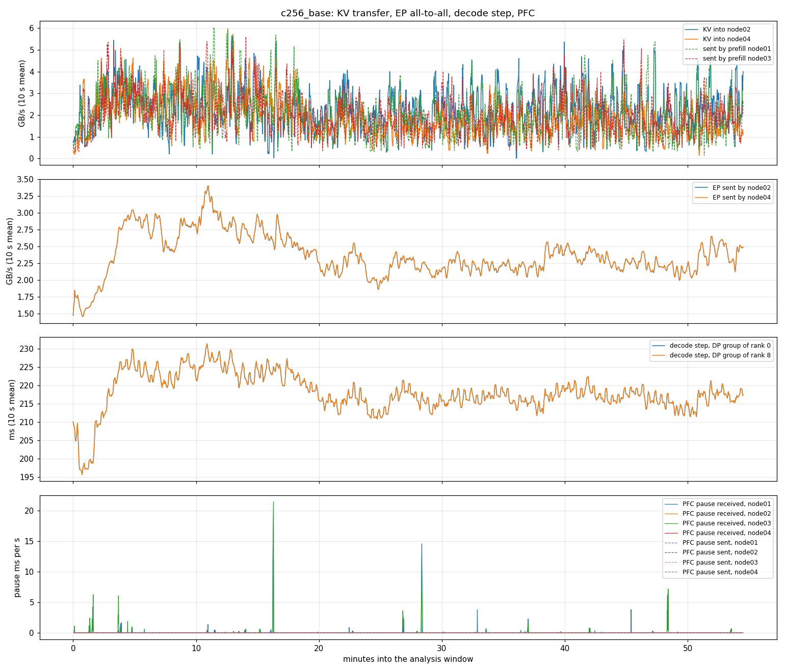
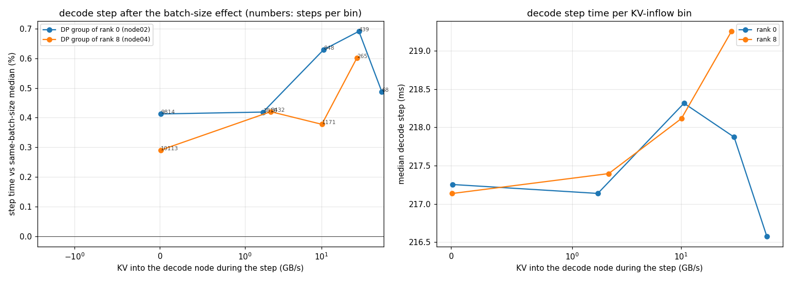
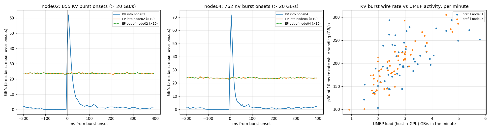
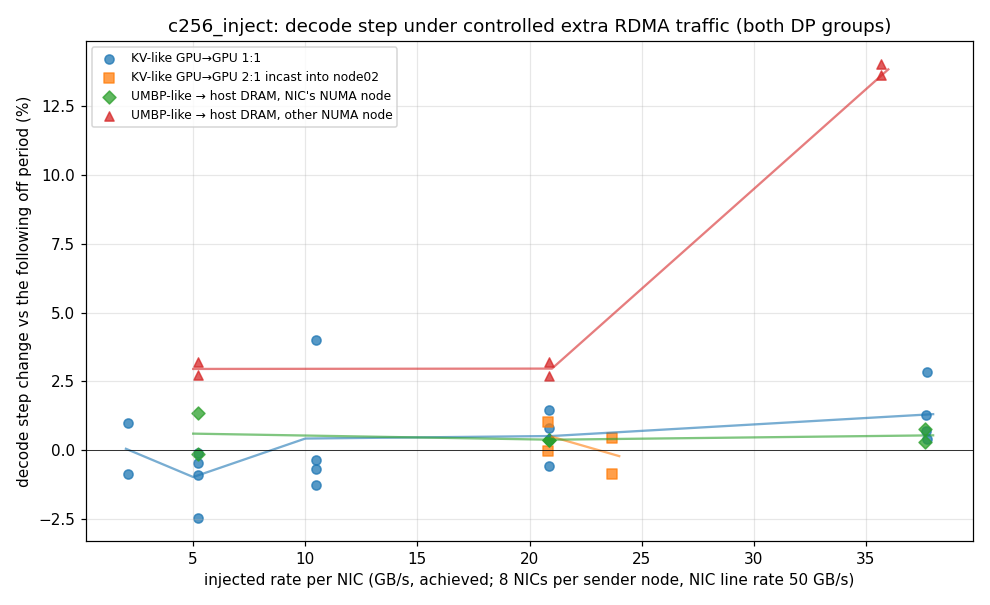
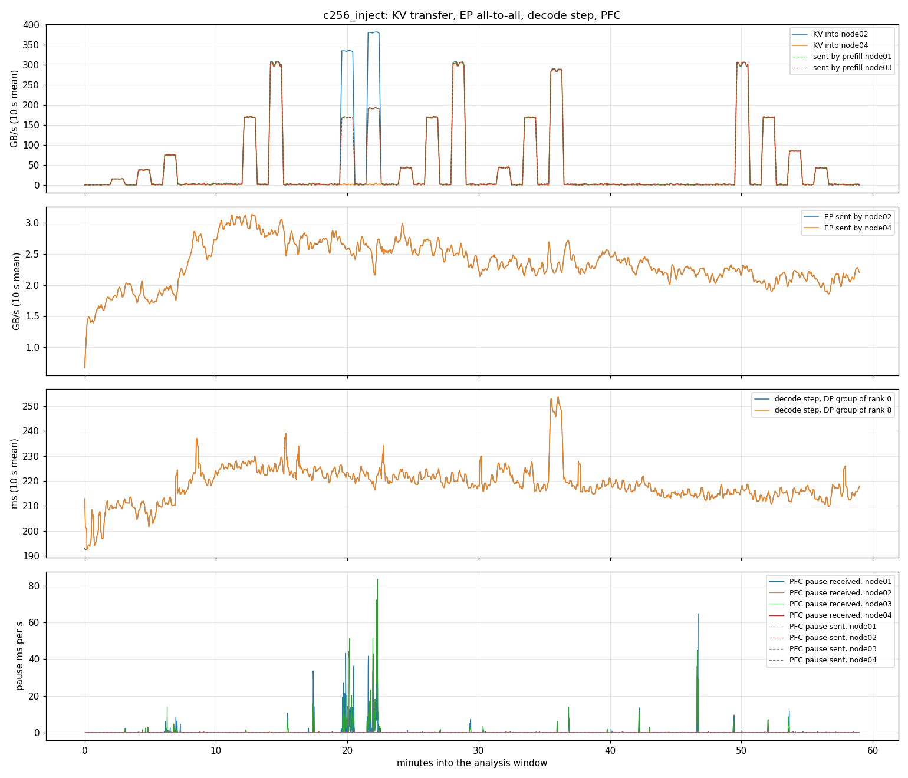
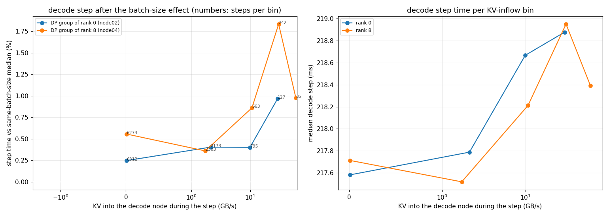

# K3.1-Pro AgentX PD：KV 传输 / UMBP 对 MoRI EP 的影响 —— 测试方法和数据（AMD MI355X）

本文记录我们在 MI355X 上的测试方法、配置和数据。

## 1. 结论摘要

- 真实负载（K3.1-Pro AgentX，2P1D，decode 两机 EP16，所有 RDMA 流量在无损 TC 104）下，KV 传输对 decode 步（含跨机 EP all-to-all）的影响 ≤ 0.3%。
- 在真实负载上叠加 KV 形状的流量（写 decode 的 GPU 显存），一直加到每网卡 38 GB/s 背靠背（每个 EP 操作都和注入流量撞上），decode 步平均 +1.3%；两台 prefill 同时打一台 decode（2:1 汇聚、接收网卡接近线速）≤ +1%。
- 同样的流量改成写 decode 的主机内存：网卡同 NUMA ≤ +1.4%；另一个 NUMA 每网卡 5–21 GB/s +3%，36 GB/s +14%。
- EP 在这个 decode 里是小流量、低时间占比：两台 decode 之间每个方向约 2.4 GB/s（网卡能力的 0.6%），EP dispatch / combine 内核占 decode GPU 时间的 9.2%。
- 对照：EP / KV / RCCL 全部改到有损 TC 0 时，端到端不变，但 KV 突发开始丢包（KV 发送方重传 2.1–2.3% 的包），EP 也被连带重传，KV 对 decode 步的影响升到 0.3–1.1%。

## 2. 测试环境

### 2.1 硬件和网络

| 项 | 配置 |
|---|---|
| 节点 | 4 台 AMD MI355X（每台 8 GPU，每 GPU 288 GB HBM），云上虚拟机，GPU 和网卡（VF）直通 |
| 网卡 | 每 GPU 一张 AMD AINIC 400 Gb/s（ionic，驱动 25.12.15.001，固件 1.117.5），RoCEv2，MTU 4096 |
| 拓扑 | rail-only：GPU i ↔ 网卡 i ↔ rail i，rail 之间不互通 |
| 流量类别 | DSCP 26 = TC 104（无损，PFC 优先级 3）：EP、KV、跨机 RCCL 都在这里；对照组全部 DSCP 0 = TC 0（有损） |
| 共享 | 同一批 rail 交换机上另有一个任务在 4 台节点上跑 RDMA（真实负载那组期间其中两台平均收发约 220 Gb/s、峰值约 930 Gb/s） |

### 2.2 软件

| 项 | 版本 |
|---|---|
| 模型 | moonshotai/Kimi-K3.1-Pro（fp4 权重，KV fp8_e4m3）；DFLASH 投机解码，草稿 RadixArk/Kimi-K3.1-Dflash2-Preview（d0d8bc2e），每步 5 个草稿 token，接受长度按 InferenceY recipe 模拟为 3.25（`SGLANG_SIMULATE_ACC_LEN=3.25`） |
| sglang | 0.5.24（de0f491）+ UMBP linker v4 + MoRI PD under DCP（sgl-project/sglang#48902）+ linker / MoRI 传输优化，加测量探针；即本分支 `k31-epio-probe-opt4` |
| MoRI | ROCm/mori PR #996（3a869d5f）：EPv2 跨机（无 RDMA 原子的信号）、v2_ll、MI355X EP32 调优表；带 UMBP |
| 镜像 | 基于 `lmsysorg/sglang:dev-kimi-k31-pro-mi35x`（PyTorch 2.11，ROCm 10.0），替换 mori |

### 2.3 部署（2P1D）

| 角色 | 节点 | 并行 | 要点 |
|---|---|---|---|
| prefill × 2 | 各 1 台 | TP8 + DCP8 | chunked prefill 16384；本机 UMBP DRAM tier 1 TB（大页，standalone server，只走本机 GPU↔主机内存，不经网卡） |
| decode × 1 | 2 台 | attention DP2（每台一个 DP 组，TP8 + DCP8），MoE EP16 跨两台（MoRI EPv2，dispatch / combine bf16），共享专家 TP8 | 最多 272 个运行请求（每 DP 组 136，cuda graph batch ≤ 136）；decode 侧 radix cache 开启；每 DP 组 KV 2264 万 token |
| router | prefill 节点之一 | sglang-router PD 模式 | prefill 选择 cache_aware；decode 内两个 DP 组 round_robin |

KV 传输：MoRI IO RDMA WRITE，从 prefill 的 GPU 显存直接写 decode 的 GPU 显存（不经主机内存）；prefill GPU i 经 rail i 写 decode GPU i（`MORI_IO_RAIL_AFFINITY=1`），8 张网卡并行；每个 chunk 的 KV 和线性注意力状态合成一次 batch write（`SGLANG_MORI_COALESCE_TRANSFERS=1`）。

### 2.4 关键参数

decode（两台各起一个进程，node-rank 0 / 1）：

```
python3 -m sglang.launch_server --model-path Kimi-K3.1-Pro --served-model-name moonshotai/Kimi-K3.1-Pro \
  --disaggregation-mode decode --disaggregation-transfer-backend mori \
  --disaggregation-ib-device ionic_0,...,ionic_7 --disaggregation-decode-enable-radix-cache \
  --disaggregation-decode-extra-slots 16 --tp-size 16 --attn-dp-size 2 --enable-dp-lm-head \
  --ep-size 16 --moe-a2a-backend mori --shared-experts-tp-size 8 --nnodes 2 --node-rank {0,1} \
  --dcp-size 8 --dcp-comm-backend a2a --max-running-requests 272 --cuda-graph-max-bs-decode 136 \
  --mem-fraction-static 0.64 --kv-cache-dtype fp8_e4m3 --enable-dsa-fp4-indexer \
  --mamba-radix-cache-strategy extra_buffer --enable-linear-replayssm-spec \
  --speculative-algorithm DFLASH --speculative-draft-model-path Kimi-K3.1-Dflash2-Preview \
  --speculative-num-draft-tokens 5 --speculative-use-block-verification \
  --speculative-draft-attention-backend triton --speculative-draft-kv-cache-dtype fp8_e4m3 \
  --reasoning-parser kimi_k3 --tool-call-parser kimi_k3 --trust-remote-code --skip-server-warmup
```

prefill（每台一个）：

```
python3 -m sglang.launch_server ... --disaggregation-mode prefill --disaggregation-transfer-backend mori \
  --disaggregation-ib-device ionic_0,...,ionic_7 --disaggregation-bootstrap-port 7200 \
  --disaggregation-decode-allocation-policy early --tensor-parallel-size 8 --dcp-size 8 --dcp-comm-backend a2a \
  --chunked-prefill-size 16384 --max-prefill-tokens 16384 --cuda-graph-backend-prefill breakable \
  --cuda-graph-bs-prefill 256 512 768 1024 1536 2048 3072 4096 --mem-fraction-static 0.85 \
  --schedule-policy shortest-prefill-first --enable-unified-cache-external-linker \
  --unified-cache-external-linker-backend mori --mamba-full-memory-ratio 0.65 \
  --mamba-max-states-per-path 1 --mamba-track-interval 64 --enable-cache-report （模型 / 投机解码参数同 decode）
```

环境变量（与 RDMA 相关的部分）：

| | decode | prefill |
|---|---|---|
| TC | `MORI_RDMA_TC=104 MORI_IO_TC=104 NCCL_IB_TC=104` | `MORI_RDMA_TC=104 MORI_IO_TC=104` |
| MoRI EP | `SGLANG_MORI_EP_V2=true MORI_EP_DISABLE_RDMA_ATOMICS=1 MORI_ENABLE_RAIL_ONLY=1 MORI_DEVICE_NIC=ionic MORI_RDMA_DEVICES=ionic_0..7 MORI_ENABLE_SDMA=0 MORI_EP_LAUNCH_CONFIG_MODE=AUTO` | – |
| MoRI IO | `MORI_IO_RAIL_AFFINITY=1 MORI_IO_QP_MAX_SEND_WR=32767` | 同左，加 `SGLANG_MORI_COALESCE_TRANSFERS=1` |
| 网卡 | `MORI_IB_GID_INDEX=1 MORI_DISABLE_IONIC_CCQE=1 MORI_IB_ENABLE_RELAXED_ORDERING=0` | 同左 |
| RCCL | `NCCL_IB_DISABLE=0 NCCL_NET=IB NCCL_IB_GID_INDEX=1 NCCL_CROSS_NIC=0` | `NCCL_IB_DISABLE=1`（单机 TP8） |
| 其他 | `SGLANG_ROCM_RUNTIME_RESERVE_GB=24`，其余 recipe 原样 | recipe 原样（`SGLANG_ROCM_RUNTIME_RESERVE_GB=10` 等） |

## 3. 负载

InferenceY 的 K3.1 AgentX 测试，命令行和环境变量与 InferenceY CI 一致，只把并发从 128 提到 256：

```
agentx profile --url http://<router>:8000 --model moonshotai/Kimi-K3.1-Pro --tokenizer moonshotai/Kimi-K3.1-Pro \
  --concurrency 256 --benchmark-duration 3600 --tokenizer-trust-remote-code \
  --server-metrics <prefill1>/metrics <prefill2>/metrics <decode>/metrics \
  --output-artifact-dir <out> --public-dataset semianalysis_cc_traces_weka_062126
# AIPERF_HTTP_TCP_USER_TIMEOUT=900000 AIPERF_USE_DYNAMO_CONV_AWARE_ROUTING=1 AIPERF_DYNAMO_SESSION_TIMEOUT_SECONDS=3600 ...
```

- agentx-harness 1.0.13（AIPerf），数据集 393 条 Claude Code 轨迹，agentic replay。
- 每个点先跑 AIPerf 的 warmup（约 2845 个请求，只填缓存），再跑 3600 s profiling；以下数据都来自 profiling 阶段。
- 负载特征：平均输入 8.7 万 token、输出 806 token，客户端前缀命中 81%；decode 内 round_robin 使几乎每个请求都传完整上下文的 KV（平均约 1.6 GB / 请求）；decode KV 占用 95–100%。

## 4. 测量方法

| 测什么 | 怎么测 |
|---|---|
| decode 步 | 在每个 DP 组 attention-TP rank 0 上，用 HIP event 包住每个 decode 步（draft + verify）取 GPU 时间，同时记 batch 大小（本分支的 `epio_probe.py`，`EPIO_PROBE_DIR` 打开） |
| 网卡流量 | 4 台机器每张网卡的 RDMA 字节 / 包计数，5 ms 采样；端口 PFC 计数和字节 1 Hz；重传、ACK 超时、序号错误计数 |
| KV / EP 拆分 | decode 之间只有 EP，prefill 网卡只发 KV：每条 rail 上，流入 decode 节点 j 的 KV = j 收到的字节 − 另一台 decode 发出的字节 |
| 客户端 | AIPerf 每请求记录（TTFT、ITL、每条流式消息的到达时间） |
| 内核构成 | 负载下 torch profiler 抓 5 个 decode 步（DP0 TP0） |

- 每个 decode 步都算出"这一步执行期间流入该节点的 KV 速率"，再用"同 batch 大小（每 8 个一档）的中位数"做基准取偏差，按 KV 速率分档比较；同时做最小二乘：step_ms = a + b·bs + c·bs_另一 DP 组 + d·KV_GBps。
- 突发对齐：找 KV 流入超过 20 GB/s、且之前 100 ms 都低于 1 GB/s 的 5 ms 时刻为突发起点，对齐看前后 EP 流量。
- 客户端 ITL 按流式消息切窗口：AIPerf 的 ITL 是每个请求一个平均值，而一个请求的 decode 约 250 步、50 多秒，跨多个注入窗口；所以按每条流式消息的到达时间把消息间隔分到"注入开 / 关"时段，逐 token ITL = 消息间隔 ÷ 该请求平均每条消息的 token 数。

## 5. 实验一：真实负载（TC 104，3600 s）

| 指标 | 值 |
|---|---|
| 请求 / 错误 | 8,553 / 2 |
| QPS、输出吞吐 | 2.35、1,894 tok/s |
| TTFT 均值 / p50 / p90 | 53.9 / 28.3 / 124 s |
| ITL 均值 / p90 / p99（AIPerf） | 65.6 / 69.4 / 78.2 ms |
| decode 步 p50 / p90 / p99 | 217.3 / 225.1 / 231.3 ms（每 DP 组约 70 个请求） |

网络（54 分钟分析窗口）：

| | node02 | node04 |
|---|---|---|
| KV 流入均值 | 2.25 GB/s | 1.89 GB/s |
| KV 流入 100 ms p90 / p99 / 最大 | 2.6 / 56 / 243 GB/s | 4.6 / 38 / 157 GB/s |
| 5 ms 时间占比：KV > 1 / 10 / 40 / 100 GB/s | 6.1% / 2.7% / 1.27% / 0.75% | 6.2% / 2.5% / 1.28% / 0.58% |
| 单条 rail 10 ms 最大接收 | 396 Gb/s | 395 Gb/s |
| EP 发出均值，100 ms p99 / 最大 | 2.37，3.18 / 3.58 GB/s | 2.38，3.18 / 3.63 GB/s |
| 网卡发出的 PFC pause 累计 | 141 ms | 61 ms |
| 重传包 | 0 | 43（2×10⁻⁸） |

prefill 网卡收到的 pause 累计 188 / 218 ms，单秒最多 16 / 29 ms。

decode 步按"步内 KV 流入"分档（相对同 batch 大小中位数的偏差，均值；分布右偏，整体约 +0.4%，看档间差）：

| KV 流入（GB/s） | DP0 步数 | DP0 偏差 | DP1 步数 | DP1 偏差 |
|---|---|---|---|---|
| < 0.5 | 9,814 | +0.41% | 10,113 | +0.29% |
| 0.5–5 | 3,810 | +0.42% | 3,432 | +0.42% |
| 5–20 | 848 | +0.63% | 1,171 | +0.38% |
| 20–50 | 439 | +0.69% | 265 | +0.60% |
| 50–100 | 68 | +0.49% | – | – |

最小二乘：d = 0.0136 ± 0.0030（DP0）/ 0.0079 ± 0.0042（DP1）ms per GB/s，按 p99 的 KV 流入算 0.24% / 0.10%。

突发对齐：node02 855 次（5 ms 峰值平均 62 GB/s）、node04 762 次（72 GB/s），突发开始后 50 ms 内流入同节点的 EP 从 2.375 → 2.365 GB/s（−0.4%）、2.397 → 2.392 GB/s（−0.2%）。







## 6. 实验二：受控注入（TC 104）

方法：

- 真实负载跑着（同实验一的配置和负载），在 profiling 阶段插入注入窗口，每个窗口开 60 s，和窗口结束后 5–57 s 比较；decode 步按同 batch 大小中位数归一化。
- 注入用 MoRI IO RDMA WRITE（4 QP / 传输，72 KB 段），从 prefill 的 GPU 显存写 decode 的 1 GiB 缓冲；GPU i → GPU i 走 rail i，覆盖全部 8 条 rail，和 EP 跨机入向流量共用交换机出口和 decode 网卡的接收方向；TC 104。
- 接收缓冲三种：decode GPU 显存；decode 主机内存，绑到网卡所在 NUMA 节点；绑到另一个 NUMA 节点。
- 每次突发 16 MB，以约 37 GB/s 发完（约 0.43 ms），速率靠突发间隔控制；每个高速率窗口里每个 DP 组有 230–270 个 decode 步（batch 56–98），每步约 92 次 dispatch + 92 次 combine。

| 目标速率（每网卡） | 实测 | 突发间隔 | 占空比 | 单次 EP（80–100 µs）撞上突发的概率 |
|---|---|---|---|---|
| 2 GB/s | 2.1 | 7.6 ms | 6% | 约 7% |
| 5 GB/s | 5.2 | 2.8 ms | 14% | 约 17% |
| 10 GB/s | 10.5 | 1.2 ms | 28% | 约 33% |
| 20 GB/s | 20.9 | 0.37 ms | 56% | 约 65% |
| 40 GB/s | 37.7 | 0（背靠背） | 100% | 100% |

结果（每个窗口；decode 步变化是 DP0 / DP1；ITL、步长分位数都是"关 → 开"，步长为 DP0）：

| 注入 | 每网卡 GB/s | decode 步变化 | 逐 token ITL p90（ms） | ITL p99（ms） | decode 步 p90（ms） | decode 步 p99（ms） |
|---|---|---|---|---|---|---|
| GPU 显存 1:1 | 2.1 | +1.0% / −0.9% | 68.9 → 70.6 | 259 → 254 | 212.1 → 211.5 | 218.7 → 217.1 |
| GPU 显存 1:1 | 5.2 | −0.4% / −0.1% | 67.2 → 71.3 | 428 → 433 | 211.3 → 212.1 | 216.2 → 216.1 |
| GPU 显存 1:1（7 张网卡） | 10.5 | −1.3% / +4.0% | 71.3 → 71.1 | 340 → 328 | 218.3 → 213.4 | 230.6 → 220.0 |
| GPU 显存 1:1 | 20.9 | +0.8% / +1.5% | 73.9 → 76.4 | 378 → 373 | 226.0 → 230.6 | 232.1 → 235.3 |
| GPU 显存 1:1 | 37.7 | +0.4% / +2.9% | 76.2 → 73.3 | 364 → 449 | 228.0 → 230.2 | 316.0 → 236.3 |
| GPU 显存 1:1 | 37.7 | +1.3% / +0.7% | 70.7 → 73.3 | 407 → 409 | 216.4 → 218.7 | 222.2 → 226.4 |
| GPU 显存 1:1 | 20.9 | +0.4% / −0.6% | 72.4 → 72.1 | 350 → 384 | 217.4 → 216.8 | 222.6 → 220.3 |
| GPU 显存 1:1 | 10.5 | −0.7% / −0.4% | 70.1 → 70.4 | 407 → 375 | 218.2 → 218.4 | 223.7 → 222.5 |
| GPU 显存 1:1 | 5.2 | −2.5% / −0.9% | 70.8 → 70.1 | 381 → 398 | 219.3 → 215.3 | 225.8 → 220.2 |
| GPU 显存 2:1 汇聚进 node02 | 20.8 | +1.0% / −0.0% | 79.6 → 76.7 | 359 → 363 | 224.6 → 224.4 | 231.7 → 230.5 |
| GPU 显存 2:1 汇聚进 node02 | 23.7（接收网卡约 47） | +0.4% / −0.9% | 75.6 → 75.0 | 419 → 385 | 222.0 → 224.3 | 282.3 → 230.7 |
| 主机内存，同 NUMA | 5.2 | −0.1% / +1.3% | 72.8 → 72.8 | 377 → 386 | 221.9 → 226.2 | 229.3 → 230.2 |
| 主机内存，同 NUMA | 20.9 | +0.4% / +0.4% | 75.6 → 79.6 | 333 → 533 | 221.1 → 225.3 | 228.3 → 231.0 |
| 主机内存，同 NUMA | 37.7 | +0.3% / +0.8% | 71.9 → 73.9 | 361 → 445 | 220.3 → 224.4 | 223.9 → 231.6 |
| 主机内存，另一 NUMA | 5.2 | +2.7% / +3.2% | 74.1 → 76.7 | 378 → 402 | 221.6 → 229.5 | 228.3 → 233.5 |
| 主机内存，另一 NUMA | 20.9 | +2.7% / +3.2% | 71.1 → 75.9 | 390 → 402 | 221.4 → 228.5 | 224.0 → 231.7 |
| 主机内存，另一 NUMA | 35.7 | **+13.6% / +14.0%** | **71.7 → 84.0** | 350 → 447 | **221.7 → 255.3** | **227.9 → 261.4** |

按速率汇总（两个 DP 组、同档各窗口平均）：

| 注入 | ≈5 GB/s | ≈21 GB/s | 36–38 GB/s |
|---|---|---|---|
| GPU 显存 1:1 | −1.0% | +0.5% | +1.3% |
| 主机内存，同 NUMA | +0.6% | +0.4% | +0.5% |
| 主机内存，另一 NUMA | +3.0% | +3.0% | +13.8% |

- 2:1 汇聚（两台 prefill 同时写 node02 的 GPU 显存，node02 每张网卡收约 47 GB/s）：+0.5% / −0.2%。
- 单窗口噪声约 ±2%（相邻窗口间负载组成在变）。逐 token ITL p99 和消息间隔 p99（0.8–1.7 s）主要是 decode 调度层面的停顿（请求进出、等 KV、KV 占满），和注入没有一致关系；decode 步的 GPU 时间 p99 只有约 231 ms。
- PFC：写 GPU 显存的 40 GB/s 窗口里 decode 网卡每 60 s 发出 pause 20–43 ms；写同 NUMA 主机内存 1–4 ms；写另一 NUMA 17–55 ms；2:1 汇聚时 node02 约 50 ms、两台 prefill 收到 390–870 ms。整个实验二期间 decode 之间的 EP 重传 0 个包；prefill（KV + 注入的发送方）重传 2×10⁻⁵、ACK 超时 768 / 852 次。
- 整个实验二（含全部注入窗口）的 AIPerf ITL 均值 / p90 为 65.8 / 69.5 ms，实验一为 65.6 / 69.4 ms。





## 7. 实验三：TC 0 对照（EP / KV / RCCL 全部有损）

配置和负载同实验一，只把 `MORI_RDMA_TC / MORI_IO_TC / NCCL_IB_TC` 改成 0；profiling 约 40 分钟，没有注入。

| 指标 | TC 104（实验一） | TC 0 |
|---|---|---|
| QPS、输出吞吐 | 2.35、1,894 tok/s | 2.40、1,766 tok/s |
| ITL 均值 / p90 | 65.6 / 69.4 ms | 65.3 / 69.2 ms |
| decode 步 p50 / p99 | 217.3 / 231.3 ms | 217.7 / 231.3 ms |
| KV 流入均值（node02 / node04） | 2.25 / 1.89 GB/s | 1.81 / 2.09 GB/s |
| EP 每方向 | 2.37 GB/s | 2.44 GB/s |
| prefill 重传（占发包） | 0 | 2,054 万 / 2,422 万（2.1% / 2.3%） |
| prefill ACK 超时 | 0 | 1,298 / 1,295 |
| decode（EP）重传 | 0 / 43 | 29,714 / 1,772 |
| decode（EP）ACK 超时 | 0 | 143 / 89 |
| PFC | 有（见上） | 无 |
| KV 对 decode 步（最小二乘，p99 KV） | 0.24% / 0.10% | 0.32% / 1.06% |
| 20–50 GB/s 档偏差（DP0 / DP1） | +0.69% / +0.60% | +0.97% / +1.83% |
| 突发后 50 ms EP 流入变化 | −0.4% / −0.2% | −0.5% / −0.3% |



## 8. EP 的流量和时间占比

流量（实验一，decode 两台之间）：

| 项 | 值 |
|---|---|
| 每台每方向均值 | 2.37–2.38 GB/s（网卡能力 400 GB/s / 台的 0.6%） |
| 100 ms p50 / p90 / p99 / 最大 | 2.31 / 2.85 / 3.18 / 3.6 GB/s |
| 每个 decode 步 | 约 0.51 GB / 方向 / 台 |
| 每次 dispatch / combine | 约 2.8 MB / 方向 / 台（每条 rail 约 0.35 MB） |

decode 步的 GPU 内核构成（负载下 5 个 decode 步，DP0 TP0，内核总时间 957.5 ms，约 229 ms / 步）：

| 内核 | 时间 | 占比 |
|---|---|---|
| MoE 专家 GEMM、排序（`mfma_moe1/2`、`moe_sort` 等） | 530.2 ms | 55.4% |
| fp8 分组量化 | 165.4 ms | 17.3% |
| MoRI EP（dispatch 36.9 + combine 45.6 + copystaging 2.5 + combineall 3.1） | 88.1 ms | 9.2% |
| TP / DCP 集合通信（allgather、reduce_scatter、RCCL） | 38.4 ms | 4.0% |
| 其他 | 135.4 ms | 14.1% |

- 每步 92 次 dispatch、92 次 combine；dispatch 平均 80.1 µs，combine 99.1 µs。
- 实验二里每个 EP 都撞上注入的 40 GB/s 档 decode 步 +1.3%；EP 占 9.2%，即使把整步变化都算到 EP 上，单次 EP 操作最多慢约 14%。

## 9. UMBP

- recipe 里 UMBP 是 prefill 节点本机的 DRAM tier，读写只走本机 GPU↔主机内存，不经网卡；EP 只在 decode 节点之间。
- 实验一里每台 prefill：UMBP load（主机→GPU）均值 2.7–3.0 GB/s、最大 5.0–5.8 GB/s，offload 1.4 GB/s，tier 占用 95–97%。
- 和 KV：按分钟比较 UMBP load 和 prefill 网卡发送 KV 时 10 ms 速率的 p90（约 200 GB/s），相关系数 0.61 / 0.86（都随负载走），没有看到 UMBP 压低 KV 传输。
- UMBP 远端池放到 decode 节点上的情形，用实验二的"写 decode 主机内存"代替：同 NUMA ≤ +1.4%，另一 NUMA +3% ～ +14%。真实 UMBP 流量摊到每张网卡约 0.2–0.7 GB/s，低于测过的最低档（5 GB/s）。

## 附：代码

- 探针（本分支）：`python/sglang/srt/epio_probe.py`、`epio_clock.py`；挂在 `disaggregation/mori/conn.py`（KV chunk 的入队 / 提交 / 完成时间和字节数）、`disaggregation/decode.py`（KV 到达）、`managers/scheduler.py`（每步 GPU 时间）；`EPIO_PROBE_DIR=<dir> EPIO_PROBE_RANKS=0,8` 打开。
- 注入：MoRI IO 的 RDMA write 生成器（同目录的 `io_inject.py`，接收端 GPU / 主机内存可选、NUMA 可选，突发大小和间隔可调，按 `--start-at` 对齐窗口）。
