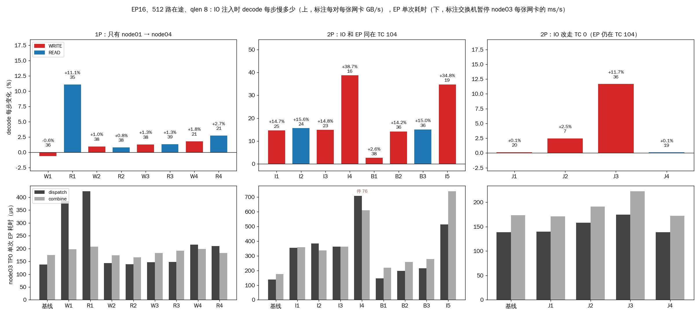
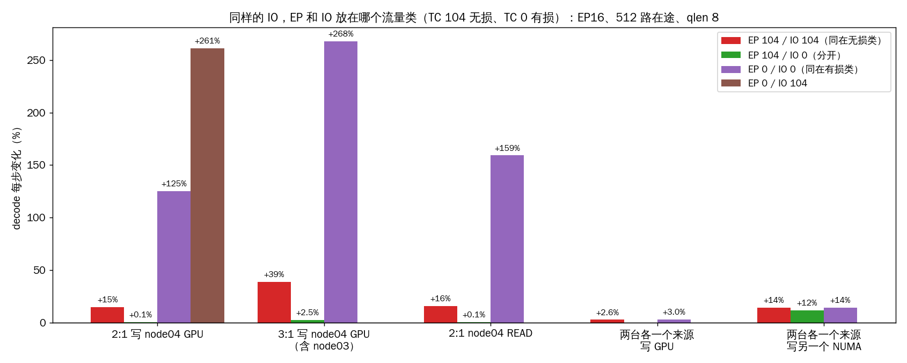

# K3.1 PD 第三轮：高 EP 流量下 IO 对 EP 的影响（EP16、全局 512 路在途、qlen 8）

第一轮文档：[k31_agentx_ep_kv_umbp_zh.md](k31_agentx_ep_kv_umbp_zh.md)；第二轮文档：[k31_ep_kv_read_write_zh.md](k31_ep_kv_read_write_zh.md)。Moonshot 看了前两轮，认为我们的 EP 流量太小；他们在 EP32、全局 batch 512、qlen 8 上测到过掉速。机器有限，这一轮先在 EP16 上把 EP 流量提上去再测。端到端参数和前两轮不同（见下表），所以单独成文。机器还是 DO MI355X fabric3（rail-only，ionic AINIC 400G）的 node01–04：decode 主要在 node03 + node04，prefill 在 node01（1P）或 node01 + node02（2P）；node04 失联的那段时间换成 prefill node01、decode node02 + node03（第 6 节）。

## 这一轮做了什么

- **把 EP 流量提上去**（第 1 节）：decode 512 路在途、每个 DP 组 256 路，每个请求每步验证 8 个 token。
- **一个 IO 来源**（第 2 节），**多个来源同时打进一台 decode（incast）**和 incast 的速率扫描（第 3 节）。
- **流量类**：IO 换到另一个类（第 4 节，含按这个方式部署的验证），EP 也放进有损类（第 5 节）。
- **换一组节点复测**（第 6 节），**真实的 KV 传输能打到多大**（第 7 节）。
- **和 Moonshot 的掉速对照、对部署的建议**（第 8 节）。

和第二轮端到端（第二轮第 3.2、4 节）的差别：

| | 第二轮 | 这一轮 |
|---|---|---|
| decode 节点 | node02 + node04 | node03 + node04（第 6 节是 node02 + node03） |
| prefill 节点 | node01、node03 | node01（1P）或 node01 + node02（2P） |
| `--max-running-requests` / `--cuda-graph-max-bs-decode` | 272 / 136 | 512 / 256 |
| `--speculative-num-draft-tokens`（qlen） | 5 | 8 |
| `SGLANG_MORI_MOE_MAX_INPUT_TOKENS` | 2048 | 不设 |
| `SGLANG_ROCM_RUNTIME_RESERVE_GB` | 24 | 10 |
| 合成负载（`load_gen.py`） | 128 路，输入 3,000、输出 600 | 512 路，输入 3,000、输出 1,500 |
| 不变的 | dispatch 上限 1024、`--mem-fraction-static 0.64`、TC 104、DFLASH 接受长度按 3.25 模拟 | 同左 |

## 结论

- **IO 让 EP 明显变慢的情况复现出来了，要两个条件同时满足**：IO 在某台 decode 的入口形成 incast（多个来源同时打进来，或者接收方排不出去），而且 EP 没有和 IO 分开。
  - EP 和 IO 同在无损类（TC 104）：2:1 incast（两台 prefill 同时写一台 decode 的 GPU 显存，也就是 KV 的正常落点）decode 每步 +15%，3:1 +39%，EP 单次 dispatch / combine 是基线的 2–5 倍（第 3 节）。
  - EP 在有损类（TC 0，也是 MoRI 不设 TC 时的默认）：+125%～+268%，EP 的包被丢、等重传；最坏是 EP 有损、IO 无损（+261%）（第 5 节）。
  - 只有一个来源（1P、两台 decode 各一个来源、或者只有另一台 decode 当来源）：不论哪个流量类都只有 1%～4%（第 2、3 节）。
  - 换一组节点（decode 02 + 03）复测一致（第 6 节）。
- **入口到线速的一半左右开始碰到 EP**（+3%～+6%），80% 以上明显变陡（+10%～+16%）（第 3 节）。
- **EP 留在无损类、IO 改走另一个类（TC 0），同样的 incast 只有 +0.1%～+2.7%**，代价是 IO 自己在 incast 时丢包重传。按这个方式整套部署（KV、UMBP 走 TC 0，EP、NCCL 走 TC 104）跑过：平时没有代价，真实的 KV 走有损类不丢包、不出错（第 4 节）。来源之一是另一台 decode 时只降到 +6%～+9%：它的 IO 和它自己的 EP 在网卡出口抢带宽（第 6 节）。
- **跨 NUMA 那部分和流量类无关**：写进 decode 另一个 NUMA 的主机内存仍有 +12%～+15%（第二轮第 6 节的主机侧机制），和 incast 叠在一起 +35%（第 3 节）。
- **真实的 KV 传输打不到这个量**：每台 decode 只有几 GB/s（多轮 32k 前缀、关掉 decode 的 radix cache 也只多约 4 GB/s），比 EP 开始受影响的入口量低一个数量级以上（第 7 节）。
- **和 Moonshot 的掉速**（第 8 节）：值得确认他们 EP 和 IO 用的 TC、那个 TC 在交换机上是不是无损，以及掉速时 decode 入口有多大的 IO；EP32 下 EP 本身就在入口形成 incast，更容易碰到（推测，没有在 EP32 上测）。

**怎么看**：每列一组测试，依次是第 2、3、4 节。上图是每个时段 decode 每步慢多少，红色 WRITE、蓝色 READ，柱上标了每对 IO 每张网卡实际跑到的速率（GB/s）；下图是同一时段 profile 里 node03 TP0 的单次 dispatch / combine，标了"停"的是交换机暂停 node03 每张网卡的时间（ms/s）。各时段的含义见下面的表。1P 那组跑的时候还没有采网卡计数。

## 1. 配置和 EP 流量

- decode：node03 + node04，attention DP2（每组 TP8 · DCP8）、MoE EP16（MoRI EPv2 跨机），`--max-running-requests 512`、`--cuda-graph-max-bs-decode 256`、`--speculative-num-draft-tokens 8`（DFLASH，接受长度和前两轮一样按 3.25 模拟）；dispatch 上限 1024 token / 卡；不设 MoE 输入上限（每卡每层收到的 token 平均约 2,000，会超过第二轮第 3.1 节的 2,048）；`--mem-fraction-static 0.64`；TC 104；重叠调度开着。
- prefill：1P（node01）或 2P（node01 + node02），配置和第二轮一样。
- 负载：`load_gen.py` 512 路在途，输入 3,000、输出 1,500 token。所有请求都成功（300 s 的预跑 1,024 个，注入的 22 分钟 5,632 个）。

| | 第二轮第 3.1 / 4 节（128 路，qlen 5） | 这一轮（512 路，qlen 8） |
|---|---|---|
| 每个 DP 组的 bs | 约 64 | 中位数 251–253（最大 256） |
| 每步每个 DP 组过 MoE 的 token | 约 320 | 约 2,048（6.4 倍） |
| 每步 GPU 时间 | 114 ms（不设 MoE 输入上限） | 236 ms |
| 单次 dispatch / combine（TP0） | 78 / 96 µs（设上限时） | 139 / 176 µs |
| 每步的 EP 时间（dispatch + combine + 其他） | 17.4 ms（15%） | 30–32 ms（13%） |
| decode 每台的 RDMA 收发（8 张网卡合计，一步内平均） | 约 3.7 GB/s（按每步 token 数和步长折算） | 发 11.5、收 12.4–12.9 GB/s（实测，其中约 1 GB/s 是流入的 KV） |

EP 在每步里的占比没有变大（内核也一起变长了），但每步要搬的数据是原来的 6.4 倍，每秒约 3 倍。

## 2. 只有一个 IO 来源（1P：node01 → node04）

**怎么测**：prefill 只有 node01（node02 当时被别人占用），第二轮第 4 节同样的 8 个时段，但 IO 只从 node01 打进 node04（8 张网卡都打，TC 104，GPU i ↔ GPU i）。

| 时段 | 方式 | 落点 | 每张网卡 GB/s | 每步变化 | 第二轮第 4 节（128 路，两台 decode 都打） |
|---|---|---|---|---|---|
| 注入前 | — | — | — | 236.3 / 236.2 ms | 87.8 / 87.9 ms |
| W1 | WRITE | 另一个 NUMA 的主机内存 | 35.5 | −0.6%（这一段 batch 掉到 198，按 batch 折算约 +12%） | +38.5% |
| R1 | READ | 另一个 NUMA 的主机内存 | 35.1 | +11.1% | +54.4% |
| W2 | WRITE | 本 NUMA 的主机内存 | 37.6 | +1.0% | +0.9% |
| R2 | READ | 本 NUMA 的主机内存 | 38.4 | +0.8% | +1.4% |
| W3 | WRITE | node04 的 GPU 显存 | 38.0 | +1.3% | +1.0% |
| R3 | READ | node04 的 GPU 显存 | 38.5 | +1.3% | +0.9% |
| W4 | WRITE | 另一个 NUMA，限 20 GB/s | 20.9 | +1.8% | +6.9% |
| R4 | READ | 另一个 NUMA，限 20 GB/s | 20.9 | +2.7% | +11.6% |

**说明了什么**：
- **写进 GPU 显存、本 NUMA 主机内存，和第二轮第 4 节一样只慢约 1%**：EP 流量大了约 3 倍，只有一个来源的 IO 仍然碰不到 EP。
- **跨 NUMA 比第二轮第 4 节轻**：R1 +11.1%。W1 这一段 decode 每个 DP 组的 batch 从 255 掉到 198（node01 是唯一的 prefill，又在往外打 IO，送进 decode 的请求变少了），每步 235 ms 看起来没变；按同样的 batch 折算约 +12%（第 6 节 P1 的 batch 是 195，每步 209 ms）。比第二轮第 4 节两台都打的 +38.5% / +54.4% 轻：一是这里只堵了 node04 一台；二是每步的内核变长了（bs 256 × 8），第二轮第 6.4 节那条跨 stream 等待给每次内核下发多加的几微秒被摊薄。下一节两台都跨 NUMA（B2 / B3）是 +14% / +15%。

## 3. 多个 IO 来源进同一台 decode（2P，IO 和 EP 同在 TC 104）

**怎么测**：prefill 两台（node01 + node02），其余同第 1 节。512 路负载上开 8 个时段（每段 60 s，间隔 60 s；每对 IO 每张网卡限 40 GB/s，GPU i ↔ GPU i，TC 104）：
- 2:1 incast：node01 和 node02 同时打 node04（写 GPU 显存、READ、写本 NUMA 或另一个 NUMA 的主机内存）；
- 3:1：再加上 node03（另一台 decode，它同时也在给 node04 发 EP）；
- 两台都打、每台一个来源：node01 → node03、node02 → node04。

另外在 4 台上每 2 s 采一次网卡计数（PFC 暂停时间、RDMA 收发和重传字节，`run/k31_netsample.sh`），取每个时段开始后 5–55 s。

| 时段 | 方式 | IO 来源 → 落点 | 每对每张网卡 GB/s | node04 收（8 卡合计） | 每步变化 | dispatch / combine（µs，node03 TP0） | PFC（每张网卡） |
|---|---|---|---|---|---|---|---|
| 注入前 | — | — | — | 12.9 GB/s | 236.5 / 236.3 ms | 139 / 176 | 无 |
| B1 | WRITE | 01 → 03、02 → 04，GPU 显存 | 38.0 | 319 GB/s | +2.6% | 146 / 220 | 无 |
| I1 | WRITE | 01、02 → node04 GPU 显存 | 24.5 | 379 GB/s | **+14.7%** | 355 / 359 | 几乎没有 |
| I2 | READ | node04 从 01、02 的 GPU 显存读 | 23.7 | 390 GB/s | **+15.6%** | 385 / 338 | 几乎没有 |
| I3 | WRITE | 01、02 → node04 本 NUMA 主机内存 | 23.5 | 388 GB/s | **+14.8%** | 363 / 363 | 几乎没有 |
| I4 | WRITE | 01、02、03 → node04 GPU 显存 | 15.9 | 392 GB/s | **+38.7%** | 709 / 610 | 交换机暂停 01 / 02 / 03：68 / 64 / 76 ms/s |
| I5 | WRITE | 01、02 → node04 另一个 NUMA 主机内存 | 19.4 | 320 GB/s | **+34.8%** | 515 / 740 | node04 发出 315 ms/s |
| B2 | WRITE | 01 → 03、02 → 04，另一个 NUMA 主机内存 | 35.6 | 297 GB/s | +14.2% | 198 / 259 | 无 |
| B3 | READ | 同上 | 35.5 | 297 GB/s | +15.0% | 215 / 277 | 无 |

**说明了什么**：
- **一个来源时 IO 碰不到 EP，两个来源进同一台 decode 就碰到了**：同样写进 GPU 显存（KV 的正常落点），每台一个来源（B1，每张网卡 38 GB/s）只慢 2.6%；两个来源同时进 node04（I1，node04 入口合计 379 GB/s，接近 8 × 50 GB/s 的线速）慢 14.7%，EP 单次耗时翻倍多。READ（I2）、写本 NUMA（I3）一样，说明这是网络上的事，和落点、读写方向无关。
- **这时几乎没有 PFC**：node04 几乎不发暂停，发送方也几乎没被暂停。EP 慢是因为交换机里朝 node04 的出口一直排着 IO 的队，EP 的包和 IO 在同一个优先级，排在后面。
- **3:1 最重（I4，+38.7%）**：交换机开始暂停发送方（每张网卡 6%–8% 的时间），node03 发给 node04 的 EP 也被一起停住，dispatch / combine 是基线的 4–5 倍。
- **incast 再加上跨 NUMA（I5，+34.8%）**：node04 的网卡往另一颗 CPU 的内存写时排不出去（第二轮第 6.1 节的上限），每张网卡 32% 的时间在发暂停；node04 的本地计算也变慢（每步 160 → 200 ms，第二轮第 6.4 节的机制）。
- 两台都跨 NUMA、每台一个来源（B2 / B3）：+14% / +15%，主要是两台的本地计算都变慢（160 → 183 ms），EP 只多了一点，网络上不拥塞。
- 全程没有重传（TC 104 是无损类）。

**IO 量多大开始碰到 EP**：同样的 2:1 incast 写 GPU 显存（TC 104），每对 IO 限不同的速率。一组是两台 prefill 打 node04（`k31_ep512_2pc`，第一段放了一个每卡 1 GB/s 的占位：load_gen 重启后的几分钟里 batch 会起伏）；一组是 node01 加另一台 decode node02 打 node03（第 6 节的三台，`k31_ep512_c`）。

| 每对每张网卡限速（GB/s） | 两台 prefill → node04：入口每卡 GB/s（线速的比例） | 每步变化 | node01 + node02 → node03：入口每卡 GB/s | 每步变化 |
|---|---|---|---|---|
| 1（占位） | 2.6（5%） | +0.3% | — | — |
| 10 | 22（45%） | +3.1% | 22（45%） | +5.6% |
| 15 | 29（57%） | +4.6% | 33（66%） | +9.6% |
| 20 | 40.5（81%） | +10.4% | — | — |
| 30（跑到 23.5） | 48.6（97%） | +14.9% | 48.5（97%） | +16.4% |
| 40，两台 decode 同时被 2:1 | 两台各 45 | +15.0% | 两台各 47 | +21.2% |
| 只有另一台 decode 当来源（40） | 38（77%） | +3.5% | 38（76%） | +3.8% |

- 入口到线速的一半左右就开始碰到 EP（+3%～+6%），80% 以上明显变陡（+10%～+16%）。来源之一是另一台 decode 时每档都更重一点：它的 IO 和它自己发出的 EP 在同一张网卡的出口抢带宽。
- 两台 decode 同时被 incast（两个方向的 EP 都排队）和只堵一台差不多（+15%）；来源里有 decode 时更重（+21%）。

## 4. IO 换一个流量类（TC 0），EP 留在 TC 104

**怎么测**：同一套栈（EP、KV 都还在 TC 104），只把注入流量改成 TC 0（DSCP 0，这套网络上的有损类，交换机里是另一个队列），重测第 3 节影响最大的几种。

| 时段 | 方式 | IO 来源 → 落点 | 每对每张网卡 GB/s | node04 收 | 每个来源的重传 | 每步变化 | 同样的 IO 在 TC 104 |
|---|---|---|---|---|---|---|---|
| J1 | WRITE | 01、02 → node04 GPU 显存 | 20.3 | 320 GB/s | 约 18 GB/s | **+0.1%** | +14.7%（I1） |
| J4 | READ | node04 从 01、02 的 GPU 显存读 | 18.6 | 332 GB/s | 0 | **+0.1%** | +15.6%（I2） |
| J2 | WRITE | 01、02、03 → node04 GPU 显存 | 6.5 | 169 GB/s | 23–25 GB/s | **+2.5%** | +38.7%（I4） |
| J3 | WRITE | 01 → 03、02 → 04，另一个 NUMA 主机内存 | 35.8 | 296 GB/s | 0 | +11.7% | +14.2%（B2） |

**说明了什么**：
- **网络上的影响基本消失**：2:1 incast 从 +14.7% 变成 +0.1%，READ 从 +15.6% 变成 +0.1%，3:1 从 +38.7% 变成 +2.5%，EP 单次耗时回到基线（140 / 171 µs）。IO 的量没少多少（2:1 时 node04 入口 320 GB/s，TC 104 时 379 GB/s）。
- **代价在 IO 自己**：TC 0 不发 PFC，交换机直接丢包。2:1 时两个来源各重传约 18 GB/s（约一成）；3:1 时丢得更多，node04 入口只剩 169 GB/s。READ 在途量有上限，不丢包。
- **跨 NUMA 那部分不受影响**（J3，+11.7%）：那是主机上 PCIe 往另一颗 CPU 内存写的上限，和网络里的队列无关。

**按这个方式部署的验证**（`TCMODE=io0`：真实的 KV 传输和 UMBP 走 TC 0，EP 和 NCCL 留在 TC 104；decode 不开 radix cache，`k31_ep512_2p_io0nrc`）：

| | io0 | 全部 TC 104 |
|---|---|---|
| 注入前每步 | 236.5 ms | 236.6 ms |
| 第 7 节的真实 KV（短请求 → 加上 32k 前缀的长请求） | 216.1 → 224.5 ms，没有重传，8,569 个长请求没有出错 | 216.3 → 224.0 ms |
| 2:1 incast 写 GPU 显存（IO 在 TC 0） | +0.2% | +14.7%（I1） |
| 3:1（含 node03，IO 在 TC 0） | +2.7% | +38.7%（I4） |
| 同样的 2:1，IO 放回 TC 104 | +14.7% | — |

平时不吃亏，真实的 KV 走有损类也不丢包、不出错；有 incast 时 EP 不受影响；IO 一回到 EP 的类，影响原样回来。

## 5. EP 也放进有损类（整套栈 TC 0）

**怎么测**：整套栈重启，EP、KV、NCCL 都用 TC 0（`TCMODE=0`），其余同第 3 节；注入的 IO 用 TC 0，最后一段（K6）IO 改回 TC 104。注入前每步 236.0 ms：没有 IO 时，EP 放在有损类不吃亏。

| 时段 | 方式 | IO 来源 → 落点 | IO 的 TC | 每步变化 | dispatch / combine（µs，node03 TP0） | 同样的 IO，EP 在 TC 104 |
|---|---|---|---|---|---|---|
| 注入前 | — | — | — | 236.0 ms | 132 / 159 | — |
| K5 | WRITE | 01 → 03、02 → 04，GPU 显存 | 0 | +3.0% | 146 / 216 | +2.6%（B1） |
| K1 | WRITE | 01、02 → node04 GPU 显存 | 0 | **+125%** | 508 / 367 | +14.7%（I1）；IO 在 TC 0 时 +0.1%（J1） |
| K4 | READ | node04 从 01、02 的 GPU 显存读 | 0 | **+159%** | 566 / 352 | +15.6%（I2）；+0.1%（J4） |
| K2 | WRITE | 01、02、03 → node04 GPU 显存 | 0 | **+268%** | 3,970 / 588 | +38.7%（I4）；+2.5%（J2） |
| K6 | WRITE | 01、02 → node04 GPU 显存 | 104 | **+261%** | 5,226 / 318 | — |
| K3 | WRITE | 01 → 03、02 → 04，另一个 NUMA 主机内存 | 0 | +14.1% | 204 / 263 | +14.2%（B2） |

**说明了什么**：
- **EP 在有损类时，incast 让 decode 慢一倍以上**：2:1 写 GPU 显存 +125%，READ +159%，3:1 +268%。EP 的包和 IO 一起在 node04 入口的队列里被丢，要靠重传（node03 每秒重传约 0.6 GB，基线为 0），dispatch 从 132 µs 涨到 0.5–4 ms。
- **最坏的是 EP 有损、IO 无损（K6，+261%）**：IO 不丢包、一直占着交换机的缓冲，EP 没有地方排队，单次 dispatch 5 ms 以上。
- 只有一个来源（K5）、或者只是跨 NUMA（K3），和 EP 在 TC 104 时一样（+3%、+14%）：网络不拥塞时，有损类不吃亏。

## 6. 换一组节点复测（prefill 01、decode 02 + 03）

node04 在 11-19 19:27 UTC 失联（宿主机侧 GPU / 网卡的 VF 故障，见附录），这段时间在另外三台上复测：prefill 只有 node01，decode 是 node02 + node03，其余同第 1 节。注入前每步 236.8 ms，batch 255，和 decode 在 03 + 04 时一样。两个来源时，另一个来源只能用另一台 decode（node02），它同时也在给 node03 发 EP。

| 时段 | 方式 | IO 来源 → 落点 | IO 的 TC | 每对每张网卡 GB/s | node03 收（8 卡合计） | 每步变化 | dispatch / combine（µs，node02 TP0） | 对应的第 3 / 4 节 |
|---|---|---|---|---|---|---|---|---|
| 注入前 | — | — | — | — | 12.1 GB/s | 236.8 ms | 147 / 184 | — |
| P1 | WRITE | 01 → node03 GPU 显存 | 104 | 37.4 | 311 GB/s | −11.6%（batch 掉到 195，不可比） | 132 / 160 | — |
| P2 | WRITE | 02（另一台 decode）→ node03 GPU 显存 | 104 | 36.5 | 305 GB/s | +3.8% | 231 / 185 | — |
| P3 | WRITE | 01、02 → node03 GPU 显存 | 104 | 23.5 | 388 GB/s | **+16.8%** | 390 / 368 | I1 +14.7% |
| P4 | READ | node03 从 01、02 的 GPU 显存读 | 104 | 23.5 | 387 GB/s | **+14.7%** | 350 / 355 | I2 +15.6% |
| P5 | WRITE | 01、02 → node03 另一个 NUMA 主机内存 | 104 | 20.7 | 320 GB/s | **+35.3%** | 512 / 723 | I5 +34.8% |
| P8 | WRITE | 01、02 → node03 GPU 显存，每对限 20 GB/s | 104 | 20.9 | 346 GB/s | **+13.3%** | 367 / 306 | — |
| P6 | WRITE | 01、02 → node03 GPU 显存 | 0 | 20.0 | 335 GB/s | +6.0% | 279 / 198 | J1 +0.1% |
| P7 | READ | node03 从 01、02 的 GPU 显存读 | 0 | 20.1 | 358 GB/s | +8.6% | 337 / 203 | J4 +0.1% |

**说明了什么**：
- **2:1 incast 在另一组节点上复现了，大小也一样**：写 GPU 显存 +16.8%、READ +14.7%、写另一个 NUMA +35.3%（第 3 节 +14.7% / +15.6% / +34.8%）。
- **入口到线速的约 86% 就开始排队**：每对限 20 GB/s 时 node03 入口合计 346 GB/s（8 × 50 GB/s 的 86%），仍有 +13.3%。
- 只有另一台 decode 当来源（P2）：+3.8%。
- **IO 改走 TC 0 只能救回一部分**（+6.0% / +8.6%，第 4 节两个来源都是 prefill 时是 +0.1%）：node02 的 IO 和它自己发给 node03 的 EP 从同一张网卡出去，换了流量类，在网卡出口还是抢带宽（node02 TP0 的 dispatch 279–337 µs，基线 147 µs）。
- P1 这一段 decode 的 batch 从 255 掉到 195（node01 是唯一的 prefill，又在往外打 IO），每步变快只是因为 batch 小了，不说明问题。

## 7. 真实的 KV 传输能不能自己打到这个量

**怎么测**：2P、decode 在 03 + 04（TC 104），短请求 448 路（输入 3,000、输出 1,500）跑 300 s 后，再加 64 路长请求跑 600 s：每一路固定一段 32,000 token 的前缀，每次只换后面 512 个 token、输出 16 个 token（多轮 agent 的样子：prefill 的前缀缓存命中，只算 512 个新 token，但 decode 要收整段上下文的 KV）。`bench/load_gen.py --prefix`，`run/k31_r31_mix.sh`。

- decode 开着 radix cache 时（1P，decode 02 + 03，`k31_ep512_c_p32000`），长请求的前缀在 decode 那边也命中了，prefill 只补传新增部分：长请求每秒完成 3.8 个，decode 每台收的流量 12.5 → 13.1 GB/s。
- decode 加 `--disable-radix-cache` 后（`k31_ep512_2p_nrc`），prefill 算的 token 只占约一成，长请求每秒完成 14.3 个；decode 每台收的流量 12.2 → 16.1 GB/s（多出来的约 3.9 GB/s，是线速的 1%），没有 PFC、没有重传；每步 216 → 224 ms（+3.6%，batch 里多了几十个带 32k 上下文的请求，其中有注意力本身变重的部分）。
- **KV 的量只有几 GB/s / 台**：每个 32.5k token 的长请求给 decode 带来约 0.55 GB（K3.1 每个 token 的 KV 很小）；短请求负载下 decode 入口的 12.2 GB/s 里，EP（另一台 decode 发过来的）约 11.4 GB/s，KV 只有约 1 GB/s。比第 3 节 EP 开始受影响的入口量（每张网卡约 20 GB/s，每台约 160 GB/s）低一个数量级以上；第二轮第 5 节 AgentX 里 KV 流入的 100 ms p99 也只有 62 GB/s / 台。
- 也就是说，在这套部署里，KV 传输本身打不到 incast 的量；能打到的是更大的 IO（注入的量级，比如远端 KV 存储、多台同时的突发）。

## 8. 和 Moonshot 测到的掉速

- 在 EP16 上，"IO 让 EP 慢很多"要两个条件同时满足：**IO 在某台 decode 的入口形成 incast**（多个来源同时打进来，或者接收方排不出去），**而且 EP 没有和 IO 分开**。EP 和 IO 同在无损类时 decode 每步慢 15%～39%；EP 在有损类时慢 1.3–3.7 倍。只有一个来源时，即使 IO 跑满、EP 流量大了 3 倍，也只有 1%～4%。
- MoRI 默认不设 traffic class（`MORI_RDMA_TC`、`MORI_IO_TC` 都不设时是 0）。如果 EP 和 IO 都用默认值，而网络上 0 是有损类（这套集群就是），一旦有 IO 在 decode 的入口形成 incast，就是 K1 / K4 那种情况。值得确认 Moonshot 那边：EP 和 KV / 其他 IO 用的 TC、那个 TC 在交换机上是不是无损，以及掉速时 decode 入口有多大的 IO（我们这里 KV 本身每台只有几 GB/s，见第 7 节）。
- EP32 下每台 decode 要同时收另外 3 台的 EP（EP16 时只有 1 台），EP 本身就在入口形成 incast，更容易碰到这种情况。这是推测，没有在 EP32 上测过。
- **对部署**：EP 放在无损类（这套集群是 DSCP 26 / TC 104），KV 等 IO 放到另一个类（MoRI 里 EP 读 `MORI_RDMA_TC`，MoRI IO 先读 `MORI_IO_TC`）。这里只有一个无损类，IO 放 TC 0 也能保护 EP，代价是 IO 在 incast 时丢包重传；按这个方式整套跑过（第 4 节最后），平时没有代价。另一台 decode 发出的 IO 仍会和它自己的 EP 在网卡出口抢带宽（第 6 节），decode 节点最好不要当大流量 IO 的来源。

## 附录：数据和脚本

都在任务目录 `k31-agentx-pd-ep-io-umbp-20261117/` 下（不在 sglang 仓库里）。

| 内容 | 脚本 | 数据 |
|---|---|---|
| 起环境 + 预跑 + 注入时段 | `run/k31_r28_ep512.sh`（`TOPO=1p_ep16` / `2p_ep16` / `1p_ep16b`，调 `k31_up.sh`、`k31_r22_lg_rw.sh`；`WINSPEC` 自定义时段，第 8 个字段是 IO 的 TC；`D_EXTRA_ARGS` 只给 decode 加参数）；编排 `run/k31_r29_2p_chain.sh`、`k31_r33_3node_chain.sh`、`k31_r35_3node_b.sh`、`k31_r36_4node.sh`；分析 `tools/k31_lgrw_analyze.py <dir> D0,D1`（标出 batch 掉了 10% 以上的时段） | `results/pcie/` 下：`k31_ep512_1p_lgrw`（第 2 节）、`k31_ep512_2p_lgrw`（第 3 节）、`k31_ep512_2pc_lgrw` 和 `k31_ep512_c_lgrw`（速率扫描）、`k31_ep512_2p_lgrw_ioTC0` 和 `k31_ep512_2p_io0nrc_lgrw`（第 4 节）、`k31_ep512_2p_tc0_lgrw`（第 5 节）、`k31_ep512_b_lgrw`（第 6 节） |
| 网卡计数（PFC 暂停时间、RDMA 收发 / 重传字节，每 2 s） | `run/k31_netsample.sh`；按时段切 `tools/k31_netwin.py <dir> results/netmon_r29`（暂停时间是 8 张卡合计，表里除以 8） | `results/netmon_r29/` |
| 真实的 KV（第 7 节） | `bench/load_gen.py --prefix --seed-base`、`run/k31_r31_mix.sh`；分析 `tools/k31_mix_analyze.py` | `results/mix/k31_ep512_2p_nrc_p32000`、`k31_ep512_2p_io0nrc_p32000`、`k31_ep512_c_p32000`、`k31_ep512_b` |
| 流量类 | `run/k31_env.sh` 的 `TCMODE=104 / 0 / io0`（io0：`MORI_IO_TC=0`，`MORI_RDMA_TC=104`，`NCCL_IB_TC=104`），`run/k31_umbp.sh` | — |
| 图 | `tools/k31_doc3_figs.py`、`tools/k31_doc3_tcfig.py` | — |

**机器**：node04 在 11-19 19:27 UTC 失联（上一次启动的内核日志里先是 GPU 0000:ab:00.0 `Doesn't get TRN_MSG_ACK from pf`，两分钟后同一个 PCIe 交换芯片下的网卡 0000:ac:00.0 `ionic_adminq_wait: context not initialized`，是 VF 和宿主机 PF 之间的通信断了），node03 在 11-20 01:42 UTC 也宕过一次；两次都是 512 路负载刚开始时，被宿主机重启后进了新装的 6.8.0-149 内核（没有 ionic RDMA 驱动），用 `grub-reboot` 回到之前一直用的 6.8.0-137、手动挂上 `/scratch` 后恢复。正在跑的那组作废，没有用在上面的结果里。
