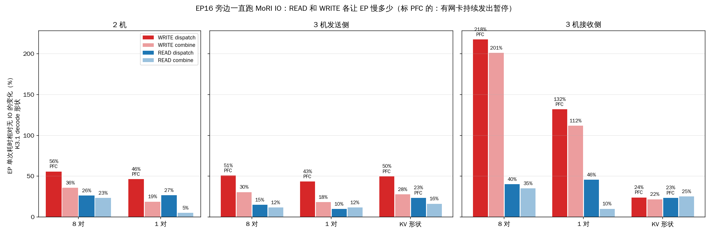
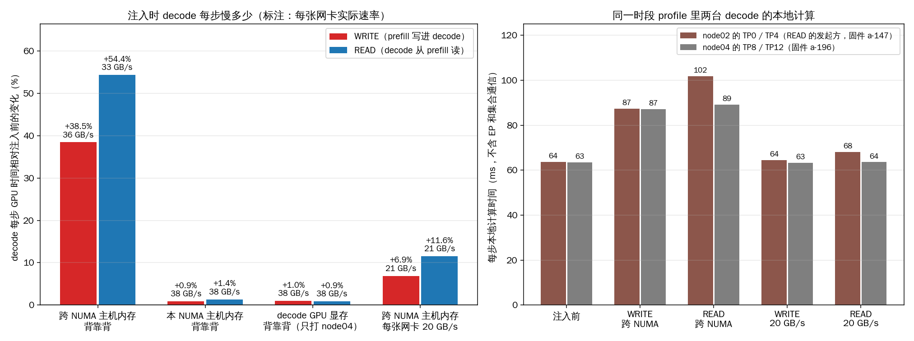

# K3.1 PD 第二轮：RDMA READ 和 WRITE 对 EP 的影响

第一轮文档：[k31_agentx_ep_kv_umbp_zh.md](k31_agentx_ep_kv_umbp_zh.md)。第一轮的 IO（KV 传输、注入的流量）全是 RDMA WRITE；Moonshot 跑端到端时 PD 传输一般用 RDMA READ（decode 去 prefill 那里读 KV），所以这一轮把 READ 加进来，单测和端到端注入都重做，并把第一轮找到的配置问题合在一起跑一个配置。机器、镜像、模型和第一轮相同：DO MI355X fabric3（rail-only，ionic AINIC 400G），2P1D，prefill node01 / node03，decode node02 + node04（EP16，MoRI EPv2）。

## 这一轮做了什么

- **READ 能不能用**（第 1 节）：先确认 MoRI IO 的 READ 在这套网络上读回来的数据对不对。
- **单测**（第 2 节）：EP16 旁边一直跑 MoRI IO，READ 和 WRITE 各三种摆法（IO 在两台 EP 节点之间；从 EP 节点发往第三台；从第三台进 EP 节点），看 EP 每次 dispatch / combine 慢多少、为什么。
- **端到端**（第 3–5 节）：一个汇总了所有修正的 decode 配置（含 `SGLANG_MORI_MOE_MAX_INPUT_TOKENS`），以及它的正确性；在这个配置上把 READ 和 WRITE 注入放在同一次跑里比较（合成负载）；在第一轮的 d1024 配置上跑一次 AgentX（256 路），前 30 分钟重做自然流量分析，后半段做 READ / WRITE 注入（第 5 节）。
- **跨 NUMA 的补充**（第 6 节）：几张网卡、多大速率才会触发；READ 是不是一样；decode 里被堵 GPU 上的小内核为什么变慢。

## 结论

先说端到端（第 3–6 节），再说 READ 的正确性和单测（第 1–2 节）。

- **`SGLANG_MORI_MOE_MAX_INPUT_TOKENS=2048` 值得加**：decode 每步 114 → 88 ms（−23%），MoE 专家 GEMM / 排序 44 → 25 ms；输出质量没有变化（第 3.1 节）。第 4 节的合成负载注入在"dispatch 上限 1024 + MoE 输入上限 2048"上跑；第 5 节的 AgentX 和 6.4 节的 decode 验证用第一轮的 d1024 配置（不设 MoE 输入上限）。
- **KV 的正常路径（写进 decode GPU 显存）用 READ 还是 WRITE，对 decode 都几乎没有影响**：每张网卡 38 GB/s 背靠背注入，decode 每步只慢约 1%；写进本 NUMA 的主机内存也一样（第 4 节）。
- **写进另一个 NUMA 的主机内存仍然最伤，而且 READ 比 WRITE 更重**：背靠背 +54%（WRITE +39%），每张网卡 20 GB/s 时 +12%（WRITE +7%）；多出来的集中在 node02（READ 的发起方、a-147 固件）（第 4 节）。
- **跨 NUMA 为什么让 decode 变慢，找到了**（第 6 节）：
  - 触发条件是同一颗 CPU 下的 4 张网卡一起往另一颗 CPU 写（合计约 145 GB/s），1–3 张不触发；READ 和 WRITE 一样；限速后是"开关式"的。这是这台机器上"PCIe 设备往另一颗 CPU 的内存写"每个方向约 150 GB/s 的上限，GPU 的 D2H 拷贝也一样被卡在约 153 GB/s；需求超过它，多出来的写就堵在这些设备的根端口里，和它们共用根端口的 GPU 往主机方向的读写要多等 10–15 µs。
  - decode 会被放大，是因为它每一步都有一条 stream 在 GPU 上等另一条 stream：有新请求并入时，调度 stream 要等这一步前向跑完（`disaggregation/decode.py` 里的 `schedule_stream.wait_stream(forward_stream)`）。我们的理解是：整步前向期间，GPU 的命令处理器要反复去主机内存读这条等待的信号，每次读都被拥塞拖慢，前向 stream 上的每个小内核也跟着等（从合成测试推断，见 6.4 节）。
  - 合成测试加上同样一条等待就复现出来（只在被堵的 GPU 上，小内核每个 +2–5 µs），去掉就没有。之前怀疑的 CUDA graph、命令队列位置、系统范围的屏障、peer access、GPU 往网卡的流量都不是原因。
  - 在真实 decode 里关掉重叠调度（`--disable-overlap-schedule`，这条等待随之消失），背靠背拥塞时每步的变慢从 +22.8% 降到 +8.9%（READ 注入）、+17.5% 降到 +6.5%（WRITE 注入），约去掉六成；不拥塞时每步仍是 114 ms，没有损失。
  - 剩下约四成是 EP 本身：被堵 GPU 的 EP 数据走的正是被堵的那几张网卡，不开 profiler 的单测里每轮 EP 多约 80 µs（其中约八成是跨插槽造成的，同样速率写本 NUMA 只多 19 µs），按每步 92 轮约 7.9 ms，decode 实测 7.3 ms。小内核本身在没有跨 stream 等待时不变慢。
  - 合起来：WRITE 注入时每步 +19.9 ms ≈ 跨 stream 等待 12.6 ms + EP 7.3 ms；READ 注入 +26.0 ms ≈ 16.0 + 10.0 ms。trace 里"每个小内核多十几 µs"偏大，是 profiler 放大的。
  - 避开的办法：RDMA 主机缓冲放在网卡所在的 NUMA 上（不触发拥塞），GPU 往主机卸载数据的锁页缓冲也一样；在这套配置上，合成负载下 `--disable-overlap-schedule` 不花代价（AgentX 下没测）；sglang 侧可以让 decode 并入新请求时不在 GPU 上挂着等前向。
- **AgentX 上的结果**（第 5 节，第一轮的 d1024 配置，不设 MoE 输入上限）：
  - decode 每步 p50 从第一轮的 217 ms 降到 114 ms，输出 2,705 tok/s（第一轮同一窗口 2,321），ITL p50 34 ms（第一轮 68 ms）。
  - KV 流入的量和突发形态和第一轮一样（每台均值 2.0–2.5 GB/s，100 ms p99 62 GB/s），对 decode 步的影响仍然很小：KV 流入 20–100 GB/s 的步慢 0.25%–0.5%（第一轮 ≤ 0.2%），超过 100 GB/s 的 26 步慢 2.3%。
  - 注入：写进 decode GPU 显存时 READ 和 WRITE 都在 ±1% 以内，EP 单次耗时不变；本 NUMA ≤ +3.3%；另一个 NUMA 背靠背 +20%～+32%；每张网卡 20 GB/s 时 READ +9%～+13%、WRITE +1%～+5%。
- **更正：这一轮前面几次 AgentX 没跑完，不是"decode 死锁"**（第 5.3 节）：
  - 之前写的"AgentX 一开始 decode 就死锁、六次都没跑成、和 MoE 输入上限无关"是我判断错了。AgentX 的预热请求都是 `max_tokens=1`，decode 在 40 多分钟的预热里本来就不跑解码步；我把"每步耗时的 probe 不涨、各 rank 停在不同的集合通信上"当成了死锁，其实是正常的空转。
  - 两次正常的运行（其中一次带 MoE 输入上限）是被我自己停掉的。真正的问题是 prefill 两次 GPU 卡死，以及之后那个 decode 实例收不进 KV。

READ 的正确性和单测：

1. **node02 上，RDMA READ 读进 GPU 显存会悄悄丢数据**：完成状态是成功，网卡也收到了全部字节，但 GPU 显存里一个字节都没变（GPU 的 PCIe 上根本没有这些数据）；读进主机内存、以及所有的 WRITE 都正确。只有 node02 当发起方时这样，node02 是四台里唯一的网卡固件 1.117.5-a-147，其余是 a-196；第一轮单测里 READ 过不了 benchmark 自己的数据校验，发起方 node06 也是 a-147。用 READ 做 PD 传输的部署，a-147 的节点需要先升级固件，并且要有数据校验。
2. **单测：READ 对 EP 的影响比 WRITE 小，而且越是"第三台往 EP 节点送数据"，差得越多**：IO 跑满 8 条 rail 时，K3.1 decode 形状的 dispatch 平均变慢——2 机（IO 在两台 EP 节点之间）：WRITE +56%、READ +26%；IO 数据从 EP 节点流向第三台（EP 节点发送；WRITE 是 EP 节点写第三台，READ 是第三台读 EP 节点）：WRITE +51%、READ +15%；IO 数据从第三台流进 EP 节点（EP 节点接收，就是 prefill 往 decode 送 KV 的摆法）：WRITE +218%、READ +40%。
3. **原因是 WRITE 推、READ 拉**：WRITE 由发送方按线速推，接收方网卡来不及把数据写进显存就发 PFC，交换机里朝接收方的队列一直很深；READ 由接收方（请求方）发读请求，同时在途的数据有上限，不会把自己灌满，8 对 rail 的 READ 场景里一次 PFC 都没有。
4. **2 机和 3 机不同，是因为 IO 和 EP 在不同的地方相遇**：2 机时 IO 和 EP 从同一张网卡发出，接收方一暂停，交换机就把这张网卡整个停下；3 机接收侧时 IO 从第三台来、EP 从另一台 EP 节点来，两路在交换机朝接收方的出口汇合，EP 包排在 IO 后面（按多出来的时间估算，前面排着约 4–7 MB）。
5. **接收侧 WRITE 的结果因机器而异，原因没查清**：同样的脚本和参数，第一轮在 06/07/08 上 1 对 rail 只慢 9%、KV 形状慢 6%，这一轮在 01/03/04 上是 132%、24%；发送侧和 2 机两轮一致。PFC 计数解释不了这个差别（2.5 节）。而端到端里同样的 KV 形状写入（每张网卡 38 GB/s 写进 node04 显存，第 4 节 W3），decode 的 EP 单次耗时没有变化。
6. **单测的影响比端到端大得多，是因为单测里 EP 背靠背地跑**（2.7 节）：换成端到端的机器（02 + 04 跑 EP、IO 从 01 进来），单测结果不变；让 EP 按 decode 的节奏跑（每轮之间插约 1.1 ms 的计算），KV 形状的 IO 让 B 侧 dispatch 的变化从 +34% 变成 −6%～+1%，combine +11%～+16%，和端到端一致。背靠背时 EP 自己一直占着链路，加上 IO 以后交换机朝接收方的队列一直很深；decode 里 EP 只是偶尔来一阵，队列来得及排空。

## 1. RDMA READ 在这套网络上读回来的数据对不对

第一轮单测里，mori IO benchmark 的 READ 在跑之前的数据校验就失败了，当时改用 WRITE，没有查原因。这一轮用专门的检查（`bench/io_rwcheck.py`）：被动方把缓冲填上已知的字节，发起方先把自己的缓冲填成另一个固定值（0xA5），READ 回来后逐字节比较；完成后立刻比一次，100 ms 后再比一次；再让被动方确认源数据没被改。段大小 4 KB–16 MB、一批 1–8,192 段、连续或隔一段，READ 和 WRITE 都测。

| 发起方（读进哪里） | 被动方（数据从哪里来） | READ 结果 | WRITE 结果 |
|---|---|---|---|
| node02 GPU 0 显存 | node01 / node03 GPU 显存，或 node01 主机内存 | **全部没写进去**：100 ms 后仍是 0xA5，整块 600 MB 缓冲一个字节都没变 | 正确 |
| node02 GPU 4 显存 | node04 GPU 4 显存 | **同上** | 正确 |
| node02 主机内存 | node01 GPU 显存或主机内存 | 正确 | — |
| node01 / node03 / node04 GPU 显存 | node02 / node03 / node04 的 GPU 显存 | 正确 | 正确 |

- READ 读进 node02 GPU 显存时，发起方网卡收到的字节数和请求的一样（18.2 MB / 4,450 个包），网卡计数器里没有任何错误；同一时刻 node02 GPU 0 的 PCIe 带宽（`amd-smi`）是 61 Mb/s，和空闲时一样，而同样速率的 WRITE 写进这张卡时是约 380 Gb/s。也就是说数据到了网卡，但没有经过 PCIe 送进 GPU。guest 里看不到 IOMMU 的报错（IOMMU 在宿主机上），也没有 ionic / amdgpu 的报错。
- 换成 dmabuf 注册显存（`MORI_ENABLE_DMABUF_REG=1`）、打开 relaxed ordering、打开 CCQE，结果都一样。
- 四台机器里只有 node02 的网卡固件是 1.117.5-a-147（node01 / node03 / node04 是 a-196）；第一轮单测 READ 校验失败时的发起方 node06 也是 a-147（第一轮记录的固件：02 / 05 / 06 / 08 是 a-147）。所以很可能是 a-147 固件的问题，需要网卡组确认。
- **对后面实验的影响**：单测改在 01 / 03 / 04 上跑（都是 a-196）；端到端里凡是"READ 读进 decode GPU 显存"的注入只打 node04，读进主机内存的照常打两台 decode。sglang 的 MoRI PD 传输只用 WRITE（prefill 往 decode 写，没有 READ 模式），所以端到端的 KV 传输本身还是 WRITE。

## 2. 单测：EP16 旁边一直跑 MoRI IO（READ / WRITE）

### 2.1 怎么测

- **EP**：mori 自带的 EPv2 跨机用例（`test_dispatch_combine_v2_internode.py --cmd bench`），node03（A）+ node04（B）共 16 卡，`v2_ll`。两种形状：K3.1 decode 形状（每卡 48 token、hidden 3584、每卡 56 个专家、top-16、bf16、8 个 QP）和 mori 默认形状（128 token、hidden 7168、top-8）。每次 2,000 轮，每个场景 2 次；看所有（轮，rank）样本的平均，并按 rank 所在的节点（A 的 rank 0–7、B 的 rank 8–15）拆开。
- **IO**：mori 自带的 IO benchmark（`tests/python/io/benchmark.py`，用户 `io.sh` 的参数：批量 + session，每次 32 KB，一批 8,192 个），READ 和 WRITE 都是 GPU 显存到 GPU 显存，8 对 rail 或只用 rail 0；另外用端到端注入的 `io_inject.py`（每批 233 段 × 72 KB，背靠背）做 KV 形状。第三台 C 是 node01。EP 和 IO 都在 TC 104（同一个优先级）。
- 三种摆法（图 1，箭头是数据流向；READ 的数据从被读的一方流向发起方）：
  - **2 机**：IO 在 A 和 B 之间。WRITE 是 A 写 B；READ 是 A 读 B（数据从 B 流到 A）。
  - **3 机发送侧**：IO 数据从 A 流到 C。WRITE 是 A 写 C（A 是请求方）；READ 是 C 读 A（A 是响应方，回 READ 响应）。
  - **3 机接收侧**：IO 数据从 C 流进 B。WRITE 是 C 写 B；READ 是 B 读 C。**这是 PD 里 prefill 给 decode 送 KV 的摆法**（WRITE：prefill 推；READ：decode 拉）。

### 2.2 结果

**怎么看**：每组柱子是一种摆法和 IO 规模；红色是 WRITE、蓝色是 READ，深色是 dispatch、浅色是 combine；纵轴是单次耗时相对无 IO 时的变化。柱子上标了"PFC"的，是场景期间有网卡持续发出暂停帧。无 IO 时 K3.1 形状 dispatch 平均 63 µs、combine 52 µs（场景前后各测一次，两次相差不到 1%）。

**说明了什么**：
- **每种摆法下 READ 都比 WRITE 轻**，差得最多的是 3 机接收侧：8 对 rail 时 WRITE +218%、READ +40%；只用 1 对 rail 时 WRITE +132%、READ +46%。
- **用 mori IO benchmark 的 READ 一次 PFC 都没有**；WRITE 在每种摆法下都有接收方持续发暂停。
- **KV 形状的 IO 影响小得多，READ 和 WRITE 也差不多**（接收侧 +23% / +24%）：每批 16 MB 发完要等完成再发下一批，中间有空档，交换机里的队列能排空；这时 READ 的接收方也会发 PFC（每批 233 段同时在途，量大）。

K3.1 decode 形状的完整数字（µs，括号里是相对无 IO 的变化；"A 侧 / B 侧"是按 rank 所在节点拆开的平均）：

| 摆法 | IO | 实际速率（GB/s） | dispatch | A 侧 / B 侧 | combine | A 侧 / B 侧 | PFC（谁发出暂停 / 谁被暂停） |
|---|---|---|---|---|---|---|---|
| 无 IO | — | — | 63.3 | 56.6 / 70.0 | 51.8 | 58.5 / 45.2 | 无 |
| 2 机 | A 写 B，8 对 | 354 | 98.6（+56%） | +61% / +51% | 70.4（+36%） | +34% / +38% | B 发 82 ms / A 被停 90 ms |
| 2 机 | A 读 B，8 对 | 352 | 79.9（+26%） | **+69%** / −9% | 63.9（+23%） | −19% / **+78%** | 无 |
| 发送侧 | A 写 C，8 对 | 355 | 95.4（+51%） | +59% / +44% | 67.7（+30%） | +24% / +39% | C 发 84 ms / A 被停 87 ms |
| 发送侧 | C 读 A，8 对 | 353 | 72.7（+15%） | −2% / **+28%** | 57.9（+12%） | **+27%** / −9% | 无 |
| 接收侧 | C 写 B，8 对 | 355 | **201.0（+218%）** | +208% / +225% | **156.1（+201%）** | +214% / +184% | B 发 93 ms / C 被停 671 ms，A 没被停 |
| 接收侧 | B 读 C，8 对 | 352 | 88.7（+40%） | +41% / +39% | 70.0（+35%） | +36% / +34% | 无 |
| 2 机 | A 写 B，1 对 | 44 | 92.6（+46%） | +33% / +57% | 61.6（+19%） | +35% / −3% | B 发 5 ms / A 被停 4 ms |
| 2 机 | A 读 B，1 对 | 44 | 80.2（+27%） | +36% / +19% | 54.5（+5%） | −2% / +14% | 无 |
| 发送侧 | A 写 C，1 对 | 44 | 90.8（+43%） | +28% / +56% | 61.2（+18%） | +36% / −5% | C 发 9 ms / A 被停 11 ms |
| 发送侧 | C 读 A，1 对 | 44 | 69.6（+10%） | −4% / +21% | 57.9（+12%） | +25% / −6% | 无 |
| 接收侧 | C 写 B，1 对 | 44 | **146.8（+132%）** | +110% / +150% | **109.9（+112%）** | +136% / +81% | B 发 6 ms / C 被停 5 ms |
| 接收侧 | B 读 C，1 对 | 44 | 92.2（+46%） | +46% / +46% | 57.0（+10%） | +14% / +5% | 无 |
| 发送侧 | A 写 C，KV 形状 | 326 | 94.8（+50%） | +56% / +44% | 66.2（+28%） | +23% / +33% | C 发 42 ms |
| 发送侧 | C 读 A，KV 形状 | 326 | 78.1（+23%） | +20% / +26% | 60.3（+16%） | +20% / +12% | C 发 30 ms |
| 接收侧 | C 写 B，KV 形状 | 328 | 78.4（+24%） | +12% / +33% | 63.1（+22%） | +35% / +5% | B 发 19 ms |
| 接收侧 | B 读 C，KV 形状 | 324 | 78.1（+23%） | +11% / +33% | 65.0（+25%） | +38% / +8% | B 发 31 ms |

- 发送侧 WRITE（A 写 C，8 对）这一场，A 重传了 697 万个包、ACK 超时 533 次。多半是发往 C 的 IO 包在路上丢了、A 重发（C 同时在发 PFC，说明它收不过来；丢在哪一段看不到）；EP 的 p99 没有暴涨（127 µs），EP 的包没有受到丢包影响。其余场景都没有重传。
- mori 默认形状的变化方向一样、幅度更大：2 机 WRITE dispatch +119%（一年前的单测是约 2.1 倍，对得上）、READ +34%；发送侧 WRITE +118%、READ +15%；接收侧 WRITE +316%、READ +57%。

### 2.3 为什么 READ 比 WRITE 轻

- **WRITE 是发送方推**：发送方的网卡按线速往外发，不管对面收不收得动。这套机器上，网卡把收到的数据写进 GPU 显存的速度跟不上约 44 GB/s 的连续写入：发送侧 WRITE 里第三台 C 只收 IO、没有任何 EP，也发出了 84 ms 的暂停。接收方网卡的缓冲一满就发 PFC，让交换机停发；交换机自己的缓冲再满，就去暂停它的来源。所以 WRITE 的场景里，接收方一直在发暂停，交换机里朝接收方的队列一直是满的。
- **READ 是接收方拉**：接收方（请求方）发读请求，对面按请求回数据；同时在途的读请求有上限，回来的数据不会超过接收方能接住的量。mori IO benchmark 的 READ 场景里，没有任何网卡发出暂停。
- **所以 READ 对 EP 的影响只剩"发送端抢"和"有上限的排队"**：发送侧 READ（+10%～+15%）比 WRITE（+43%～+51%）轻，是因为响应方回数据的节奏由对面的读请求决定，发送端不是一直被 IO 占满；接收侧 READ（+40%～+46%）比 WRITE（+132%～+218%）轻，是因为朝 B 的出口队列有上限，按多出来的时间估算前面约排着 1.3–1.5 MB，WRITE 时是 4–7 MB。
- **在途量大的 READ 一样会灌满接收方**：KV 形状的 READ（每批 233 段 × 72 KB 一次性发出）在接收侧和发送侧都出现了 PFC，这时 READ 和 WRITE 对 EP 的影响差不多（+23% / +24%）。

### 2.4 为什么 2 机和 3 机不一样

关键是 EP 和 IO 在哪里相遇（图 1 的星号），以及暂停落在谁身上：

- **2 机**：IO 和"发往 IO 接收方的 EP"从同一张网卡发出。WRITE 时，接收方 B 一发暂停，交换机就把 A 整个停下（A 被停了 90 ms），A 的 IO 和 EP 一起等；交换机里攒的主要是 A 自己按比例混着发出的包，EP 前面排的 IO 不多。所以 2 机 WRITE（+56%）比 3 机接收侧 WRITE（+218%）轻得多。READ 时 B 的网卡忙着回响应，受影响的是 B 发出的 EP：A 侧 rank 的 dispatch 慢 69%（它们在等 B 发来的 token），B 侧 rank 的 combine 慢 78%（它们要把结果经 B 的网卡发回 A）；反方向的 EP 不受影响（B 侧 dispatch −9%，A 侧 combine −19%）。
- **3 机发送侧**：只在 A 的网卡发送端相遇，A 发往 B 的 EP 排在 IO 后面。READ 时 A 是响应方，回数据的节奏跟着 C 的读请求走，所以只慢 15%。
- **3 机接收侧**：IO 从 C 来、EP 从 A 来，两路在交换机朝 B 的出口队列里汇合（多对一）。B 收不过来时，交换机只会暂停自己入口缓冲超过阈值的那一路——C 的量大，被暂停了 671 ms；A 的 EP 量小，从来没被暂停，但它的包排在攒起来的 C 的 IO 后面。所以这是 WRITE 最重的摆法，A 侧和 B 侧的 rank 一起慢 2 倍多（每次 EP 都要等最慢的那条 rail）。READ 时队列有上限，只慢 40%。
- **1 对 rail 也慢这么多**：只有 rail 0 有 IO 时，只有 rail 0 上的 EP 包要排队；但每次 dispatch / combine 都要等 16 个 rank 全部收齐，最慢的那条 rail 决定整次的时间，所以 1 对 rail（+46%～+132%）和 8 对 rail（+56%～+218%）差得不多。

### 2.5 和第一轮单测（06 / 07 / 08）的差别

发送侧和 2 机的结果和第一轮一致（发送侧 1 对 WRITE 两轮都是 +43%；KV 形状发送侧 +52% / +50%；2 机 8 对 WRITE +64% / +56%），差别只在接收侧 WRITE：第一轮 1 对 +9%、KV 形状 +6%，这一轮 +132%、+24%。脚本、mori 版本和参数都相同，换的是机器（第一轮 EP 在 06 + 07、第三台 08；这一轮 EP 在 03 + 04、第三台 01）。

| 接收侧 WRITE | 场景时长 | EP 节点 B 发出的暂停 | IO 来源 C 被暂停（占时间） | dispatch |
|---|---|---|---|---|
| 第一轮 1 对（08 写 07） | 106 s | 12 ms | 328 ms（0.31%） | +9% |
| 第一轮 KV 形状，8 条 rail（08 写 07） | 109 s | 38 ms | 0 | +6% |
| 这一轮 1 对（01 写 04） | 88 s | 6 ms | 5 ms（0.005%） | +132% |
| 这一轮 KV 形状，8 条 rail（01 写 04） | 82 s | 19 ms | 0 | +24% |
| 这一轮 8 对（01 写 04） | 117 s | 93 ms | 671 ms（8 条链路合计，0.57%） | +218% |

PFC 解释不了这个差别：KV 形状的两场里 IO 来源都完全没被暂停，EP 却分别慢 6% 和 24%；这一轮 8 对时 IO 来源被暂停得比第一轮还多，EP 慢得最多。差别在哪一层（交换机端口的缓冲、接收方网卡把数据写进显存的速度、还是别的）还没查清。要确认是哪台机器或哪个端口带来的，可以在 01 / 03 / 04 上轮换 A、B、C 的角色重跑接收侧，或者回到 06 / 07 / 08 上重跑。

对 PD 来说更要紧的是端到端：第 4 节 W3 用同样的 KV 形状、每张网卡 38 GB/s 背靠背写进 node04 的 GPU 显存，decode 每步只慢 1.0%，profile 里 EP 单次耗时也没变（TP8 dispatch 79 µs、combine 89 µs，注入前 78 / 89 µs）。单测里 EP 是一轮接一轮背靠背地跑，真实 decode 里 EP 夹在计算之间、每步只占约 19%，这一轮的机器上接收侧 WRITE 对真实 decode 的影响仍然很小。

### 2.6 对 PD 意味着什么

- PD 的 KV 传输是"3 机接收侧"：prefill 往 decode 送 KV，decode 之间跑 EP。单测里 WRITE（sglang 现在的做法）在 KV 持续接近线速时最伤 EP；READ（Moonshot 的做法）在同样的速率下轻得多，前提是 decode 同时在途的读请求不要太多。但单测是 EP 背靠背连续跑的最坏情况：端到端里 KV 形状的 WRITE 以每张网卡 38 GB/s 写进 decode 显存，decode 只慢 1%，EP 单次耗时没变（第 4 节 W3）；单测里让 EP 按 decode 的节奏跑，同样的 IO 对 dispatch 也就看不出来了（2.7 节）。
- 端到端里 KV 平均每张网卡只有 0.2–0.7 GB/s，大部分时间远低于线速，所以第一轮端到端看到的影响很小；但 KV 是按 16 MB 左右一批、线速发的，每一批持续的那几百微秒里，朝 decode 的队列会像单测一样涨起来，正好碰上的那几次 EP 会变慢。

### 2.7 补测：为什么单测里接收侧影响很大，端到端却看不出来

端到端里（第 4、5 节）KV 形状的 IO 以每张网卡 38 GB/s 写进 node04 的显存，decode 每步只变化 ±1%，node04 上 EP 的单次耗时也几乎不变（dispatch 64 → 68 µs）；而 2.2 节的单测里，同样形状、差不多速率的 IO 从第三台流进 EP 节点，接收 IO 那一侧（B 侧）的 dispatch 慢 33%。两边有两处不同：机器不一样（单测的 EP 在 03 + 04，端到端的 decode 是 02 + 04）；单测里 EP 一轮接一轮背靠背地跑，decode 里每层只有一次 dispatch + combine，其余约九成时间在算。分两步去掉（`microbench/run/mb_e2e7.sh`）：

1. **换成端到端的机器**（c7_e2e：EP16 在 02 + 04，IO 从 prefill 节点 01 流进 04，其余和 2.2 节相同）：结果和 2.2 节几乎一样，KV 形状的 WRITE / READ 时 B 侧 dispatch 都 +34%（2.2 节 +33%），1 对 WRITE +133%（+132%），8 对 WRITE +223%（+218%），作参照的 2 机、发送侧 1 对是 +48%、+47%（+46%、+43%）。所以和机器无关。
2. **再让 EP 按 decode 的节奏跑**（c7_duty）：每次 combine 之后插 20 个各写 16 MB 的 GEMM（约 1.1 ms，不计入 EP 的计时），EP 只占约十分之一的时间。

| 从 01 流进 04 的 IO | B 侧 dispatch：背靠背 → 按 decode 节奏 | 按 decode 节奏的 combine（A 侧 / B 侧） |
|---|---|---|
| KV 形状 WRITE（每卡约 40 GB/s） | +34% → −6% | +16% / +11% |
| KV 形状 READ | +34% → +1% | +16% / +11% |
| 1 对 WRITE（44 GB/s） | +149% → +7% | +26% / +9% |
| 8 对 WRITE（每卡约 44 GB/s，接近线速） | +229% → +13% | +50% / +40% |

两次无 IO 基线之间相差约 ±8%。

- **按 decode 的节奏，KV 形状的 IO 对 dispatch 已经看不出来，combine 多 11%–16%**，和端到端（EP 单次耗时 ±6%，decode 每步 ±1%）是同一个量级。
- **原因是背靠背时 EP 自己把链路也占着**：EP 一直在往接收方送数据（每张网卡几 GB/s），加上 IO 以后，交换机朝接收方的出口一直接近满载、队列一直很深，每个 EP 包都排在后面。按 decode 的节奏，EP 只是偶尔来一阵，两阵之间队列来得及排空；IO 本身（每卡约 40 GB/s）不到线速，EP 只碰到一个浅队列。IO 接近线速时（8 对 WRITE）队列排不空，按 decode 节奏也还有 +13% / +40%–50%。
- 按 decode 节奏时 dispatch 比 combine 受影响小：各 rank 做完本地计算的时间相差约 100 µs，dispatch 要等最慢的 rank，网络多出来的十几 µs 被这段等待盖住；combine 开始时各 rank 已经对齐，网络延迟直接显出来。
- **所以 2.2 节的单测（以及第一轮的单测）测的是"EP 一直在跑"的最坏情况**：适合比较不同摆法之间的相对轻重，不能直接拿来估 decode 慢多少。估 decode 要看端到端，或者按 decode 节奏的单测。
- 另外两组最后一个基线（都紧跟在 node04 发起的 KV 形状 READ 之后）各出现过一次单轮的长时间卡顿（一次 combine 卡了约 80 s，一次 dispatch 74 ms），其余轮正常；上表没有用这两个基线，原因没查。

## 3. 端到端：decode 配置

### 3.1 `SGLANG_MORI_MOE_MAX_INPUT_TOKENS=2048`

第一轮修正了 `SGLANG_MORI_NUM_MAX_DISPATCH_TOKENS_PER_RANK=1024`（接收缓冲从 65,536 行降到 16,384 行），但 DCP8 下 sglang 算不出每个 rank 实际收到多少行，MoE 仍然按整个接收缓冲（16,384 行）来算。`SGLANG_MORI_MOE_MAX_INPUT_TOKENS` 直接给 MoE 的输入行数设上限（`moriep.py` 里取 `min(上限, 接收缓冲行数)`，传输层的接收缓冲不变，所以 EPv2 初始化日志里仍是 `recv_cap=16384`）。它必须不小于每个 rank 实际收到的最大行数：我们的 decode 最多每组 136 个请求 × 6 个验证 token × 2 组 = 1,632 行，所以 2048 够用。数值来自本地 sglang 仓库 MI355X 2P1D EP16 的配方。

**正确性**：同一组请求（16 个文本问题 + 8 个 1,000–2,750 token 的长输入，temperature 0，每个生成 48 个 token，带 decode 给输出 token 的 logprob），每种配置串行跑两遍、24 路并发跑一遍。这套部署本身不确定（decode 开着模拟接受 `SGLANG_SIMULATE_ACC_LEN=3.25`，接受多少个 draft token 是随机的），同一配置跑两遍，24 个里也有 22 个在第 0–18 个 token 处分叉，所以不能要求逐 token 一致；改看 decode 给自己输出的 logprob——如果上限截掉了某些行，那些 token 的专家输出就没了，logprob 会整体变低、文字会乱：

| 配置 | 平均 logprob（3 次） | logprob < −5 的 token 占比 | 文本问题都答了 |
|---|---|---|---|
| 不设上限 | −1.42 / −1.44 / −1.17 | 8.1% / 9.3% / 6.8% | 是 |
| 上限 2048 | −1.43 / −1.27 / −1.44 | 9.1% / 7.2% / 8.9% | 是 |

两种配置在同一个范围里，和"不设上限"自己跑两遍的差别一样大，输出文字正常（例如 "The capital of France is" → " Paris."）。

**性能**（`load_gen.py` 128 路合成请求，输入 3,000 token、输出 600 token；step probe 的每步 GPU 时间，以及 profile 里每步的内核时间）：

| | 不设上限 | 上限 2048 |
|---|---|---|
| 每步 GPU 时间 | 114.0 ms | **88.0 ms（−23%）** |
| 每步内核时间 | 116.0 ms | 87.8 ms |
| 其中 MoE 专家 GEMM / 排序 | 44.2 ms | 25.1 ms |
| 其中 fp8 量化 | 9.8 ms | 3.0 ms |
| EP（dispatch + combine + 其他） | 17.4 ms（15%） | 16.3 ms（19%） |

### 3.2 这一轮的端到端配置

在第一轮最后的配置上加 `SGLANG_MORI_MOE_MAX_INPUT_TOKENS=2048`，其余不变：

- decode：`SGLANG_ROCM_RUNTIME_RESERVE_GB=24 SGLANG_MORI_NUM_MAX_DISPATCH_TOKENS_PER_RANK=1024 SGLANG_MORI_MOE_MAX_INPUT_TOKENS=2048`，MoRI EPv2 跨机，TC 104。
- PD 传输：仍是 sglang MoRI 连接器的 RDMA WRITE（prefill 写 decode 的 GPU 显存）。它没有 READ 模式；而且 node02 上 READ 进 GPU 显存会丢数据（第 1 节），改成 READ 也没法在这里验证。
- 试过但没有放进来的：`HSA_ALLOCATE_QUEUE_DEV_MEM=1`（命令队列放显存，对跨 NUMA 没有帮助，见第 6 节）。
- 第 5 节的 AgentX 和 6.4 节的验证没有用这个配置，而是第一轮的 d1024 配置（不设 MoE 输入上限），原因见第 5 节开头。
- 没有改的：UMBP 的 DRAM 层按默认分在两个 NUMA 上（`UMBP_DRAM_NUMA_NODE` 可以指定，但它只是平均分到各节点，不会按发起的 GPU 选近的那个）；UMBP 的实际流量每张网卡只有 0.2–0.7 GB/s，碰不到第 6 节的触发条件。

## 4. 端到端：READ 和 WRITE 注入（合成负载）

**怎么测**：3.2 节的配置；`load_gen.py` 128 路并发（输入 3,000 token、输出 600 token）；两台 prefill 往两台 decode 注入 KV 形状的流量（node01 → node02、node03 → node04，GPU i ↔ GPU i，8 张网卡都打，TC 104），每个时段 60 s、间隔 60 s。WRITE 是 prefill 写进 decode；READ 是 decode 从 prefill 的 GPU 显存读。数据落到 decode 的哪里有四种：另一个 NUMA 的主机内存、网卡所在 NUMA 的主机内存、decode 的 GPU 显存（只打 node04，原因见第 1 节）、另一个 NUMA 的主机内存但每张网卡限 20 GB/s。每步耗时取 step probe 的中位数（时段开始后 5–55 s），和第一个时段之前的 50 s 比；每个时段开始后 25 s 抓一次 decode 的 profile。脚本 `run/k31_r22_lg_rw.sh`，分析 `tools/k31_lgrw_analyze.py`。

**怎么看**：左图每组是一种落点，红色 WRITE、蓝色 READ，柱上标了 decode 每步变慢多少和每张网卡实际跑到的速率；右图是同一时段 profile 里两台 decode 每步的本地计算时间（不含 EP 和集合通信）。

**说明了什么**：
- **KV 的正常路径（写进 GPU 显存）和本 NUMA 主机内存，READ 和 WRITE 都只慢约 1%**，两者没有差别。
- **写进另一个 NUMA 的主机内存时 READ 更重**：背靠背 +54%（WRITE +39%），每张网卡 20 GB/s 时 +12%（WRITE +7%）。多出来的几乎都在 node02：READ 时 node02 的 TP0 / TP4 本地计算每步 101–103 ms，WRITE 时 85–90 ms；node04 两种都是 87–90 ms。node02 是 READ 的发起方，也是唯一的 a-147 固件（第 1 节），可能和这个固件下 READ 响应写主机内存的方式有关，没有单独验证。
- 这里两台 decode 的 8 张网卡都在跨 NUMA（两颗 CPU 互相写），所以所有 GPU 都被拖慢；第一轮 d1 和第 6.2 节只打了网卡 4–7。

| 时段 | 方式 | 落点 | 每张网卡 GB/s | 每步 ms（DP0 / DP1） | 变化 | 单次 dispatch / combine（TP0，µs） |
|---|---|---|---|---|---|---|
| 注入前 | — | — | — | 87.8 / 87.9 | — | 78 / 96 |
| W1 | WRITE | 另一个 NUMA 的主机内存 | 36.0 | 121.6 / 121.7 | +38.5% | 160 / 161 |
| R1 | READ | 另一个 NUMA 的主机内存 | 33.0 | 135.6 / 135.6 | **+54.4%** | 184 / 170 |
| W2 | WRITE | 本 NUMA 的主机内存 | 37.8 | 88.7 / 88.7 | +0.9% | 88 / 93 |
| R2 | READ | 本 NUMA 的主机内存 | 38.0 | 89.0 / 89.0 | +1.4% | 88 / 94 |
| W3 | WRITE | node04 的 GPU 显存 | 37.9 | 88.7 / 88.7 | +1.0% | 80 / 98 |
| R3 | READ | node04 的 GPU 显存 | 38.1 | 88.7 / 88.6 | +0.9% | 79 / 101 |
| W4 | WRITE | 另一个 NUMA，限 20 GB/s | 20.9 | 93.9 / 93.9 | +6.9% | 72 / 103 |
| R4 | READ | 另一个 NUMA，限 20 GB/s | 20.9 | 98.0 / 98.0 | +11.6% | 70 / 103 |

## 5. 端到端：AgentX

11-19 07:00 起，在第一轮的 d1024 配置上（dispatch 上限 1024，不设 MoE 输入上限，router 用默认健康检查）跑了一次 AgentX（256 路，`run/k31_r23_ctrl.sh`）。没有用 3.2 节带 MoE 输入上限的配置，是因为这一次同时要当对照：按第一轮原样跑，看前几次没跑完到底是机器的问题还是配置的问题（5.3 节）。预热 2648 s 完成、0 个错误（第一轮 2706 s、0 个错误），正式阶段 3600 s：前 1800 s 不注入，用作自然流量；之后 8 个 READ / WRITE 注入时段，落点和速率和第 4 节一样。MoE 输入上限在 AgentX 正式阶段下还没有跑过。

### 5.1 自然流量（正式阶段 300–1780 s，和第一轮第 3 节同样的分析）

| | 第一轮（无 dispatch 上限） | 这一次（dispatch 上限 1024） |
|---|---|---|
| QPS / 输出 tok/s | 2.84 / 2,321 | 3.07 / 2,705 |
| ITL p50 / p90 / p99（ms） | 67.6 / 69.8 / 77.5 | 34.1 / 36.4 / 39.9 |
| TTFT p50 / p90（s） | 34.4 / 106.7 | 45.9 / 112.7 |
| decode 每步 p50 / p90 / p99（ms），每组平均 batch | 217.3 / 225.1 / 231.3，69 | 114.1 / 120.2 / 125.5，41 |
| EP dispatch / combine 每次（µs，负载下的 trace） | 80 / 99 | 63–66 / 76–81 |
| KV 流入每台 decode 均值（GB/s，02 / 04） | 2.25 / 1.89 | 2.53 / 1.98 |
| KV 流入 node02，100 ms p99 / 最大（GB/s） | 56 / 243 | 62 / 199 |
| EP 每台每方向（GB/s） | 2.37 | 2.95 |
| 有 KV 流入（> 1 GB/s）的步 | 31% | 19% |
| KV 突发（node02）次数，突发后 50 ms 流入的 EP 变化 | 855，−0.4% | 321，−0.6% |
| decode 发 PFC（ms，02 / 04）；重传 | 141 / 61（全程 54 分钟）；0–43 包 | 39 / 30（这 25 分钟）；0 |

按"这一步里流入的 KV"分档，decode 步相对同 batch 中位数的残差（DP0，均值 / 中位数）：

| 这一步里 KV 流入 | 第一轮：步数，残差 | 这一次：步数，残差 |
|---|---|---|
| < 0.5 GB/s | 9,814，+0.41% / −0.02% | 10,655，+0.71% / −0.02% |
| 0.5–5 | 3,810，+0.42% / −0.03% | 1,426，+0.98% / +0.07% |
| 5–20 | 848，+0.63% / +0.15% | 751，+0.77% / 0.00% |
| 20–50 | 439，+0.69% / +0.19% | 309，+1.26% / +0.25% |
| 50–100 | 68，+0.49% / +0.18% | 133，+1.50% / +0.50% |
| > 100 | — | 26，+3.28% / +2.34% |

- decode 每步快了将近一半，KV 流入的量和突发形态基本没变，所以同样的 KV 占每步的比例变大了：KV 流入 20–100 GB/s 的步中位数慢 0.25%–0.5%（第一轮 ≤ 0.2%），超过 100 GB/s 的 26 步慢 2.3%。这些步只占全部步的 3.5%，对平均每步的影响仍在 0.1% 量级。
- 线路上同样看不到干扰：KV 突发开始后 50 ms 内，流入同一节点的 EP 流量只变化 −0.6%；全程没有重传。
- TTFT 比第一轮高，是 decode 的 KV 池容量限制（decode 日志里 KV 占用 99%–100%）：吞吐上去以后同时在系统里的请求更多，等 decode 收的时间更长。和 KV 传输对 EP 的影响无关。

### 5.2 READ / WRITE 注入

60 s 一个时段，相邻时段隔 60 s；decode 步的变化按同 batch 中位数归一化（`tools/k31_inject_analyze.py`），EP 单次耗时取自时段中段 node04 上 TP8 的 trace（注入前 dispatch 64 µs、combine 81 µs）：

| 时段 | 方式 | 落点 | 每卡实测 GB/s | decode 每步（node02 组 / node04 组） | TP8 dispatch / combine（µs） |
|---|---|---|---|---|---|
| W1 | WRITE，两台都注入 | 另一个 NUMA，背靠背 | 36.1 | +28.9% / +20.0% | 90 / 109 |
| R1 | READ，只注入 node04 | 另一个 NUMA，背靠背 | 35.4 | +31.7% / +21.6% | 91 / 113 |
| W2 | WRITE，两台 | 本 NUMA，背靠背 | 38.0 | +3.3% / +0.1% | 62 / 86 |
| R2 | READ，只 node04 | 本 NUMA，背靠背 | 38.1 | +1.5% / +1.2% | 64 / 85 |
| W3 | WRITE，只 node04 | node04 的 GPU 显存，背靠背 | 37.8 | −2.6% / −0.6% | 68 / 77 |
| R3 | READ，只 node04 | node04 的 GPU 显存，背靠背 | 38.1 | +0.9% / +1.0% | 62 / 87 |
| W4 | WRITE，两台 | 另一个 NUMA，20 GB/s | 20.9 | +4.9% / +1.2% | 61 / 87 |
| R4 | READ，只 node04 | 另一个 NUMA，20 GB/s | 20.9 | +13.1% / +8.7% | 69 / 102 |

- READ 时被读的一方在 prefill 上。node01 的 prefill 跑了一小时 AgentX 以后，GPU 上连 256 MiB 都分不出来（第一轮文档问题 3 的上限：已分配加注册给网卡的显存不能超过 308.9 GB），所以 R1 / R2 / R4 只有 node03 → node04 这一对，WRITE 时段两对都有。EP16 把两组绑在一起，一台变慢，另一台在 EP 上等它，所以只注入 node04 时两组也都变慢。
- **写进 decode GPU 显存（KV 的正常路径）READ 和 WRITE 都没有影响**：每步在 ±1% 以内，EP 单次耗时和注入前一样。和第 4 节合成负载的结论一致。
- **另一个 NUMA 仍然最重**：背靠背 +20%～+32%，被堵的 node04 本地计算每步 77 → 108–117 ms，node02 在 EP 上等（dispatch 360–396 µs）。原因见 6.4 节。
- **每张网卡 20 GB/s 时 READ 明显比 WRITE 重**：READ 只注入一台就 +9%～+13%，WRITE 注入两台只有 +1%～+5%，和第 4 节（READ +12%、WRITE +7%）方向一致。限速后拥塞是开关式的（6.1 节），READ 进入拥塞状态的时间更多。

### 5.3 前几次 AgentX 为什么没跑完（更正）

这一轮最早写的是"AgentX 一开始 decode 就死锁、六次都没跑成、和 MoE 输入上限无关、同样的配置第一轮能跑这一轮不能跑"。这是我判断错了。

- **误判在哪里**：AgentX 的预热请求都是 `max_tokens=1`（只填缓存），第一个 token 由 prefill 给，decode 在 40 多分钟的预热里本来就不跑解码步。所以"每步耗时的 probe 不涨、`num_running_reqs` 为 0、py-spy 看到各 rank 停在 DP 同步和 KV 传输状态的几个 gloo 集合通信上"都是正常的空转：5.1 节这次正常的运行里，预热期间看到的就是同样的栈，隔两秒再抓位置就变了。
- **逐次复核**：

| 开始 | decode | 实际情况 |
|---|---|---|
| 11-18 20:42 | 带 MoE 上限，新起 | 预热约 28 分钟时 node03 的 prefill GPU 卡死（下面第 1 条） |
| 21:39 | 同一个 decode | 22:12 node01 的 prefill 也卡死；一个根请求失败，AgentX 中止 |
| 22:50 | 同上 | 23:23 router 连续 3 次健康检查超时，把 decode 摘掉，AgentX 中止 |
| 23:37 | 同上 | 这个 decode（20:41 起）在两次 prefill 卡死之后已经收不进 KV：110 多个请求在等 decode 接收 KV，504 次传输失败，一个普通请求 588 s 后返回 502。**这是唯一一次 decode 真的不工作** |
| 11-19 02:05 | 重启后的 decode，带上限 | 5 分钟后被我自己的监视脚本误停（它数的日志每 40 步才打一行） |
| 03:24 | 整套新起，带上限 | **正常**：预热到 04:11 一直 0 个错误、返回 2823 / 2845；我在 03:5x 误判为死锁，04:11 为换配置重启 decode，打断了最后 22 个请求（4 个在途、18 个还没发出，AgentX 记为错误） |
| 04:17 | 第一轮 d1024，不带上限 | **正常**：预热第一阶段 1230 s 返回 280 / 285 个，和第一轮同一时刻（283 / 285）一样；04:37 被我误判后停掉 |

真正的问题是这几条：

1. **prefill 两次 GPU 卡死**（node03 21:10、node01 22:12）：都在 AgentX 预热约 30 分钟、prefill 积压最重的时候（待处理约 1,100–1,200 万 token），某个 rank 的 GPU 停在一个 [28672] × 256 的内核上不返回，CPU 在 indexer 的 `ks.cpu()` 同步处等，300 s 后被 watchdog 杀掉。第一轮和这次的对照里都没有出现，原因没查。
2. **prefill 卡死之后，那个 decode 收不进 KV**：KV 分配平均要等 36.5 s，504 次传输失败。看起来是在途传输的对端死了以后，decode 一直没有释放它们，新请求排在后面；重启 decode 才恢复，具体原因没查。
3. **router 默认健康检查会把忙碌的 decode 摘掉**：decode 的 `/health` 要走一遍调度器，负载重时要等好几分钟；router 默认 5 s 超时、连续 3 次失败就摘掉 decode，之后所有请求返回 503。可以改成 `--health-check-timeout-secs 120 --health-failure-threshold 10 --disable-circuit-breaker`（5.1 节那次用的是默认值，没有触发）。
4. **AgentX 只要有一个根请求在预热里失败，就中止整次运行**。
5. **崩溃后显存没有释放**：node03 的 prefill 崩溃后每张卡仍占着约 20 GB 显存（kfd 里已经没有进程），新起的 prefill 算不出 mamba 状态缓存起不来；删掉容器重建后恢复。
6. **我留下的采样进程**：每次被中止的运行都留下一个 5 ms 的网卡计数采样进程（停的时候脚本路径写错了），到最后每台机器 6–7 个，每个进程每秒往每张网卡的管理队列发 200 个统计命令，合计 1,200–1,400 个；单次统计查询从约 2 ms 变成 11–15 ms，而 QP、内存注册走的也是这个队列。上面几次失败里没有哪一次能确定是它造成的，但这是机器上唯一不正常的状态。5.1 节那次之前已经全部停掉，bench 脚本加了中止时停掉它们的保护；对照没有重启机器。

## 6. 跨 NUMA 的补充

第一轮第 10 节的结论是"网卡往另一个 NUMA 写，堵住和它共用根端口的 GPU 的 PCIe 路"。这一轮补了四件事：什么条件下触发（6.1）、decode 在 READ 注入下（6.2）、排除了什么（6.3）、decode 为什么会被放大（6.4）。

### 6.1 要几张网卡一起写、多大速率才会触发

node02 上 8 张 GPU 各起一个小程序，不停地测"4 KB 显存→主机拷贝 + 同步"的时间（不注入时约 13–14 µs）；同时让 node02 的部分网卡往另一个 NUMA 的主机内存收数据（`run/k31_r13_onenic.sh`、`k31_r14_xgmi.sh`、`k31_r17_rwnuma.sh`，60 s 窗口的中位数，µs）：

| 往另一个 NUMA 收数据的网卡（实际速率） | GPU 4 | GPU 5 | GPU 6 | GPU 7 | GPU 0 |
|---|---|---|---|---|---|
| 不注入 | 13.9–14.4 | 13.0–13.2 | 14.1–14.5 | 12.6–13.9 | 12.4–14.3 |
| 网卡 4，WRITE（41.5 GB/s） | 14.2 | 13.1 | 13.2 | 13.9 | 14.3 |
| 网卡 4–5，WRITE（各 41.4–41.9） | 14.3 | 13.4 | 13.1 | 13.9 | 14.4 |
| 网卡 4–6，WRITE（各 40.3–41.7） | 14.9 | 13.5 | 14.4 | 13.0（网卡空闲） | 12.7 |
| 网卡 4–7，WRITE（各 36.3–38.7） | **27.6–30.1** | **26.6–28.3** | **26.6–28.5** | **24.5–26.7** | 13.1–13.7 |
| 网卡 4–7，READ（node02 发起，各 34.4–36.1） | **30.9** | **30.5** | **30.6** | **28.2** | 14.9 |
| 网卡 4–7，READ 进本 NUMA（各 40.7–41.2） | 14.5 | 13.7 | 14.7 | 13.1 | 14.4 |
| 网卡 4–7，WRITE 各限 25 GB/s | **31.2** | 13.7 | **29.5** | **28.6** | 12.8 |
| 网卡 4–7，READ 各限 25 GB/s | 15.3 | 19.3 | 14.8 | 13.5 | 14.7 |
| 网卡 4–7，WRITE 各限 32 GB/s | 14.9 | 13.4 | 15.9 | 13.5 | 12.9 |

- **触发条件是这颗 CPU 往另一颗 CPU 写的总量**：1–3 张网卡满速跨 NUMA（合计 41–124 GB/s）任何 GPU 都不受影响；4 张一起写时每张只能跑到 35–39 GB/s（合计约 145 GB/s，被两颗 CPU 之间的路限住），这时和它们共用根端口的 GPU 4–7 来回翻倍。
- **READ 和 WRITE 一样**：decode 当请求方、把数据 READ 进另一个 NUMA 的主机内存，GPU 4–7 同样翻倍；READ 进本 NUMA 没有影响。起作用的是"网卡往另一颗 CPU 的内存做 DMA 写"，和 RDMA 由谁发起无关。
- **上限是这台机器"PCIe 设备往另一颗 CPU 写"这条路，不是网卡的**（`bench/gpu_d2h_numa.py`，node02 上让 GPU 做 D2H 拷贝，写进绑在指定 NUMA 上、注册过的主机内存，合计 GB/s）：

| 写进另一个 NUMA 的 GPU | 合计 | 每张 |
|---|---|---|
| GPU 4 | 53.7 | 53.7（PCIe 本身的速度） |
| GPU 4–5 | 114.2 | 57.1 |
| GPU 4–6 | 153.1 | 48–56 |
| GPU 4–7 | 153.5 | 37–40 |
| GPU 0–3（反方向） | 154.2 | 37–40 |
| GPU 0–7（两个方向同时） | 307.8 | 37–40 |
| 对照：GPU 4–7 / 0–7 写本 NUMA | 226.9 / 454.4 | 56–57 |

  每个方向合计封顶在约 150 GB/s（网卡 RDMA 写测出来约 145 GB/s，GPU 拷贝约 153 GB/s），两个方向互不影响；写本 NUMA 没有这个上限。4 张网卡各约 40 GB/s 加起来超过它，多出来的写就堵在这些网卡的根端口里。GPU 往错 NUMA 的锁页内存卸载数据（KV 卸载、UMBP 之类）走的也是这条路，会触发同样的拥塞。
- **是"开关式"的**：限速后单张 GPU 会在约 14 µs 和约 30 µs 两种状态之间切换，一个状态持续十几到几十秒（WRITE 各限 25 GB/s 时 GPU 4、6、7 大部分时间在拥塞状态，GPU 5 基本不进；各限 32 GB/s 时只在开头 5 s 四张都翻倍）。所以"限速到多少就安全"给不出一个干净的阈值，避开的办法仍然是把缓冲放在网卡所在的 NUMA 上。

### 6.2 decode 在 READ 注入下

和第一轮 d1 同样的做法（128 路合成请求，只让 node02 的网卡 4–7 把数据 READ 进另一个 NUMA 的主机内存，`run/k31_r15_decprof2.sh`），这一轮的配置下（上限 2048）：每步 88.0 → 111.8 ms（**+27%**）；每张网卡限 25 GB/s 时 89.6 ms（+2%）。profile 里，路被堵的 TP4 / TP5 本地计算每步 63 → 92 ms，60%–63% 的小内核每个多出十几 µs，而且成段出现；TP0 / TP8 / TP12 本地不变，在 EP 和集合通信上等它们（25–26 → 69 ms）。和 WRITE 注入时一样。

### 6.3 "decode 里每个小内核多十几 µs"——排除了什么

第一轮没定位的一点是：被堵的 GPU 上，decode 的小内核会成段地每个多十几 µs，但合成的 CUDA graph 测试复现不出来。这一轮的排查：

- **逐位置对齐 decode 的 4,515 个内核**（同一个 graph，注入前 9 步、注入时 4 步）：被拖慢不是固定某些内核——同一个位置的内核，这一步慢、下一步不慢；一旦慢，后面几个也慢（前一个慢时下一个慢的概率 70%，前一个不慢时 28%），一段中位数约 240 µs；长内核（200 µs 的 MoE GEMM）很少被拖慢。TP4 和 TP5 挂在不同的 PCIe 交换芯片下，但它们按 200 µs 分段的"被拖慢比例"相关系数 0.88。
- **不是 CUDA graph 的问题**：`--disable-cuda-graph` 时 decode 变成 CPU 下发内核决定速度（每步 239 ms），被堵的 TP4 / TP5 上仍有 43%–46% 的小内核被拖慢，本地计算 56 → 74 ms；这时每步 +16 ms（+7%）。
- **不是 GPU 从主机内存取命令包**：`HSA_ALLOCATE_QUEUE_DEV_MEM=1` 把命令队列放进显存，注入时每步仍 +28%，被拖慢的小内核比例不变（61%）。
- **CPU 下发内核也变慢**：开着 profiler 的 trace 里，被堵的 GPU 上每次 `hipLaunchKernel` 的 CPU 耗时从 3.9 µs 变成 7.7 µs（没被堵的 GPU 3.6 → 4.1 µs）。不开 profiler 的单测里（6.4 节，每轮约 125 次下发）没有看到相应的变慢，可能是 profiler 自己每次下发要和 GPU 交互一次。
- **也不是"拥塞时网卡同时往这张 GPU 写"**：decode 里网卡和 GPU 之间一直有点对点读写（KV 写进显存、EP 收发），之前的合成测试里没有。补测（`run/k31_r20_p2p.sh`）：网卡 4–7 跨 NUMA 写主机内存的同时，再让它们往 GPU 5–7 的显存各写 5 GB/s，GPU 4–7 的主机来回照样翻倍（22–25 µs），但合成 CUDA graph 的小内核仍然每个只多约 0.06 µs，没有 decode 里那种成段卡顿。顺带看到：往显存写改成背靠背、网卡带宽被一分为二后，跨 NUMA 那部分每张只剩约 24 GB/s，拥塞基本消失——又一次说明触发条件是跨插槽写的总量。
- **也不是 GPU 往网卡的流量、系统范围的屏障或 peer access**（`bench/gpu_lat6.py`、`run/k31_r25_gputx.sh`，合成 graph 在同样的拥塞下）：让网卡 4–7 同时从 GPU 4–7 的显存读数据发出去（每张 5 GB/s 或背靠背），小内核不变；内核边界强制用系统范围的屏障（`AMD_OPT_FLUSH=0`），每个内核本身多约 2 µs，但拥塞时不再变慢；开 peer access（decode 为 aiter 的 all-reduce 开着）也不变。
- decode 特有的诱因见 6.4 节。

### 6.4 诱因：decode 每步都有一条 stream 在 GPU 上等另一条

**现象再看一遍**（`results/pcie/dr_base`，只堵 node02 的 GPU 4–7；不开 profiler 时每步 114.0 → 139.7 ms）：

- 拥塞时被拖慢的不是某一类内核，而像是每个内核多了一个最短耗时。小内核在 trace 里从约 5.5 µs 被抬到 22.7 µs 左右，`add3`、`rmsnorm`、`silu_and_mul`、EP 的 `copystaging` / `combineall` 都是这个数；本来就比它长的内核（45 µs 的 GEMM、200 µs 的 MoE GEMM）基本不变；内核之间的空隙没有变大。
- 跟在大量写显存的内核（MoE GEMM、EP combine、各类 GEMM）后面的内核 80%–100% 被拖慢，跟在很小的内核后面的只有 7%–14%。
- 同一张 GPU、同样的拥塞下，合成 graph 里的小内核一直是 1.5 µs。

**decode 有、合成测试没有的：一条挂着的跨 stream 等待**。trace 里 decode 每步调用一次 `hipStreamWaitEvent`，另一条 stream 上每步有几个小内核（`alloc_extend_kernel` 等）。对应的代码是 `disaggregation/decode.py` 的 `get_new_prebuilt_batch()`：开着重叠调度（默认）、有新请求并入时（AgentX 和合成负载下几乎每步都有），先调用 `self.schedule_stream.wait_stream(self.forward_stream)`，调度 stream 要等正在跑的这一步前向结束，才能做并入时的 KV 位置分配。这条等待在 GPU 上是调度 stream 的硬件队列里一个等前向结束的包，前向跑多久它就挂多久。我们的理解是 GPU 的命令处理器在这段时间里反复去读它等的那个信号，而信号在主机内存里，所以每次读都要走被堵的那段 PCIe；这是从下面合成测试的表现推断的，没有直接看到命令处理器的访存。

**合成复现**（`bench/gpu_lat7.py`、`run/k31_r27_pending.sh`）：和 6.1 节一样只让网卡 4–7 往另一个 NUMA 收数据；每张 GPU 回放同样的 graph，一部分 GPU 让第二条 stream 等一个"graph 回放完才记录"的事件（挂着等），其余不挂。graph 里每个内核的 GPU 时间（µs，60 s 中位数，不注入 → 拥塞时）：

| GPU（哪一次） | 被堵 | 挂着等 | tiny 内核 | 写 16 MB 的 GEMM 后面的小内核 |
|---|---|---|---|---|
| 4（pw2） | 是 | 否 | 1.59 → 1.68 | 2.46 → 2.44 |
| 6（pw2） | 是 | 否 | 1.57 → 1.62 | 2.76 → 2.73 |
| 5（pw2） | 是 | 是 | 2.95 → 6.01 | 4.08 → 9.05 |
| 7（pw2） | 是 | 是 | 2.92 → 4.88 | 3.87 → 7.20 |
| 4（pw3） | 是 | 是 | 2.90 → 5.99 | 4.03 → 9.20 |
| 6（pw3） | 是 | 是 | 2.88 → 4.75 | 4.28 → 7.83 |
| 1（pw2） | 否 | 是 | 2.93 → 2.99 | 4.10 → 4.19 |
| 2、3（pw2） | 否 | 否 | 1.58 → 1.58 | 2.83 → 2.82 |

- 只有"被堵 + 挂着等"同时满足时内核才变慢，每个 +2–5 µs：同一张 GPU 4，不挂时拥塞也不变，挂上就变慢。`ROC_SYSTEM_SCOPE_SIGNAL=0` 去不掉（pw3 的 GPU 5、7 和 4、6 一样）。
- 不拥塞时，挂着等本身也让每个内核多约 1.3 µs（tiny 内核：不挂的 GPU 1.58 µs，挂着的 GPU 1 是 2.93 µs）。
- 量级对得上：decode 不开 profiler 时，被堵的那组每步多约 26 ms，按每步约 4,300 个内核算，平均每个多约 6 µs。trace 里看到的每个多十几 µs 更大，可能是开着 profiler 时每个内核还要多往主机内存写一次时间戳，没有单独验证。
- 这也解释了之前排除不掉的几点：关掉 CUDA graph 没用（这条等待和 graph 无关）；命令队列放显存没用（等的信号仍在主机内存里）；合成 graph 复现不出来（它们只有一条 stream）。

**在 decode 里验证**（`run/k31_r26_rtvars.sh`，同一套服务只重启 decode，和 6.2 节同样的注入：node02 的网卡 4–7 往另一个 NUMA，不开 profiler 的每步耗时 p50，ms，"墙钟"是相邻两步的下发间隔）：

| decode | 注入 | 不注入：GPU / 墙钟 | 背靠背：GPU / 墙钟 | 每卡 25 GB/s：GPU |
|---|---|---|---|---|
| 默认（重叠调度） | READ | 113.9 / 114.0 | 139.9 / 140.0（+22.8%） | 119.3（+4.7%） |
| `--disable-overlap-schedule` | READ | 111.1 / 114.0 | 121.1 / 124.1（+8.9%） | 112.3（+1.1%） |
| 默认（重叠调度） | WRITE | 114.0 / 114.0 | 133.9 / 134.0（+17.5%） | 118.8（+4.2%） |
| `--disable-overlap-schedule` | WRITE | 111.1 / 113.7 | 118.4 / 121.1（+6.5%） | 112.0（+0.8%） |

- 关掉重叠调度后，trace 里每步的 `hipStreamWaitEvent` 从 1 次变成 0 次，所有内核都在一条 stream 上；拥塞造成的每步增量从 26.0 → 10.0 ms（READ）、19.9 → 7.3 ms（WRITE），两种注入都去掉了约 62%。
- 不拥塞时两种都是每步 114 ms：关掉后 GPU 时间少了约 3 ms（和合成测试里"挂着等本身每个内核多约 1.3 µs"方向一致），正好抵掉不再和 GPU 重叠的 CPU 调度时间。
- 剩下的约四成是 EP 本身变慢，见下面。

**剩下的四成：EP 走的正是被堵的那几张网卡**（`microbench/run/mb_numa8.sh`，不开 profiler，只用事件计时）：EP16 在 02 + 04 上，node01 往 node02 另一个 NUMA 的主机内存写（网卡 4–7 背靠背，每卡 37–44 GB/s），只堵 node02 的 GPU 4–7；EP 每轮之间插 100 个 tiny 内核、1 个小 GEMM 和 20 个写 16 MB 的 GEMM（约 1.2 ms，按 decode 的节奏）。各组 rank 的平均（µs，不注入 → 注入）：

| | node02 GPU 0–3 | node02 GPU 4–7（被堵） | node04 |
|---|---|---|---|
| dispatch | 120 → 101 | 137 → 171（+34） | 170 → 232（+62） |
| combine（不含本地计算） | 71 → 71 | 73 → 81（+8） | 46 → 63（+18） |
| 两次 EP 之间的 121 个本地内核 | 1280 → 1288 | 1242 → 1249（+7） | 1248 → 1244 |
| 每轮墙钟（整个 EP16） | 2150 → 2236（+86） | | |

- **小内核本身不变慢**：没有挂着的跨 stream 等待时，被堵 GPU 上 121 个本地内核总共只多约 7 µs（像是 combine 之后的第一个内核多等一次），不是每个内核都等。内核边界强制用系统范围的屏障（`AMD_OPT_FLUSH=0`）也一样：每轮 +77 µs，本地内核不变。
- **EP 每轮慢约 80 µs**：被堵 GPU 的 EP 数据要经过网卡 4–7，这几张网卡和 GPU 之间的 PCIe 正被跨插槽的写堵着，node04 在 EP 上等它们。每轮墙钟 +86 µs，按 decode 每步 92 轮算约 7.9 ms；decode 里关掉重叠调度后实测每步 +7.3 ms（WRITE 注入），对得上。
- **其中约八成是跨插槽造成的**：同样速率写进 node02 本 NUMA 的主机内存时，每轮只多 19 µs（背靠背时 +27 µs，跨 NUMA +133 µs），被堵 GPU 上 combine 之后的那次多等也没有了；按每步 92 轮约 1.7 ms，和端到端 W2（写本 NUMA，+3.3% / +0.1%）一致。剩下的那点是网卡同时在收注入流量。
- 关掉重叠调度后 trace 里小内核仍被抬到约 13 µs（开着时 22.7 µs），只在开 profiler 时出现：不开 profiler 的单测里同样是单 stream 加 EP，没有这个现象；decode 不开 profiler 的每步增量也已经被上面两部分解释完。

**合起来**（node02 的网卡 4–7 背靠背跨 NUMA，decode 默认配置，不开 profiler 的每步 GPU 时间）：WRITE 注入 +19.9 ms = 挂着的跨 stream 等待约 12.6 ms + EP 走被堵的网卡约 7.3 ms；READ 注入 +26.0 ms = 约 16.0 + 10.0 ms。

**对部署**：根本的办法仍是 RDMA 主机缓冲放在网卡所在的 NUMA 上，不触发拥塞。在这套配置（PD decode、DFLASH、DP attention）上，合成负载下 `--disable-overlap-schedule` 不拥塞时不损失、拥塞时少损失一半多，是一个现成的缓解；AgentX 负载下没有测过。sglang 侧更好的改法是让 decode 并入新请求时不在 GPU 上挂着等前向，例如由 CPU 等前向的事件后再下发，或者把 `_nonblocking_admit_in_scope()` 的非阻塞并入放开到 DFLASH；这样既保留重叠调度，又可能省掉每步约 3 ms 的等待开销。

## 附录：数据和脚本

都在任务目录 `k31-agentx-pd-ep-io-umbp-20261117/` 下（不在 sglang 仓库里）。

| 内容 | 脚本 | 数据 |
|---|---|---|
| READ / WRITE 正确性 | `bench/io_rwcheck.py` | `results/rw/` |
| 单测（EP16 + MoRI IO） | `microbench/run/mb_campaign5.sh`、`mb_lib_k31.sh`；分析 `microbench/tools/mb_analyze5.py` | `microbench/results/c5/`（`summary5.md`、`summary5.json`） |
| decode 配置、正确性、排查 | `run/k31_r18_cfgs.sh`、`k31_r15_decprof2.sh`、`bench/k31_correctness.py`；分析 `tools/k31_decprof2_analyze.py` | `results/rw_cfgs/`、`results/pcie/dr_base`、`dr_cap`、`dr_qdev`、`dr_nog` |
| 合成负载下的 READ / WRITE 注入 | `run/k31_r22_lg_rw.sh`、`bench/k31_inject.sh`（`OP=read`）；分析 `tools/k31_lgrw_analyze.py` | `results/pcie/lg_rw/` |
| 跨 NUMA 触发条件 | `run/k31_r13_onenic.sh`、`k31_r14_xgmi.sh`、`k31_r17_rwnuma.sh`、`k31_r20_p2p.sh` | `results/pcie/o1`、`o2`、`o3`、`p2p1` |
| AgentX（第 5 节） | `run/k31_r23_ctrl.sh`（调 `k31_up.sh`、`k31_r16_inj_rw.sh`、`k31_bench.sh`）；分析 `run/k31_r21_post.sh`（`RUN=k31_ctrl SUB=c256 TAIL=1850`：这次正式阶段跑了 3640 s）、`tools/k31_nat_cmp.py`、`k31_client_window.py` | `results/k31_ctrl/c256/` |
| 小内核变慢的诱因（6.3、6.4 节） | `bench/gpu_lat6.py` + `run/k31_r25_gputx.sh`、`bench/gpu_lat7.py` + `run/k31_r27_pending.sh`；分析 `tools/k31_gputx_analyze.py` | `results/pcie/gt1`、`pw2`、`pw3`（`pw1_badtiming` 是计时写错的一次） |
| decode 里关掉重叠调度（6.4 节） | `run/k31_r26_rtvars.sh`（`VARIANTS="noovl:ARGS=--disable-overlap-schedule base:"`，`OP=read` / `write`，调 `k31_r15_decprof2.sh`）；分析 `tools/k31_decprof2_analyze.py` | `results/pcie/rt_base`、`rt_noovl`、`rt_basew`、`rt_noovlw`，`results/rt_vars/` |
| 单测和端到端为什么对不上（2.7 节） | `microbench/run/mb_e2e7.sh`（`mb_campaign5.sh`，A=02 B=04 C=01；`ep_local/` 变体加 `EP_LOCAL_BIG_N`）；分析 `microbench/tools/mb_analyze5.py`（`02 04 01`）、`mb_local_analyze.py` | `microbench/results/c7_e2e`、`c7_duty`（`zz_base2_80s_stall` 是那次 80 s 卡顿的基线） |
| EP 走被堵的网卡（6.4 节） | `microbench/run/mb_numa8.sh`（`RNUMA=remote` / `local`）；分析 `microbench/tools/mb_local_analyze.py --groups 0-3,4-7,8-15` | `microbench/results/c8_numa`、`c8_local` |
| 跨插槽写的上限（6.1 节） | `bench/gpu_d2h_numa.py` | — |
| 注入工具（READ / WRITE） | `bench/io_inject.py`（`--op read`） | — |
| 图 | `tools/k31_doc2_figs.py` | — |
