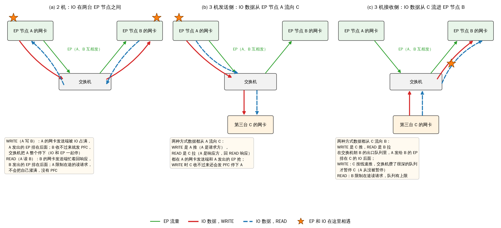

# K3.1 PD 第二轮：RDMA READ 和 WRITE 对 EP 的影响

第一轮文档：[k31_agentx_ep_kv_umbp_zh.md](k31_agentx_ep_kv_umbp_zh.md)。第一轮的 IO（KV 传输、注入的流量）全是 RDMA WRITE；Moonshot 跑端到端时 PD 传输一般用 RDMA READ（decode 去 prefill 那里读 KV），所以这一轮把 READ 加进来，单测和端到端注入都重做，并把第一轮找到的配置问题合在一起跑一个配置。机器、镜像、模型和第一轮相同：DO MI355X fabric3（rail-only，ionic AINIC 400G），2P1D，prefill node01 / node03，decode node02 + node04（EP16，MoRI EPv2）。

## 这一轮做了什么

- **READ 能不能用**（第 1 节）：先确认 MoRI IO 的 READ 在这套网络上读回来的数据对不对。
- **单测**（第 2 节）：EP16 旁边一直跑 MoRI IO，READ 和 WRITE 各三种摆法（IO 在两台 EP 节点之间；从 EP 节点发往第三台；从第三台进 EP 节点），看 EP 每次 dispatch / combine 慢多少、为什么。
- **端到端**（第 3–5 节）：一个汇总了所有修正的 decode 配置（含 `SGLANG_MORI_MOE_MAX_INPUT_TOKENS`），以及它的正确性；在这个配置上把 READ 和 WRITE 注入放在同一次跑里比较（合成负载）。AgentX 上的自然流量和注入因为 decode 死锁没有跑成（第 3.3、5 节）。
- **跨 NUMA 的补充**（第 6 节）：几张网卡、多大速率才会触发；READ 是不是一样。

## 结论

先说端到端（第 3–6 节），再说 READ 的正确性和单测（第 1–2 节）。

- **`SGLANG_MORI_MOE_MAX_INPUT_TOKENS=2048` 值得加**：decode 每步 114 → 88 ms（−23%），MoE 专家 GEMM / 排序 44 → 25 ms；输出质量没有变化（第 3.1 节）。这一轮的端到端都在"dispatch 上限 1024 + MoE 输入上限 2048"上跑。
- **KV 的正常路径（写进 decode GPU 显存）用 READ 还是 WRITE，对 decode 都几乎没有影响**：每张网卡 38 GB/s 背靠背注入，decode 每步只慢约 1%；写进本 NUMA 的主机内存也一样（第 4 节）。
- **写进另一个 NUMA 的主机内存仍然最伤，而且 READ 比 WRITE 更重**：背靠背 +54%（WRITE +39%），每张网卡 20 GB/s 时 +12%（WRITE +7%）；多出来的集中在 node02（READ 的发起方、a-147 固件）（第 4 节）。
- **跨 NUMA 的触发条件补齐了**（第 6 节）：要同一颗 CPU 下的 4 张网卡一起往另一颗 CPU 写（合计约 145 GB/s）才会触发，1–3 张不触发；READ 和 WRITE 一样；限速后是"开关式"的，给不出干净的安全阈值。关掉 CUDA graph、命令队列放显存都消除不了 decode 里被堵 GPU 上的内核卡顿。避开的办法仍是把 RDMA 主机缓冲放在网卡所在的 NUMA 上。
- **这一轮没有拿到 AgentX 的端到端结果**（第 3.3、5 节）：AgentX 的流量每次都让 decode 死锁（同组的 rank 停在不同的集合通信上，与 MoE 输入上限无关，合成负载下不出现），六次都没跑成；连带出现了 prefill 积压时两次 GPU 卡死、router 默认健康检查把忙碌的 decode 摘掉、崩溃后显存不释放。自然流量仍以第一轮为准，需要在 decode 死锁修好后重测。

READ 的正确性和单测：

1. **node02 上，RDMA READ 读进 GPU 显存会悄悄丢数据**：完成状态是成功，网卡也收到了全部字节，但 GPU 显存里一个字节都没变（GPU 的 PCIe 上根本没有这些数据）；读进主机内存、以及所有的 WRITE 都正确。只有 node02 当发起方时这样，node02 是四台里唯一的网卡固件 1.117.5-a-147，其余是 a-196；第一轮单测里 READ 过不了 benchmark 自己的数据校验，发起方 node06 也是 a-147。用 READ 做 PD 传输的部署，a-147 的节点需要先升级固件，并且要有数据校验。
2. **单测：READ 对 EP 的影响比 WRITE 小，而且越是"第三台往 EP 节点送数据"，差得越多**：IO 跑满 8 条 rail 时，K3.1 decode 形状的 dispatch 平均变慢——2 机（IO 在两台 EP 节点之间）：WRITE +56%、READ +26%；IO 数据从 EP 节点流向第三台（EP 节点发送；WRITE 是 EP 节点写第三台，READ 是第三台读 EP 节点）：WRITE +51%、READ +15%；IO 数据从第三台流进 EP 节点（EP 节点接收，就是 prefill 往 decode 送 KV 的摆法）：WRITE +218%、READ +40%。
3. **原因是 WRITE 推、READ 拉**：WRITE 由发送方按线速推，接收方网卡来不及把数据写进显存就发 PFC，交换机里朝接收方的队列一直很深；READ 由接收方（请求方）发读请求，同时在途的数据有上限，不会把自己灌满，8 对 rail 的 READ 场景里一次 PFC 都没有。
4. **2 机和 3 机不同，是因为 IO 和 EP 在不同的地方相遇**：2 机时 IO 和 EP 从同一张网卡发出，接收方一暂停，交换机就把这张网卡整个停下，队列里攒不了多少 IO；3 机接收侧时 IO 从第三台来、EP 从另一台 EP 节点来，两路在交换机朝接收方的出口队列里汇合，交换机只暂停 IO 的来源，EP 包排在攒起来的 IO 后面（按多出来的时间估算，前面排着约 4–7 MB）。第一轮在 06/07/08 上同样的摆法只慢 +9%，那次交换机把 IO 来源暂停了 328 ms（这次只有 5 ms），队列浅得多——这取决于交换机的缓冲和 PFC 阈值，需要网络组确认。

## 1. RDMA READ 在这套网络上读回来的数据对不对

第一轮单测里，mori IO benchmark 的 READ 在跑之前的数据校验就失败了，当时改用 WRITE，没有查原因。这一轮用专门的检查（`bench/io_rwcheck.py`）：被动方把缓冲填上已知的字节，发起方先把自己的缓冲填成另一个固定值（0xA5），READ 回来后逐字节比较；完成后立刻比一次，100 ms 后再比一次；再让被动方确认源数据没被改。段大小 4 KB–16 MB、一批 1–8,192 段、连续或隔一段，READ 和 WRITE 都测。

| 发起方（读进哪里） | 被动方（数据从哪里来） | READ 结果 | WRITE 结果 |
|---|---|---|---|
| node02 GPU 0 显存 | node01 / node03 GPU 显存，或 node01 主机内存 | **全部没写进去**：100 ms 后仍是 0xA5，整块 600 MB 缓冲一个字节都没变 | 正确 |
| node02 GPU 4 显存 | node04 GPU 4 显存 | **同上** | 正确 |
| node02 主机内存 | node01 GPU 显存或主机内存 | 正确 | — |
| node01 / node03 / node04 GPU 显存 | node02 / node03 / node04 的 GPU 显存 | 正确 | 正确 |

- READ 读进 node02 GPU 显存时，发起方网卡收到的字节数和请求的一样（18.2 MB / 4,450 个包），网卡计数器里没有任何错误；同一时刻 node02 GPU 0 的 PCIe 带宽（`amd-smi`）是 61 Mb/s，和空闲时一样，而同样速率的 WRITE 写进这张卡时是约 380 Gb/s。也就是说数据到了网卡，但没有经过 PCIe 送进 GPU。guest 里看不到 IOMMU 的报错（IOMMU 在宿主机上），也没有 ionic / amdgpu 的报错。
- 换成 dmabuf 注册显存（`MORI_ENABLE_DMABUF_REG=1`）、打开 relaxed ordering、打开 CCQE，结果都一样。
- 四台机器里只有 node02 的网卡固件是 1.117.5-a-147（node01 / node03 / node04 是 a-196）；第一轮单测 READ 校验失败时的发起方 node06 也是 a-147（第一轮记录的固件：02 / 05 / 06 / 08 是 a-147）。所以很可能是 a-147 固件的问题，需要网卡组确认。
- **对后面实验的影响**：单测改在 01 / 03 / 04 上跑（都是 a-196）；端到端里凡是"READ 读进 decode GPU 显存"的注入只打 node04，读进主机内存的照常打两台 decode。sglang 的 MoRI PD 传输只用 WRITE（prefill 往 decode 写，没有 READ 模式），所以端到端的 KV 传输本身还是 WRITE。

## 2. 单测：EP16 旁边一直跑 MoRI IO（READ / WRITE）

### 2.1 怎么测

- **EP**：mori 自带的 EPv2 跨机用例（`test_dispatch_combine_v2_internode.py --cmd bench`），node03（A）+ node04（B）共 16 卡，`v2_ll`。两种形状：K3.1 decode 形状（每卡 48 token、hidden 3584、每卡 56 个专家、top-16、bf16、8 个 QP）和 mori 默认形状（128 token、hidden 7168、top-8）。每次 2,000 轮，每个场景 2 次；看所有（轮，rank）样本的平均，并按 rank 所在的节点（A 的 rank 0–7、B 的 rank 8–15）拆开。
- **IO**：mori 自带的 IO benchmark（`tests/python/io/benchmark.py`，用户 `io.sh` 的参数：批量 + session，每次 32 KB，一批 8,192 个），READ 和 WRITE 都是 GPU 显存到 GPU 显存，8 对 rail 或只用 rail 0；另外用端到端注入的 `io_inject.py`（每批 233 段 × 72 KB，背靠背）做 KV 形状。第三台 C 是 node01。EP 和 IO 都在 TC 104（同一个优先级）。
- 三种摆法（图 1，箭头是数据流向；READ 的数据从被读的一方流向发起方）：
  - **2 机**：IO 在 A 和 B 之间。WRITE 是 A 写 B；READ 是 A 读 B（数据从 B 流到 A）。
  - **3 机发送侧**：IO 数据从 A 流到 C。WRITE 是 A 写 C（A 是请求方）；READ 是 C 读 A（A 是响应方，回 READ 响应）。
  - **3 机接收侧**：IO 数据从 C 流进 B。WRITE 是 C 写 B；READ 是 B 读 C。**这是 PD 里 prefill 给 decode 送 KV 的摆法**（WRITE：prefill 推；READ：decode 拉）。

### 2.2 结果

**怎么看**：每组柱子是一种摆法和 IO 规模；红色是 WRITE、蓝色是 READ，深色是 dispatch、浅色是 combine；纵轴是单次耗时相对无 IO 时的变化。柱子上标了"PFC"的，是场景期间有网卡持续发出暂停帧。无 IO 时 K3.1 形状 dispatch 平均 63 µs、combine 52 µs（场景前后各测一次，两次相差不到 1%）。

**说明了什么**：
- **每种摆法下 READ 都比 WRITE 轻**，差得最多的是 3 机接收侧：8 对 rail 时 WRITE +218%、READ +40%；只用 1 对 rail 时 WRITE +132%、READ +46%。
- **用 mori IO benchmark 的 READ 一次 PFC 都没有**；WRITE 在每种摆法下都有接收方持续发暂停。
- **KV 形状的 IO 影响小得多，READ 和 WRITE 也差不多**（接收侧 +23% / +24%）：每批 16 MB 发完要等完成再发下一批，中间有空档，交换机里的队列能排空；这时 READ 的接收方也会发 PFC（每批 233 段同时在途，量大）。

K3.1 decode 形状的完整数字（µs，括号里是相对无 IO 的变化；"A 侧 / B 侧"是按 rank 所在节点拆开的平均）：

| 摆法 | IO | 实际速率（GB/s） | dispatch | A 侧 / B 侧 | combine | A 侧 / B 侧 | PFC（谁发出暂停 / 谁被暂停） |
|---|---|---|---|---|---|---|---|
| 无 IO | — | — | 63.3 | 56.6 / 70.0 | 51.8 | 58.5 / 45.2 | 无 |
| 2 机 | A 写 B，8 对 | 354 | 98.6（+56%） | +61% / +51% | 70.4（+36%） | +34% / +38% | B 发 82 ms / A 被停 90 ms |
| 2 机 | A 读 B，8 对 | 352 | 79.9（+26%） | **+69%** / −9% | 63.9（+23%） | −19% / **+78%** | 无 |
| 发送侧 | A 写 C，8 对 | 355 | 95.4（+51%） | +59% / +44% | 67.7（+30%） | +24% / +39% | C 发 84 ms / A 被停 87 ms |
| 发送侧 | C 读 A，8 对 | 353 | 72.7（+15%） | −2% / **+28%** | 57.9（+12%） | **+27%** / −9% | 无 |
| 接收侧 | C 写 B，8 对 | 355 | **201.0（+218%）** | +208% / +225% | **156.1（+201%）** | +214% / +184% | B 发 93 ms / C 被停 671 ms，A 没被停 |
| 接收侧 | B 读 C，8 对 | 352 | 88.7（+40%） | +41% / +39% | 70.0（+35%） | +36% / +34% | 无 |
| 2 机 | A 写 B，1 对 | 44 | 92.6（+46%） | +33% / +57% | 61.6（+19%） | +35% / −3% | B 发 5 ms / A 被停 4 ms |
| 2 机 | A 读 B，1 对 | 44 | 80.2（+27%） | +36% / +19% | 54.5（+5%） | −2% / +14% | 无 |
| 发送侧 | A 写 C，1 对 | 44 | 90.8（+43%） | +28% / +56% | 61.2（+18%） | +36% / −5% | C 发 9 ms / A 被停 11 ms |
| 发送侧 | C 读 A，1 对 | 44 | 69.6（+10%） | −4% / +21% | 57.9（+12%） | +25% / −6% | 无 |
| 接收侧 | C 写 B，1 对 | 44 | **146.8（+132%）** | +110% / +150% | **109.9（+112%）** | +136% / +81% | B 发 6 ms / C 被停 5 ms |
| 接收侧 | B 读 C，1 对 | 44 | 92.2（+46%） | +46% / +46% | 57.0（+10%） | +14% / +5% | 无 |
| 发送侧 | A 写 C，KV 形状 | 326 | 94.8（+50%） | +56% / +44% | 66.2（+28%） | +23% / +33% | C 发 42 ms |
| 发送侧 | C 读 A，KV 形状 | 326 | 78.1（+23%） | +20% / +26% | 60.3（+16%） | +20% / +12% | C 发 30 ms |
| 接收侧 | C 写 B，KV 形状 | 328 | 78.4（+24%） | +12% / +33% | 63.1（+22%） | +35% / +5% | B 发 19 ms |
| 接收侧 | B 读 C，KV 形状 | 324 | 78.1（+23%） | +11% / +33% | 65.0（+25%） | +38% / +8% | B 发 31 ms |

- 发送侧 WRITE（A 写 C，8 对）这一场，A 重传了 697 万个包、ACK 超时 533 次。多半是发往 C 的 IO 包在路上丢了、A 重发（C 同时在发 PFC，说明它收不过来；丢在哪一段看不到）；EP 的 p99 没有暴涨（127 µs），EP 的包没有受到丢包影响。其余场景都没有重传。
- mori 默认形状的变化方向一样、幅度更大：2 机 WRITE dispatch +119%（一年前的单测是约 2.1 倍，对得上）、READ +34%；发送侧 WRITE +118%、READ +15%；接收侧 WRITE +316%、READ +57%。

### 2.3 为什么 READ 比 WRITE 轻

- **WRITE 是发送方推**：发送方的网卡按线速往外发，不管对面收不收得动。这套机器上，网卡把收到的数据写进 GPU 显存的速度跟不上约 44 GB/s 的连续写入：发送侧 WRITE 里第三台 C 只收 IO、没有任何 EP，也发出了 84 ms 的暂停。接收方网卡的缓冲一满就发 PFC，让交换机停发；交换机自己的缓冲再满，就去暂停它的来源。所以 WRITE 的场景里，接收方一直在发暂停，交换机里朝接收方的队列一直是满的。
- **READ 是接收方拉**：接收方（请求方）发读请求，对面按请求回数据；同时在途的读请求有上限，回来的数据不会超过接收方能接住的量。mori IO benchmark 的 READ 场景里，没有任何网卡发出暂停。
- **所以 READ 对 EP 的影响只剩"发送端抢"和"有上限的排队"**：发送侧 READ（+10%～+15%）比 WRITE（+43%～+51%）轻，是因为响应方回数据的节奏由对面的读请求决定，发送端不是一直被 IO 占满；接收侧 READ（+40%～+46%）比 WRITE（+132%～+218%）轻，是因为朝 B 的出口队列有上限，按多出来的时间估算前面约排着 1.3–1.5 MB，WRITE 时是 4–7 MB。
- **在途量大的 READ 一样会灌满接收方**：KV 形状的 READ（每批 233 段 × 72 KB 一次性发出）在接收侧和发送侧都出现了 PFC，这时 READ 和 WRITE 对 EP 的影响差不多（+23% / +24%）。

### 2.4 为什么 2 机和 3 机不一样

关键是 EP 和 IO 在哪里相遇（图 1 的星号），以及暂停落在谁身上：

- **2 机**：IO 和"发往 IO 接收方的 EP"从同一张网卡发出。WRITE 时，接收方 B 一发暂停，交换机就把 A 整个停下（A 被停了 90 ms），A 的 IO 和 EP 一起等；交换机里攒的主要是 A 自己按比例混着发出的包，EP 前面排的 IO 不多。所以 2 机 WRITE（+56%）比 3 机接收侧 WRITE（+218%）轻得多。READ 时 B 的网卡忙着回响应，受影响的是 B 发出的 EP：A 侧 rank 的 dispatch 慢 69%（它们在等 B 发来的 token），B 侧 rank 的 combine 慢 78%（它们要把结果经 B 的网卡发回 A）；反方向的 EP 不受影响（B 侧 dispatch −9%，A 侧 combine −19%）。
- **3 机发送侧**：只在 A 的网卡发送端相遇，A 发往 B 的 EP 排在 IO 后面。READ 时 A 是响应方，回数据的节奏跟着 C 的读请求走，所以只慢 15%。
- **3 机接收侧**：IO 从 C 来、EP 从 A 来，两路在交换机朝 B 的出口队列里汇合（多对一）。B 收不过来时，交换机只会暂停自己入口缓冲超过阈值的那一路——C 的量大，被暂停了 671 ms；A 的 EP 量小，从来没被暂停，但它的包排在攒起来的 C 的 IO 后面。所以这是 WRITE 最重的摆法，A 侧和 B 侧的 rank 一起慢 2 倍多（每次 EP 都要等最慢的那条 rail）。READ 时队列有上限，只慢 40%。
- **1 对 rail 也慢这么多**：只有 rail 0 有 IO 时，只有 rail 0 上的 EP 包要排队；但每次 dispatch / combine 都要等 16 个 rank 全部收齐，最慢的那条 rail 决定整次的时间，所以 1 对 rail（+46%～+132%）和 8 对 rail（+56%～+218%）差得不多。

### 2.5 和第一轮单测（06 / 07 / 08）的差别

发送侧和 2 机的结果和第一轮一致（发送侧 1 对 WRITE 两轮都是 +43%；KV 形状发送侧 +52% / +50%；2 机 8 对 WRITE +64% / +56%），差别只在接收侧 WRITE：第一轮 1 对 +9%、KV 形状 +6%，这一轮 +132%、+24%。两次的计数器差在交换机怎么暂停 IO 的来源：

| 接收侧 WRITE，1 对 rail | EP 节点 B 发出的暂停 | IO 来源 C 被暂停 | EP 节点 A 被暂停 | dispatch |
|---|---|---|---|---|
| 第一轮：C = node08 写 B = node07 | 12 ms | **328 ms** | 0 | +9% |
| 这一轮：C = node01 写 B = node04 | 6 ms | **5 ms** | 0 | +132% |

第一轮交换机把 IO 的来源压得很死，朝 B 的队列很浅；这一轮几乎没暂停 C，C 的数据在交换机里攒成了深队列，A 的 EP 排在后面。同一种流量，交换机在哪个缓冲水位暂停来源（端口所在的芯片、动态阈值、当时交换机上别的流量）决定了接收侧 EP 慢 9% 还是慢 132%。交换机配置我们看不到，需要网络组确认这些端口的缓冲和 PFC 阈值。

### 2.6 对 PD 意味着什么

- PD 的 KV 传输是"3 机接收侧"：prefill 往 decode 送 KV，decode 之间跑 EP。WRITE（sglang 现在的做法）在 KV 持续接近线速时最伤 EP；READ（Moonshot 的做法）在同样的速率下轻得多，前提是 decode 同时在途的读请求不要太多。
- 端到端里 KV 平均每张网卡只有 0.2–0.7 GB/s，大部分时间远低于线速，所以第一轮端到端看到的影响很小；但 KV 是按 16 MB 左右一批、线速发的，每一批持续的那几百微秒里，朝 decode 的队列会像单测一样涨起来，正好碰上的那几次 EP 会变慢。

## 3. 端到端：decode 配置

### 3.1 `SGLANG_MORI_MOE_MAX_INPUT_TOKENS=2048`

第一轮修正了 `SGLANG_MORI_NUM_MAX_DISPATCH_TOKENS_PER_RANK=1024`（接收缓冲从 65,536 行降到 16,384 行），但 DCP8 下 sglang 算不出每个 rank 实际收到多少行，MoE 仍然按整个接收缓冲（16,384 行）来算。`SGLANG_MORI_MOE_MAX_INPUT_TOKENS` 直接给 MoE 的输入行数设上限（`moriep.py` 里取 `min(上限, 接收缓冲行数)`，传输层的接收缓冲不变，所以 EPv2 初始化日志里仍是 `recv_cap=16384`）。它必须不小于每个 rank 实际收到的最大行数：我们的 decode 最多每组 136 个请求 × 6 个验证 token × 2 组 = 1,632 行，所以 2048 够用。数值来自本地 sglang 仓库 MI355X 2P1D EP16 的配方。

**正确性**：同一组请求（16 个文本问题 + 8 个 1,000–2,750 token 的长输入，temperature 0，每个生成 48 个 token，带 decode 给输出 token 的 logprob），每种配置串行跑两遍、24 路并发跑一遍。这套部署本身不确定（decode 开着模拟接受 `SGLANG_SIMULATE_ACC_LEN=3.25`，接受多少个 draft token 是随机的），同一配置跑两遍，24 个里也有 22 个在第 0–18 个 token 处分叉，所以不能要求逐 token 一致；改看 decode 给自己输出的 logprob——如果上限截掉了某些行，那些 token 的专家输出就没了，logprob 会整体变低、文字会乱：

| 配置 | 平均 logprob（3 次） | logprob < −5 的 token 占比 | 文本问题都答了 |
|---|---|---|---|
| 不设上限 | −1.42 / −1.44 / −1.17 | 8.1% / 9.3% / 6.8% | 是 |
| 上限 2048 | −1.43 / −1.27 / −1.44 | 9.1% / 7.2% / 8.9% | 是 |

两种配置在同一个范围里，和"不设上限"自己跑两遍的差别一样大，输出文字正常（例如 "The capital of France is" → " Paris."）。

**性能**（`load_gen.py` 128 路合成请求，输入 3,000 token、输出 600 token；step probe 的每步 GPU 时间，以及 profile 里每步的内核时间）：

| | 不设上限 | 上限 2048 |
|---|---|---|
| 每步 GPU 时间 | 114.0 ms | **88.0 ms（−23%）** |
| 每步内核时间 | 116.0 ms | 87.8 ms |
| 其中 MoE 专家 GEMM / 排序 | 44.2 ms | 25.1 ms |
| 其中 fp8 量化 | 9.8 ms | 3.0 ms |
| EP（dispatch + combine + 其他） | 17.4 ms（15%） | 16.3 ms（19%） |

### 3.2 这一轮的端到端配置

在第一轮最后的配置上加 `SGLANG_MORI_MOE_MAX_INPUT_TOKENS=2048`，其余不变：

- decode：`SGLANG_ROCM_RUNTIME_RESERVE_GB=24 SGLANG_MORI_NUM_MAX_DISPATCH_TOKENS_PER_RANK=1024 SGLANG_MORI_MOE_MAX_INPUT_TOKENS=2048`，MoRI EPv2 跨机，TC 104。
- PD 传输：仍是 sglang MoRI 连接器的 RDMA WRITE（prefill 写 decode 的 GPU 显存）。它没有 READ 模式；而且 node02 上 READ 进 GPU 显存会丢数据（第 1 节），改成 READ 也没法在这里验证。
- 试过但没有放进来的：`HSA_ALLOCATE_QUEUE_DEV_MEM=1`（命令队列放显存，对跨 NUMA 没有帮助，见第 6 节）。
- 没有改的：UMBP 的 DRAM 层按默认分在两个 NUMA 上（`UMBP_DRAM_NUMA_NODE` 可以指定，但它只是平均分到各节点，不会按发起的 GPU 选近的那个）；UMBP 的实际流量每张网卡只有 0.2–0.7 GB/s，碰不到第 6 节的触发条件。

## 4. 端到端：READ 和 WRITE 注入（合成负载）

**怎么测**：3.2 节的配置；`load_gen.py` 128 路并发（输入 3,000 token、输出 600 token）；两台 prefill 往两台 decode 注入 KV 形状的流量（node01 → node02、node03 → node04，GPU i ↔ GPU i，8 张网卡都打，TC 104），每个时段 60 s、间隔 60 s。WRITE 是 prefill 写进 decode；READ 是 decode 从 prefill 的 GPU 显存读。数据落到 decode 的哪里有四种：另一个 NUMA 的主机内存、网卡所在 NUMA 的主机内存、decode 的 GPU 显存（只打 node04，原因见第 1 节）、另一个 NUMA 的主机内存但每张网卡限 20 GB/s。每步耗时取 step probe 的中位数（时段开始后 5–55 s），和第一个时段之前的 50 s 比；每个时段开始后 25 s 抓一次 decode 的 profile。脚本 `run/k31_r22_lg_rw.sh`，分析 `tools/k31_lgrw_analyze.py`。

**怎么看**：左图每组是一种落点，红色 WRITE、蓝色 READ，柱上标了 decode 每步变慢多少和每张网卡实际跑到的速率；右图是同一时段 profile 里两台 decode 每步的本地计算时间（不含 EP 和集合通信）。

**说明了什么**：
- **KV 的正常路径（写进 GPU 显存）和本 NUMA 主机内存，READ 和 WRITE 都只慢约 1%**，两者没有差别。
- **写进另一个 NUMA 的主机内存时 READ 更重**：背靠背 +54%（WRITE +39%），每张网卡 20 GB/s 时 +12%（WRITE +7%）。多出来的几乎都在 node02：READ 时 node02 的 TP0 / TP4 本地计算每步 101–103 ms，WRITE 时 85–90 ms；node04 两种都是 87–90 ms。node02 是 READ 的发起方，也是唯一的 a-147 固件（第 1 节），可能和这个固件下 READ 响应写主机内存的方式有关，没有单独验证。
- 这里两台 decode 的 8 张网卡都在跨 NUMA（两颗 CPU 互相写），所以所有 GPU 都被拖慢；第一轮 d1 和第 6.2 节只打了网卡 4–7。

| 时段 | 方式 | 落点 | 每张网卡 GB/s | 每步 ms（DP0 / DP1） | 变化 | 单次 dispatch / combine（TP0，µs） |
|---|---|---|---|---|---|---|
| 注入前 | — | — | — | 87.8 / 87.9 | — | 78 / 96 |
| W1 | WRITE | 另一个 NUMA 的主机内存 | 36.0 | 121.6 / 121.7 | +38.5% | 160 / 161 |
| R1 | READ | 另一个 NUMA 的主机内存 | 33.0 | 135.6 / 135.6 | **+54.4%** | 184 / 170 |
| W2 | WRITE | 本 NUMA 的主机内存 | 37.8 | 88.7 / 88.7 | +0.9% | 88 / 93 |
| R2 | READ | 本 NUMA 的主机内存 | 38.0 | 89.0 / 89.0 | +1.4% | 88 / 94 |
| W3 | WRITE | node04 的 GPU 显存 | 37.9 | 88.7 / 88.7 | +1.0% | 80 / 98 |
| R3 | READ | node04 的 GPU 显存 | 38.1 | 88.7 / 88.6 | +0.9% | 79 / 101 |
| W4 | WRITE | 另一个 NUMA，限 20 GB/s | 20.9 | 93.9 / 93.9 | +6.9% | 72 / 103 |
| R4 | READ | 另一个 NUMA，限 20 GB/s | 20.9 | 98.0 / 98.0 | +11.6% | 70 / 103 |

## 5. 端到端：AgentX（这一轮没有拿到结果）

原计划在 3.2 节的配置上跑一次 AgentX（256 路）：前 30 分钟不注入，用来重做第一轮第 3 节的自然流量分析；后半段做和第 4 节一样的 8 个 READ / WRITE 注入时段。六次尝试都因为 3.3 节的问题没跑成，主要是 AgentX 一开始 decode 就死锁。所以：

- **自然流量**仍以第一轮第 3 节为准（那时 decode 没设 MoE 输入上限，每步约 217 ms）。这一轮 decode 每步快了约一半，同样的 KV 流量占每步的比例会更大，结论需要在 decode 死锁修好后重测。
- **注入**用第 4 节合成负载的结果：它的落点和速率和 AgentX 方案一样，只是负载是合成的。

### 3.3 这一轮端到端跑的时候遇到的问题

这一轮的 AgentX 一次都没跑成（11-18 20:42 到 11-19 04:30，共六次），所以第 5 节没有 AgentX 的结果。原因依次是：

1. **AgentX 的流量让 decode 死锁**（每次都发生，最主要的原因）：AgentX 一开始，decode 就一个 batch 都不跑了（每步耗时的 probe 不再增长，生成吞吐为 0），之后的请求等几百秒、只返回 prefill 给的第一个 token。py-spy 看到同一组的 rank 停在不同的集合通信上，例如 DP1 的 8 个 rank 里，TP8、9、11、14 在同步 KV 传输状态的 `all_reduce_flags`（`poll_and_all_reduce`），TP10、15 在 DP attention 每步的 `exchange_sync_rows`，TP12、13 在广播新请求的 `broadcast_pyobj`；gloo 按调用顺序配对，组内成员走了不同的分支，就互相等死。它和 `SGLANG_MORI_MOE_MAX_INPUT_TOKENS` 无关（不设也一样），和 router 的健康检查参数也无关；同样的服务用 `load_gen.py` 的合成请求（第 3.1、4 节，共约 2 小时）、或者 16 个并发的短请求都正常。sglang 代码和第一轮完全相同（第一轮的 AgentX 都跑完了），所以是一个和时序有关、AgentX 的流量（长上下文、多轮、几百个会话一起开始）能触发的 decode 调度 bug（PD 分离 + DCP8 + DP attention），需要单独查。
2. **prefill 两次卡死**（node03 21:10、node01 22:12）：都在 AgentX 预热约 30 分钟、prefill 积压最重的时候（待处理约 1,100–1,200 万 token，等 decode 接收的请求 62–78 个），某个 rank 的 GPU 停在一个 [28672] × 256 的内核上不返回，CPU 在 indexer 的 `ks.cpu()` 同步处等，300 s 后被 watchdog 杀掉。上面 decode 死锁造成的积压可能是诱因；第一轮所有运行的日志里都没有这种卡死。
3. **router 把忙碌的 decode 判为不健康**：decode 的 `/health` 要走一遍调度器，负载重时要等好几分钟；router 默认 5 s 超时、连续 3 次失败就摘掉 decode，之后所有请求返回 503。后面的运行改成 `--health-check-timeout-secs 120 --health-failure-threshold 10 --disable-circuit-breaker`。
4. **AgentX 只要有一个根请求在预热里失败，就中止整次运行**（`Terminal warmup failure ... aborting run early`）。
5. **崩溃后显存没有释放**：node03 的 prefill 崩溃后每张卡仍占着约 20 GB 显存（kfd 里已经没有进程），新起的 prefill 算不出 mamba 状态缓存（`max_mamba_cache_size=1`）起不来；删掉容器重建后恢复（这部分多半是注册给网卡的显存）。

## 6. 跨 NUMA 的补充

第一轮第 10 节的结论是"网卡往另一个 NUMA 写，堵住和它共用根端口的 GPU 的 PCIe 路"。这一轮补了三件事。

### 6.1 要几张网卡一起写、多大速率才会触发

node02 上 8 张 GPU 各起一个小程序，不停地测"4 KB 显存→主机拷贝 + 同步"的时间（不注入时约 13–14 µs）；同时让 node02 的部分网卡往另一个 NUMA 的主机内存收数据（`run/k31_r13_onenic.sh`、`k31_r14_xgmi.sh`、`k31_r17_rwnuma.sh`，60 s 窗口的中位数，µs）：

| 往另一个 NUMA 收数据的网卡（实际速率） | GPU 4 | GPU 5 | GPU 6 | GPU 7 | GPU 0 |
|---|---|---|---|---|---|
| 不注入 | 13.9–14.4 | 13.0–13.2 | 14.1–14.5 | 12.6–13.9 | 12.4–14.3 |
| 网卡 4，WRITE（41.5 GB/s） | 14.2 | 13.1 | 13.2 | 13.9 | 14.3 |
| 网卡 4–5，WRITE（各 41.4–41.9） | 14.3 | 13.4 | 13.1 | 13.9 | 14.4 |
| 网卡 4–6，WRITE（各 40.3–41.7） | 14.9 | 13.5 | 14.4 | 13.0（网卡空闲） | 12.7 |
| 网卡 4–7，WRITE（各 36.3–38.7） | **27.6–30.1** | **26.6–28.3** | **26.6–28.5** | **24.5–26.7** | 13.1–13.7 |
| 网卡 4–7，READ（node02 发起，各 34.4–36.1） | **30.9** | **30.5** | **30.6** | **28.2** | 14.9 |
| 网卡 4–7，READ 进本 NUMA（各 40.7–41.2） | 14.5 | 13.7 | 14.7 | 13.1 | 14.4 |
| 网卡 4–7，WRITE 各限 25 GB/s | **31.2** | 13.7 | **29.5** | **28.6** | 12.8 |
| 网卡 4–7，READ 各限 25 GB/s | 15.3 | 19.3 | 14.8 | 13.5 | 14.7 |
| 网卡 4–7，WRITE 各限 32 GB/s | 14.9 | 13.4 | 15.9 | 13.5 | 12.9 |

- **触发条件是这颗 CPU 往另一颗 CPU 写的总量**：1–3 张网卡满速跨 NUMA（合计 41–124 GB/s）任何 GPU 都不受影响；4 张一起写时每张只能跑到 35–39 GB/s（合计约 145 GB/s，被两颗 CPU 之间的路限住），这时和它们共用根端口的 GPU 4–7 来回翻倍。
- **READ 和 WRITE 一样**：decode 当请求方、把数据 READ 进另一个 NUMA 的主机内存，GPU 4–7 同样翻倍；READ 进本 NUMA 没有影响。起作用的是"网卡往另一颗 CPU 的内存做 DMA 写"，和 RDMA 由谁发起无关。
- **是"开关式"的**：限速后单张 GPU 会在约 14 µs 和约 30 µs 两种状态之间切换，一个状态持续十几到几十秒（WRITE 各限 25 GB/s 时 GPU 4、6、7 大部分时间在拥塞状态，GPU 5 基本不进；各限 32 GB/s 时只在开头 5 s 四张都翻倍）。所以"限速到多少就安全"给不出一个干净的阈值，避开的办法仍然是把缓冲放在网卡所在的 NUMA 上。

### 6.2 decode 在 READ 注入下

和第一轮 d1 同样的做法（128 路合成请求，只让 node02 的网卡 4–7 把数据 READ 进另一个 NUMA 的主机内存，`run/k31_r15_decprof2.sh`），这一轮的配置下（上限 2048）：每步 88.0 → 111.8 ms（**+27%**）；每张网卡限 25 GB/s 时 89.6 ms（+2%）。profile 里，路被堵的 TP4 / TP5 本地计算每步 63 → 92 ms，60%–63% 的小内核每个多出十几 µs，而且成段出现；TP0 / TP8 / TP12 本地不变，在 EP 和集合通信上等它们（25–26 → 69 ms）。和 WRITE 注入时一样。

### 6.3 "decode 里每个小内核多十几 µs"——排除了什么

第一轮没定位的一点是：被堵的 GPU 上，decode 的小内核会成段地每个多十几 µs，但合成的 CUDA graph 测试复现不出来。这一轮的排查：

- **逐位置对齐 decode 的 4,515 个内核**（同一个 graph，注入前 9 步、注入时 4 步）：被拖慢不是固定某些内核——同一个位置的内核，这一步慢、下一步不慢；一旦慢，后面几个也慢（前一个慢时下一个慢的概率 70%，前一个不慢时 28%），一段中位数约 240 µs；长内核（200 µs 的 MoE GEMM）很少被拖慢。TP4 和 TP5 挂在不同的 PCIe 交换芯片下，但它们按 200 µs 分段的"被拖慢比例"相关系数 0.88。
- **不是 CUDA graph 的问题**：`--disable-cuda-graph` 时 decode 变成 CPU 下发内核决定速度（每步 239 ms），被堵的 TP4 / TP5 上仍有 43%–46% 的小内核被拖慢，本地计算 56 → 74 ms；这时每步 +16 ms（+7%）。
- **不是 GPU 从主机内存取命令包**：`HSA_ALLOCATE_QUEUE_DEV_MEM=1` 把命令队列放进显存，注入时每步仍 +28%，被拖慢的小内核比例不变（61%）。
- **CPU 下发内核也变慢**：被堵的 GPU 上，每次 `hipLaunchKernel` 的 CPU 耗时从 3.9 µs 变成 7.7 µs（没被堵的 GPU 3.6 → 4.1 µs），说明每次下发也要经过这段 PCIe 来回一次。
- **也不是"拥塞时网卡同时往这张 GPU 写"**：decode 里网卡和 GPU 之间一直有点对点读写（KV 写进显存、EP 收发），之前的合成测试里没有。补测（`run/k31_r20_p2p.sh`）：网卡 4–7 跨 NUMA 写主机内存的同时，再让它们往 GPU 5–7 的显存各写 5 GB/s，GPU 4–7 的主机来回照样翻倍（22–25 µs），但合成 CUDA graph 的小内核仍然每个只多约 0.06 µs，没有 decode 里那种成段卡顿。顺带看到：往显存写改成背靠背、网卡带宽被一分为二后，跨 NUMA 那部分每张只剩约 24 GB/s，拥塞基本消失——又一次说明触发条件是跨插槽写的总量。
- **所以 decode 特有的诱因还没找到**：decode 的小内核在拥塞期间成段地每个多十几 µs，合成测试（graph 或 eager、各种内核、各种参数位置、点对点流量、EP16 加本地内核）都复现不出来。

## 附录：数据和脚本

都在任务目录 `k31-agentx-pd-ep-io-umbp-20261117/` 下（不在 sglang 仓库里）。

| 内容 | 脚本 | 数据 |
|---|---|---|
| READ / WRITE 正确性 | `bench/io_rwcheck.py` | `results/rw/` |
| 单测（EP16 + MoRI IO） | `microbench/run/mb_campaign5.sh`、`mb_lib_k31.sh`；分析 `microbench/tools/mb_analyze5.py` | `microbench/results/c5/`（`summary5.md`、`summary5.json`） |
| decode 配置、正确性、排查 | `run/k31_r18_cfgs.sh`、`k31_r15_decprof2.sh`、`bench/k31_correctness.py`；分析 `tools/k31_decprof2_analyze.py` | `results/rw_cfgs/`、`results/pcie/dr_base`、`dr_cap`、`dr_qdev`、`dr_nog` |
| 合成负载下的 READ / WRITE 注入 | `run/k31_r22_lg_rw.sh`、`bench/k31_inject.sh`（`OP=read`）；分析 `tools/k31_lgrw_analyze.py` | `results/pcie/lg_rw/` |
| 跨 NUMA 触发条件 | `run/k31_r13_onenic.sh`、`k31_r14_xgmi.sh`、`k31_r17_rwnuma.sh`、`k31_r20_p2p.sh` | `results/pcie/o1`、`o2`、`o3`、`p2p1` |
| 注入工具（READ / WRITE） | `bench/io_inject.py`（`--op read`） | — |
| 图 | `tools/k31_doc2_figs.py` | — |
