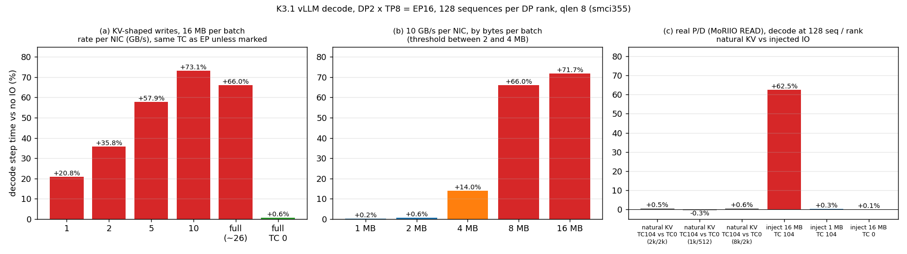
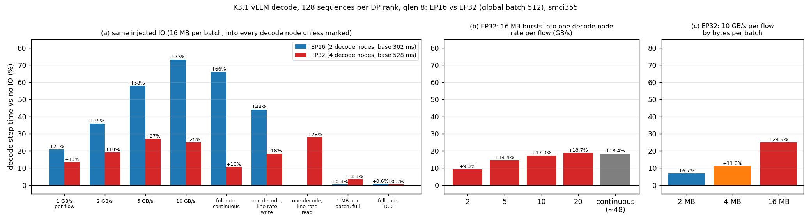

# K3.1 vLLM 在 smci355 上：IO 对 EP 的影响（DO 的对照，EP16 和 EP32）

DO 上的三轮：[k31_agentx_ep_kv_umbp_zh.md](k31_agentx_ep_kv_umbp_zh.md)、[k31_ep_kv_read_write_zh.md](k31_ep_kv_read_write_zh.md)、[k31_ep512_io_zh.md](k31_ep512_io_zh.md)。
复现指南：[k31_smci355_vllm_ep_io_repro_zh.md](k31_smci355_vllm_ep_io_repro_zh.md)。脚本在 [smci355_vllm/](smci355_vllm/)。

Moonshot 在 EP32、全局 batch 512、qlen 8 上看到过 IO 突发让 EP 明显变慢。DO 上的结论是：一个 IO 来源几乎不影响，要多个来源同时打进一台 decode（incast）才会明显变慢。
这里换了一套集群（smci355，6 台 MI355X）和推理框架（vLLM，DO 用的是 SGLang）做对照：
- decode 用宽 EP。每个 EP rank 每次 dispatch 128 个 token，和 Moonshot 那个 case 每个 rank 的负载相同。
- 测了两类场景：
  - 只有 decode，外加注入的 IO；
  - 真实 PD，负载分别是 AgentX 和合成负载，看自然的 KV 流量，也在上面再注入 IO。
- EP16 和 EP32（Moonshot 的配置）都测了“只有 decode 加注入”和真实 PD；EP32 加 AgentX 那一次挂死了，没有数据（第 6 节）。

## 先说结论

1. **复现了 IO 让 EP 明显变慢，而且只需要一个 IO 来源。**
   - 配置：EP16 decode，每个 DP rank 128 条序列，qlen 8。
   - IO：第三台机器往两台 decode 写或读 KV 形状的数据（16 MB 一批），和 EP 同在 TC 104。
   - 结果：decode 每步慢 62–73%。每张网卡只有 1 GB/s（不到链路的 2%）时也有 +15–21%（第 2、3 节）。
   - 和 DO 的对比：DO 上一个来源只慢 1–3%。
2. **EP32（Moonshot 的配置：4 台 decode，全局 batch 512，qlen 8）也复现了，幅度是 EP16 的三分之一到一半（第 6 节）。**
   - 1 台 decode 以线速从 C 读（MoRIIO 拉 KV 的方向）：+28%；4 台各收每股 5–10 GB/s 的 16 MB 突发：+25–27%；线速写进 1 台：+18%（三次都是 18% 左右）。
   - 每股 1 GB/s 也有 +13%。模拟真实到达的突发（每卡每秒一次 16 / 64 MB）没有影响。
   - 决定影响的是 IO 到达 decode 网卡时的瞬时速率：C 的网卡同时给 4 台连续发时，每股只有约 1/4 线速，反而只慢 10.5%。
3. **机制是 ECN / DCQCN 把 EP 一起降速。**
   - 过程：
     1. 一次提交几 MB 的 IO，会在 decode 入口的 TC 104 队列里堆起来；
     2. 交换机给排队的包打 ECN 标记，EP 的包也一起被标记；
     3. 接收方回 CNP，发送方网卡的 DCQCN 就给 EP 的 QP 降速；
     4. EP 每一层要等最慢的 rank，所以整个 decode 变慢。
   - 整个过程没有 PFC，也没有重传。
   - 只往一台 decode 写时，另一台没有收到任何 IO，却因为它发出去的 EP 被降速，每秒收到 6.4 万个 CNP，decode 整体慢 44%（第 4 节）。
   - EP32 没有 IO 时，EP 自己就在被 ECN 标记：每台 decode 每秒收到 4–6 千个 CNP（EP16 是 0）。每台要同时收另外 3 台的 EP，本身就是 incast。
4. **有两种缓解办法，在端到端里都验证过。EP32 上 TC 0 仍然完全有效，拆小只能减轻：**
   - 把 IO 放进另一个流量类（TC 0）：EP16 只慢 0.1–0.7%，EP32 只慢 0.3%。
   - 把每次提交拆小：EP16 上门槛在单批 2 到 4 MB 之间，1–2 MB 一批没有影响，每台 decode 收 180 GB/s 也只慢 0.4%（第 3 节）。
     EP32 上 2 MB 一批还有 +6.7%，1 MB 一批 +1–3%：EP32 没有 IO 时队列就贴着 ECN 门限，多一点同 TC 的流量就会越线（第 6 节）。
5. **真实 PD 里，自然的 KV 流量没有拖慢 EP。**
   - 配置：MoRIIO READ 模式。负载分别是 AgentX 回放 Claude Code 轨迹（并发 128），以及每个 rank 128 条的合成负载。
   - KV 和 EP 同在 TC 104 时，与 KV 放进 TC 0 相比，每步差别在 ±0.5% 以内。
   - 真实 KV 只有 0.8–3.1 GB/s（两台 decode 合计），EP 每秒只收到 2–20 个 CNP（第 5 节）。
   - EP32 上也一样：512 条合成负载，KV 平均 3.6 GB/s、p99 9 GB/s，TC 104 和 TC 0 的步时是 545.3 对 545.0 ms（第 6.4 节）。
6. **在真实 PD 上注入 IO，影响取决于 EP 负载。**
   - 每个 rank 128 条序列时，和只有 decode 时一样：16 MB 一批慢 62–70%，1 MB 一批或 TC 0 没有影响。
     EP32 也一样：1 台 decode 线速读 +25%，每股 10 GB/s 写 +22%，线速写进 1 台 +17%，TC 0 +0.3%。
   - AgentX 并发 128 时，同时在解码的序列只有每个 rank 十几到二十几条，EP 在一步里占比小，注入的影响落在约 14% 的噪声以内（第 5 节）。
7. **KV 放进 TC 0 没有代价。** TTFT、KV 读取时间、生成吞吐在两个流量类之间都差 0.6% 以内；注入的 IO 在 TC 0 里吞吐也一样（第 5.3 节）。
8. **单测会低估端到端的影响。**
   - 同样的 KV 形状 IO，单测里 vLLM 的 EP 内核（mori v1 LL）只慢 5–11%，端到端慢 66%。
   - 单测里最严重的是 EP 节点同时挂几千个 32 KB 的 READ（每对 GPU 在途 256 MB）：EP 慢 10–40 倍，延迟大致随在途量线性上升，放进 TC 0 也没用（问题在请求方网卡内部）。
     但端到端里用同样方式读，decode 只慢 13%（第 7 节）。
9. **稳定性：** decode 的两台节点类型不同、同序号 GPU 跨 rail（`RAIL_ALIGN=0`）时，大批量下挂死了 3 次。按 rail 对齐（`RAIL_ALIGN=1`）后跑了十几次都没挂（第 8 节）。
   EP32 挂死过两次：一次在注入脚本往 decode 上起接收进程之后，一次在 AgentX 预热时（MoRIIO 正在拉一个 93k token 请求的 KV）。都是所有 rank 停在 EP 内核里，原因没查清（第 6.3 节）。

三张图依次是：
- 16 MB 一批时的速率扫描，以及 TC 0 的对照；
- 每卡 10 GB/s 时，单批大小的影响；
- 真实 PD 下，自然 KV（TC 104 对 TC 0）和注入 IO 的对比。

### 对 Moonshot

- **在 Moonshot 的配置（EP32、全局 batch 512、qlen 8）上复现了 IO 突发让 EP 变慢：decode 慢 13–28%。**
  - 条件和 EP16 一样：IO 和 EP 同在 TC 104，而且以接近线速到达 decode 的网卡。最重的是 1 台 decode 以线速读（+28%），也就是 MoRIIO 拉 KV 的方向。
  - EP32 没有 IO 时 EP 自己就在被 ECN 标记（每台 decode 每秒 4–6 千个 CNP），再来同 TC 的突发，EP 会被进一步降速。
- 一个 IO 来源就足以让 EP 明显变慢（EP16 慢一半以上），不一定要 incast。前提是两个：
  - IO 和 EP 在同一个流量类；
  - IO 一次提交几 MB 以上，能以线速打进 decode 的网卡。
- 两个集群结论不同，最可能的原因是交换机和网卡的 ECN / DCQCN 配置不同。smci355 上 EP 的发送方收到了每秒上万个 CNP。这一点是推断，还没去对比两边的配置。
- 建议看三件事：
  1. 掉速时 EP 发送方（decode 网卡）收到的 CNP：`/sys/class/infiniband/ionic_*/ports/1/hw_counters/rx_rdma_cnp_pkts`；
  2. KV 或其他 IO 和 EP 是不是同一个 TC；
  3. KV 连接器每次提交多大。
- 缓解办法：IO 换一个流量类，EP16 和 EP32 上都能完全消除影响；把每次提交拆到 2 MB 以内，EP16 上能消除，EP32 上只能减到几个百分点；如果交换机支持，给 KV 单独配一个无损类。
- 自然的 PD KV 流量在这里打不出影响，EP32、全局 512 时也一样（TC 104 对 TC 0 差 0.06%）。Moonshot 看到的掉速，更可能来自比 KV 大得多、成批的 IO，比如前缀缓存池的加载、批量写回。

## 1. 环境和配置

| 项 | 值 |
|---|---|
| 集群 | smci355（Slurm），可调度节点 n08-21/25/29/33、n09-21/29，每台 8 × MI355X、8 × AINIC 400G（ionic），rail-only |
| 固件 / 驱动 | 网卡固件 6 台都是 1.117.5-a-45；amdgpu 6.16.6（n08-33 是 6.14.14），走 peermem |
| QoS | DSCP 26 → 优先级 3，唯一的无损类（PFC），DWRR 90%；其他 DSCP → 优先级 0，有损，DWRR 10%。EP 和 KV 默认都用 TC 104（DSCP 26） |
| 镜像 / 模型 | `yukiozzz/vllm-openai-rocm:k31-ms-1114`（vLLM 0.0.0+mum.181bd93fc6），Kimi-K3.1-Pro，DSpark 投机 7 个草稿 token（qlen 8），接受长度按 3.0 模拟 |
| decode | 每台一个 DP rank：TP8 · DCP8，`--enable-expert-parallel --all2all-backend mori_low_latency`（MoRI InterNodeV1LL），每个 rank 最多 128 条，`max-num-batched-tokens 2048`，其余参数和环境变量照同事的 K3.1 配方 |
| prefill（PD 时） | TP8 · DCP8，fcfs（这个版本的 shortest-prefill-first 必须配 SimpleCPUOffloadConnector） |
| KV 传输（PD 时） | vLLM MoRIIO 连接器 READ 模式，代理是自己写的 `e2e/pd_proxy.py`，按 AIPerf 的会话头做亲和 |

EP16 是两台 decode（DP2 × TP8）。每个 rank 128 条序列、qlen 8 时，每个 EP rank 每次 dispatch 128 个 token，和 EP32、全局 512 时每个 rank 的量相同。这时每步约 300 ms，decode 每台的 EP 收发约 35 GB/s。

## 2. 方法

- **只有 decode，加注入（E1）：** 两台 decode，第三台 C 跑负载和 IO。
  - 负载：随机 token，输入 1k、输出 8k ± 50%，每个 rank 128 条。
  - IO：`io_inject.py`（MoRI IO，KV 形状：72 KiB 一段，每批 N MB，GPU i ↔ GPU i，8 张网卡都用），从 C 往两台 decode 写或读。
  - 每个窗口 120 秒、间隔 60 秒。
  - 测量：
    - 步时：客户端看到的 token 间隔中位数；
    - profiler 采样；
    - 每秒的网卡计数：字节、PFC、收到的 CNP 和 ECN 标记包。
- **真实 PD：** 1 到 2 台 prefill，两台 decode，C 跑代理、客户端和 IO。
  - 客户端是 AgentX（`agentx-harness 1.0.13`，回放 393 条 Claude Code 轨迹，参数和 InferenceX 的 `agentx profile` 一致），或者经代理发请求的合成负载。
  - 先测一段自然流量（不注入），再跑注入窗口。每组都有一次 KV 放进 TC 0 的对照。
- **单测：** mori EP 内核（v1 = vLLM 用的，v2 = EPv2）背靠背跑，第三台机器同时做 IO。

## 3. 只有 decode：IO 的速率、单批大小、流量类

base 步时约 302 ms。IO 同时打到两台 decode，每台每秒收到的量里含 EP 自身的约 35 GB/s。

| 窗口 | IO | 每台 decode 收到 | 步时变化 | decode 收到的 CNP（每秒） |
|---|---|---|---|---|
| IWk1g | 写，每卡 1 GB/s，16 MB 一批 | 37 GB/s | +15–21% | 约 3,300 |
| IWk2 / IWk5 / IWk10 | 写，每卡 2 / 5 / 10 GB/s，16 MB 一批 | 43 / 64 / 105 GB/s | +36% / +58% / +72% | 1 万–2 万 |
| IWk | 写，满速，16 MB 一批 | 210 GB/s | +66% | 约 2.5 万 |
| IRk | decode 读，满速，16 MB 一批 | 212 GB/s | +66% | 约 2.6 万 |
| **IWkT0 / IRkT0** | **满速写 / 读，IO 在 TC 0** | **227 GB/s** | **+0.6% / +0.9%** | **0** |
| IWk1gS | 每卡 1 GB/s，1 MB 一批 | 45 GB/s | +0.1% | 0 |
| IWk1gB | 每卡 1 GB/s，64 MB 一批 | 38 GB/s | +22% | 约 2,700 |
| IWk10c2 / c4 / c8 | 每卡 10 GB/s，2 / 4 / 8 MB 一批 | 约 115 GB/s | +0.6% / +14% / +66% | 0 / 1.4 万 / 2.2 万 |
| IWk10S | 每卡 10 GB/s，1 MB 一批 | 120 GB/s | +0.2% | 0 |
| IWkS / IRkS | 写 / 读，1 MB 一批连续发 | 180 / 186 GB/s | +0.4% / +0.7% | 0 |
| IWkSi16 | 1 MB 一批，同时 16 批在途 | 225 GB/s | +0.9% | 约 700 |
| IWkR16 / IWkR64 | 每张网卡每秒一次 16 / 64 MB 突发（模拟每秒到一个请求的 KV） | 约 35 GB/s | +0.6% / +1.3% | 100–200 |
| IRb | mori IO benchmark 读（每对 GPU 同时几千个 32 KB 的 READ） | 182 GB/s | +13% | — |
| IWb | mori IO benchmark 写 | 199 GB/s | +68% | — |

- **起作用的是单次提交的大小，不是平均速率，也不是在途总量。**
  - 平均每卡 1 GB/s，1 MB 一批没有影响，16 MB 一批就有 +15–21%。
  - 1 MB 一批、同时挂 16 批在途（总在途 16 MB）只有 +0.9%。
  - 一次提交 16 MB，网卡会对着同一个目标线速连续发完，出口队列就堆起来了；逐批提交 1 MB 时，瞬时速率在线速以下，队列堆不起来。
- 10 GB/s 左右影响就饱和了。
- profiler 里 dispatch 的中位数从 670 µs 涨到 1,750–2,250 µs，专家计算时间不变，增加的时间都在 EP 上。
- READ 方向的规律和写一样。

## 4. 机制：ECN 标记 EP 的包，DCQCN 给 EP 降速

- **decode 节点只发 EP 数据和 READ 请求。** 所以它收到 CNP，就说明它某个发送 QP 被要求降速，而这几乎只能是 EP 的 QP。
  上表里只要步时变慢，decode 就收到每秒几千到几万个 CNP；凡是没有影响的情况，CNP 都是 0。整个过程没有 PFC，也没有重传。
- **只往一台 decode（A）写时（IWk1），另一台（B）没有收到任何 IO**，却每秒收到 6.4 万个 CNP：B 发往 A 的 EP 在 A 的入口被标记了。decode 整体慢 44%。
- **TC 0 里既没有 ECN，也没有 CNP。** IO 和 EP 在交换机里走不同的队列，EP 的包不会被标记。
- 这和 DO 第三轮不同：DO 上一个来源每卡 38 GB/s 只慢 1–3%。两边交换机和网卡的 ECN / DCQCN 配置可能不同，这一点还没对比。

## 5. 真实 PD

### 5.1 自然流量：KV 没有拖慢 EP

| 负载 | decode 每个 rank 在解码 | KV 所在流量类 | 步时中位数 | KV 流入（两台 decode 合计） | decode 收到的 CNP |
|---|---|---|---|---|---|
| AgentX 并发 128，2 台 prefill | 10–40 | TC 104 / TC 0 | 131.5 / 133.7 ms | 2.6 / 2.5 GB/s | 8 / 0 个/秒 |
| 合成，输入 2k、输出 2k，1 台 prefill | 128 | TC 104 / TC 0 | 308.8 / 307.3 ms | 0.81 / 0.79 GB/s | 2 / 0 |
| 合成，输入 1k、输出 512（新请求多 4 倍） | 128 | TC 104 / TC 0 | 313.2 / 314.3 ms | 3.1 / 3.1 GB/s | 20 / 0 |
| 合成，输入 8k、输出 2k，2 台 prefill | 128 | TC 104 / TC 0 | 303.8 / 302.1 ms | 1.0 / 1.0 GB/s | 14 / 0 |

- 同一种负载下，TC 104 和 TC 0 的差别在 ±0.6% 以内，方向也不一致。
- 每次运行内部按秒看：KV 流入多的那一秒，步时最多高 2%。但 TC 0 里这个趋势同样存在，所以它来自新请求加入时 decode 自己的计算，不是网络。
- K3.1 每个新请求除了 KV，还要传每张卡约 58 MB 的 KDA 递归状态（69 层 conv + ssm），但请求的到达速率被 decode 的吞吐限住了，真实 KV 的总量还是很小。

### 5.2 在真实 PD 上注入 IO

| 窗口 | 合成负载，每个 rank 128 条（两次运行） | AgentX 并发 128 |
|---|---|---|
| 满速写，16 MB 一批，TC 104 | +62.5% / +66.0% | +11.6% |
| 满速读，16 MB 一批，TC 104 | +64.2% / +67.3% | +2.2% |
| 每卡 10 GB/s 写 / 读 | +70.5% / +62.2%；+62.3% / +69.9% | −1.4% / +5.8% |
| 1 MB 一批写 | +0.3% / +0.4% | +6.6% |
| 满速写，TC 0 | +0.1% / +0.7% | +4.4% |
| 无 IO | −0.1% | +15.6%（只有 1 个点） |

合成负载那一列是相对自然流量拟合值的变化，拟合残差只有 1 ms。AgentX 的 batch 一直在变，按运行请求数和 KV 用量拟合后，残差仍有约 14%。
AgentX 下 decode 收到的 CNP 和合成负载时一样多，EP 确实被降速了，但它在一步里只有几百微秒，加到步时上就很小。

### 5.3 KV 放进 TC 0 会不会拖慢 KV 和 TTFT：不会

TTFT 拆成两段：prefill 那一路，以及“prefill 完成到首个 token”。后一段包含 decode 的 RDMA READ。

| 负载 | 流量类 | prefill 完成到首个 token，p50 / p99 | TTFT p50 | 生成吞吐 |
|---|---|---|---|---|
| 合成，2k / 2k | TC 104 / TC 0 | 0.780 / 0.949 s；0.776 / 0.942 s | 0.930 / 0.925 s | 2,471 / 2,483 tok/s |
| 合成，8k / 2k | TC 104 / TC 0 | 0.795 / 0.848 s；0.827 / 0.846 s | 1.213 / 1.205 s | 2,514 / 2,527 tok/s |
| AgentX 并发 128 | TC 104 / TC 0 | 0.408 / 0.897 s；0.422 / 0.826 s | 主要是 prefill 排队 | 837 / 866 tok/s |

- “prefill 完成到首个 token”主要是在等 decode 的下一步、再算完第一步，RDMA READ 只占很小一部分。
- 注入大流量时，TC 0 里的 IO 自己吞吐也不变：C 都发出约 380 GB/s。
- TC 0 是有损类，只有 10% 的保底带宽。出口长时间被 TC 104 占满、或者严重 incast 时，KV 会丢包重传。这里的链路大部分时间是空的，没有出现这种情况。

## 6. EP32（Moonshot 的配置：全局 batch 512，qlen 8）

**配置：**
- 4 台 decode，DP4 × TP8 = EP32，每个 rank 128 条，全局 batch 512，qlen 8；第 5 台 C 跑负载和注入。其余和第 3 节相同。
- base 每步 528 ms（EP16 是 302 ms）。profiler 里 dispatch / combine 是 1,550 / 1,106 µs（EP16 约 670 µs）。
- 下表来自最后一次运行（e1m2_7005）：输出长度设成 64k，整轮没有请求结束，batch 一直是 512。
  前几次输出 8k，开始 13 分钟后就有请求结束，新请求在 decode 上做 prefill，带 prefill 的步约 720 ms，会混进比较里。
- 步时变化：每个窗口里，IO 开着时的 10 秒中位数，和窗口前后 IO 关着的空档比（`tools/ep32_win.py`）。

### 6.1 没有 IO 时，EP32 自己就在被 ECN 标记

- 每台 decode 每秒收到 4–6 千个 CNP，EP16 时是 0。没有重传，PFC 几乎不动。
- EP32 每台 decode 同时收另外 3 台的 EP，本身就是 3 打 1 的 incast，交换机已经在给 EP 打 ECN 标记。

### 6.2 注入 IO

| 窗口 | IO（16 MB 一批，TC 104，除非注明） | 步时变化 | 前几次运行（输出 8k） | decode 收到的 CNP（每秒，每台） |
|---|---|---|---|---|
| IWkR16 / IWkR64 | 每卡每秒一次 16 / 64 MB 突发（模拟每秒到一个请求的 KV） | — | +0.3% / +1.6% | 和 base 一样 |
| IWk1g / IWk2 / IWk5 / IWk10 | 4 台都写，每股 1 / 2 / 5 / 10 GB/s | **+13.4% / +19.1% / +27.0% / +24.9%** | +13.0% / — / +22.9% / +26.2% | 2.4–2.7 万 / 3.6–4.0 万 / 6.4–6.7 万 / 7.4–7.9 万 |
| IWk | 4 台都写，连续满速 | +10.5% | +11.1% | 4.4–4.6 万 |
| IWk1 | C 的 8 张网卡线速写进 1 台 | **+18.4%** | +18.3%、+17.7% | 被写那台 0.6 万，另外 3 台 14–18 万 |
| IWk1p20 / p10 / p5 / p2 | 只写 1 台，每股 20 / 10 / 5 / 2 GB/s | +18.7% / +17.3% / +14.4% / +9.3% | — | 另外 3 台 14–17 万 / 9–10 万 / 6–7 万 / 3 万 |
| **IRk1** | **1 台 decode 线速从 C 读（MoRIIO 拉 KV 的方向）** | **+27.8%、+27.9%**（同一轮两次） | 约 +28% | 被读那台 0.3 万，另外 3 台 16–21 万 |
| IRk / IRkT0 | 4 台都从 C 读，连续满速；同样的读放进 TC 0 | +12.5% / +0.3% | — | 4.8–5.0 万 / 和 base 一样 |
| IWk10c4 / IWk10c2 | 4 台都写，每股 10 GB/s，4 / 2 MB 一批 | +11.0% / +6.7% | — | 5.0–5.5 万 / 3.2–3.9 万 |
| IWkS / IWk1S | 1 MB 一批，连续（4 台 / 1 台） | +3.3% / — | +3.4% / +1.3% | 1.9–2.5 万 / 2.1–2.4 万 |
| **IWkT0 / IWk1T0** | **同 IWk / IWk1，IO 在 TC 0** | **+0.3% / +0.3%** | — / −0.3% | **和 base 一样** |

三张图依次是：
- 同样的注入 IO，EP16 和 EP32 的对比；
- EP32 只写 1 台 decode 时，每股速率的影响；
- EP32 每股 10 GB/s 时，单批大小的影响。

- **EP32 也复现了 IO 让 EP 变慢，规律和 EP16 一样，幅度小一些。**
  - 影响在每股 5–10 GB/s 时饱和：4 台都写约 +25%，只写 1 台约 +18%，1 台读约 +28%。同样的 IO，EP16 是 +58–73% 和 +44%。
  - profiler 里增加的时间都在 EP 内核上：IWk1 时 dispatch / combine 都 +37%，IRk1 时 +70% / +48%。
- **决定影响的，是 IO 到达 decode 网卡时的瞬时速率接不接近线速。**
  - 4 台连续满速只有 +10.5%（写）/ +12.5%（读）：C 的每张网卡同时带 4 股流，每股瞬时只有约 1/4 线速，平稳地到达 decode。
  - 只写 1 台时，连续发就是线速，所以 IWk1 和每股 20 GB/s 的突发一样（+18%）。
  - 1 MB 一批有效也是这个原因：逐批提交时瞬时速率到不了线速。
- 只写 1 台时，没收到 IO 的 3 台 CNP 反而最多：它们发往被写那台的 EP 包在那台的入口被标记。和 EP16 的 IWk1 一样。
- 模拟真实到达的突发（每卡每秒一次 16 / 64 MB）没有影响。
- **缓解办法：TC 0 仍然完全有效，拆小只能减轻。**
  - IO 放进 TC 0：写和读都是 +0.3%，decode 收到的 CNP 回到 base 的水平。
  - 每股 10 GB/s 时，单批 16 / 4 / 2 MB 是 +24.9% / +11.0% / +6.7%，1 MB 连续发还有 +3.3%。EP16 上 2 MB 一批已经没有影响（+0.6%）。
  - EP32 没有 IO 时队列就贴着 ECN 门限（每台 decode 每秒 4–6 千个 CNP），再来一点同 TC 的流量就会越线。

### 6.3 稳定性：两次挂死

- 第一次 EP32 运行（e1m_7005_hang）在第一个注入窗口里挂死：
  - 注入脚本在 decode 上起 io_inject 接收进程（每张卡分配并注册 1 GB 显存）后 3–8 秒，4 台 decode 的 EP 收发同时归零，GPU 100%（停在 EP 内核里），没有恢复；
  - 这时 C 还没开始发 IO；
  - 从 base 结束到 IO 起来，有一台 decode 出现了 5124 个重传包和 2 次 ACK 超时，base 窗口里所有节点都是 0。这段计数也包含了后来打进这台的 IO，分不清是 EP 的还是 IO 的。
- 之后把接收进程提前到 decode 启动前（`PRE_RECV=1`），没再挂。故意在运行中新起接收进程的窗口（IWk0）、每次都要在 decode 上新起读进程的 IRk1（3 次）也都没挂。所以是偶发的，触发条件没确认。
- 第二次是真实 PD 加 AgentX（pd32a）：
  - AgentX 预热 3 分钟后，4 个 decode rank 在 13 秒内先后不再出 token。这时 decode 几乎空闲，有一个 DP rank 刚调度了一个 93k token 的新请求（KV 刚经 MoRIIO 拉过来）；
  - 10 分钟后 RCCL watchdog 发现 TP 组的 all-gather 超时，杀掉进程，4 个引擎全部退出；
  - 这台 decode 上有一个进程到作业结束都没杀掉，Slurm 把节点（n09-21）置成了 drain（`Kill task failed`）。
- 两次的表现一样：其他 rank 停在 TP 的 all-gather 上，等一个停在 EP 内核里的 rank。两次都发生在 decode 上另一个 RDMA 引擎有动作的时候（io_inject 的接收进程启动；MoRIIO 拉一个大请求的 KV）。EP16 的真实 PD 跑了十几次都没挂过。

### 6.4 真实 PD（作业 7006）

**配置：**
- 1 台 prefill（TP8 · DCP8），4 台 decode（EP32），C 跑代理、合成负载和注入。
- 512 条流，输入 2048、输出 512，每秒约 5 个新请求。decode 每个 rank 一直是 128 条（全局 512，qlen 8）。
- prefill 每秒处理 8–10k token，没有排队。

**自然 KV：没有拖慢 EP32。**

| 运行 | KV 所在流量类 | 步时中位数 | p99 | KV 流入（4 台 decode 合计） | decode 收到的 CNP（4 台合计，每秒） |
|---|---|---|---|---|---|
| pd32 | TC 104 | 545.3 ms | 566.6 ms | 3.58 GB/s（p99 9.0） | 2.73 万 |
| pd32t0 | TC 0 | 545.0 ms | 558.8 ms | 3.60 GB/s（p99 9.1） | 2.57 万 |

- 两者只差 0.06%。同一轮里按每秒的 KV 流入分档（0–1 / 1–5 / 5–20 GB/s），步时是 546.2 / 545.3 / 544.9 ms，没有趋势。
- KV 放进 TC 0 后，decode 收到的 CNP 只少 6%：这些 CNP 主要来自 EP32 自己的 incast，不是 KV。

**注入（pd32）：** 相对自然流量的拟合值（按运行请求数和 KV 用量拟合，残差 1.1 ms）。

| 窗口 | 真实 PD | 只有 decode（第 6.2 节） |
|---|---|---|
| IWkR64（每卡每秒一次 64 MB） | +0.6% | +1.6% |
| IWk1g（4 台都写，每股 1 GB/s） | +10.3% | +13.4% |
| IWk10（4 台都写，每股 10 GB/s） | +21.9% | +24.9% |
| IWk1（线速写进 1 台） | +16.9% | +18.4% |
| **IRk1（1 台 decode 线速读）** | **+25.2%** | **+27.8%** |
| IWkS（1 MB 一批） | +2.0% | +3.3% |
| **IWk1T0（同 IWk1，IO 在 TC 0）** | **+0.3%** | **+0.3%** |

真实 PD 上和只有 decode 时一致，只低 1.5–3 个百分点（真实 PD 每步本来就长一些，545 对 528 ms）。

**AgentX（pd32a）：** 2 台 prefill、4 台 decode，AgentX 并发 256。预热 3 分钟后 decode 挂死（第 6.3 节），没有测到数据；因为集群排队，没有重跑。

## 7. 单测（简）

EP16，v1 内核每卡 128 个 token：base 时 dispatch / combine 是 163 / 111 µs。

| IO（第三台机器 ↔ 一台 EP 节点） | v1 dispatch / combine |
|---|---|
| 写进 EP 节点，mori IO benchmark，356 GB/s | +39% / +32% |
| EP 节点读，mori IO benchmark（每对 GPU 在途 256 MB） | +849% / +3483% |
| 同上，READ 放进 TC 0 | +802% / +3335% |
| KV 形状写 / 读 | +11% / +18%；+10% / +20% |
| KV 形状写，TC 0 | +1% / +7% |

READ 在途量从 2 MB 到 256 MB，dispatch 从 +22% 涨到 +858%。READ 时请求方一次 PFC 都没发，放进 TC 0 也没用，所以瓶颈在请求方网卡内部，而不在交换机。
不过端到端 decode 里，同样的读法（IRb）只慢 13%。

## 8. 稳定性

- smci355 有两种节点的 GPU 编号顺序。混用两种节点时，同序号 GPU 之间有 6 对跨 rail。
- `RAIL_ALIGN=0` 时，大批量 decode 挂死了 3 次：每次都是所有 rank 卡在 TP 的 logits all-gather 上，等某个停在 mori EP 内核里的 rank。
- 用 `RAIL_ALIGN=1` 重排 `HIP_VISIBLE_DEVICES`，让同序号 GPU 落在同一条 rail 上，之后十几次运行都没挂。原因没有完全确认。

## 附录：数据和脚本

- 数据在 smci355 的 `/apps/yutongwu/store-vllm/k31-vllm-ep-io-smci355-20261119/results/`：
  - `e2e/<run>/`：`summary.md`、`events.tsv`、每秒网卡计数 `fab_*.tsv`、代理记录 `load/`、AgentX 输出 `agentx/`；
  - `mb/<campaign>/`：单测。
  - 过程记录是同一目录下的 `README.md`。
- 主要运行：e1ra_6866、e1t1_6866、e1_6866（第二次）、e1_6881（第 3 节）；pd_6954 / pdt0_6954（AgentX）；pdh / pdht0 / pdhf / pdhft0_6977、pdh / pdht0_6976（第 5 节）；
  e1m2_7005（第 6 节的表），e1m_7005、e1m2_7005_r1（输出 8k 的前两次），e1m_7005_hang（挂死的那次）。
- 图 2 由 `smci355_vllm/tools/fig_ep32.py` 画；EP32 窗口的比较用 `smci355_vllm/tools/ep32_win.py`。
- 脚本在 [smci355_vllm/](smci355_vllm/)，用法见[复现指南](k31_smci355_vllm_ep_io_repro_zh.md)。
